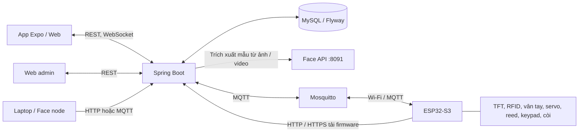

# Smart Door — Hệ thống kiểm soát ra vào thông minh

Smart Door là dự án IoT mở cửa bằng **PIN, thẻ RFID, vân tay, nhận diện khuôn mặt và lệnh từ xa**. ESP32-S3 vận hành phần cứng; backend quản lý tài khoản, quyền truy cập, cấu hình và lịch sử; app giúp chủ cửa thiết lập, giám sát và sử dụng hệ thống.

README được đối chiếu với mã nguồn ngày **10/11/2026**, bao gồm bộ Docker máy chủ có dịch vụ xử lý khuôn mặt và các môi trường firmware OTA hiện tại.

## Chức năng

| Nhóm                | Nội dung                                                         |
| ------------------- | ---------------------------------------------------------------- |
| Truy cập tại cửa    | PIN trên TFT và keypad, RFID, vân tay                            |
| Điều khiển từ app   | Mở/khóa từ xa, đổi PIN, quản lý thẻ/vân tay, cấu hình tự khóa    |
| Người dùng          | Chủ cửa, thành viên được mời, quyền theo phương thức truy cập    |
| Nhận diện khuôn mặt | Camera laptop, kiểm tra người thật và quyền tại cửa              |
| Giám sát            | Lịch sử, telemetry, thống kê, xuất CSV và cảnh báo               |
| Quản trị            | Quản lý hệ thống, thiết bị và phát hành firmware                 |
| Vòng đời thiết bị   | Cấp phát, quét QR nhận cửa, hiệu chỉnh, reset/chuyển giao và OTA |

## Kiến trúc



- **ESP32-S3:** xác thực cục bộ, vận hành servo, đọc cảm biến, lưu cấu hình và hàng đợi sự kiện.
- **Backend:** phân quyền, điều phối lệnh và ACK, đồng bộ cấu hình, lưu lịch sử và phát cảnh báo.
- **Mosquitto:** trao đổi lệnh, cấu hình và sự kiện. Topic có dạng `smartdoor-iot/{UID}/...`, giới hạn bằng ACL.
- **App:** giao diện chủ cửa và thành viên; web admin được build vào backend tại `/admin/`.
- **Face node:** chạy mô hình trên máy có camera; dùng HTTP hoặc MQTT tùy cách triển khai.
- **Face API:** dịch vụ `enrollment_server.py` xử lý ảnh/video đăng ký để trích xuất mẫu khuôn mặt cho backend. Đây là tiến trình riêng với camera nhận diện trực tiếp trên laptop; bộ Docker trong `deployment/team/` đã tích hợp dịch vụ này.

Khi người dùng xóa khuôn mặt, các yêu cầu liên quan được đánh dấu `REVOKED` và app hiển thị trạng thái đã xóa. Màn hình chủ cửa duyệt khuôn mặt ưu tiên yêu cầu chờ duyệt, sau đó đã duyệt, đã thu hồi; trong mỗi nhóm, yêu cầu có ID mới hơn được hiển thị trước.

## Cấu trúc dự án

| Đường dẫn                                         | Vai trò                                                 |
| ------------------------------------------------- | ------------------------------------------------------- |
| `firmware/connected_door/`                        | Firmware kết nối chính: mạng, thiết lập, đồng bộ và OTA |
| `firmware/offline_door/`                          | Logic cửa cục bộ được firmware connected sử dụng        |
| `firmware/include/`                               | Cấu hình và các hàm dùng chung                          |
| `firmware/maintenance/`, `firmware/factory_wipe/` | Firmware bảo trì và xóa dữ liệu có chủ đích             |
| `hardware/`                                       | Linh kiện, sơ đồ chân, lưu ý nguồn điện                 |
| `smart-access-control-backend/`                   | Spring Boot, API, nghiệp vụ và migration database       |
| `admin-web/`                                      | Mã nguồn web quản trị                                   |
| `IOT_mobile/`                                     | App Expo / React Native cho Android, iOS và web         |
| `face-node/`                                      | Nhận diện khuôn mặt, ghép camera laptop và mô hình AI   |
| `infra/mosquitto/`                                | Cấu hình broker, ACL và TLS                             |
| `deployment/`                                     | Compose cơ bản và bộ `team/` có thêm Face API           |
| `scripts/`                                        | Cấp phát, launcher, gateway, build và công cụ kiểm tra  |
| `tests/`                                          | Mục lục kiểm thử toàn hệ thống                          |
| `docs/`, `diagram/`                               | Hướng dẫn kỹ thuật và sơ đồ                             |

## Môi trường phát triển

Các phiên bản sau lấy từ cấu hình dự án:

Firmware chính hiện khai báo **1.18.0**, phần cứng **`esp32s3-n16r8`**. Các bản demo ghi đè phiên bản qua build flag; phiên bản firmware không phải phiên bản app.

| Thành phần        | Công nghệ / yêu cầu                                                                        |
| ----------------- | ------------------------------------------------------------------------------------------ |
| Backend           | Java 17, Maven, Spring Boot 3.5.16                                                         |
| Database / broker | Docker dùng MySQL 8.4 và Eclipse Mosquitto 2                                               |
| App               | Expo 58, React Native 0.88, React 19, TypeScript                                           |
| Node.js           | Theo package app: `^22.13.0`, `^24.3.0` hoặc `>=26.0.0`                                    |
| Firmware          | PlatformIO, Arduino, Espressif32 6.12.0                                                    |
| Board             | ESP32-S3 DevKitC-1 N16R8: flash 16 MB, PSRAM 8 MB                                          |
| Face node         | Python và dependency trong `face-node/requirements.txt`; hướng dẫn laptop dùng Python 3.11 |

Phần cứng gồm TFT ILI9341 + XPT2046, RC522, cảm biến vân tay UART, servo, công tắc từ, keypad HX-543 và còi. Xem [BOM và sơ đồ chân](hardware/README.md). Servo cần nguồn phù hợp và GND chung với ESP32.

## Khởi chạy

### 1. Máy chủ bằng Docker

Chạy từ thư mục gốc bằng PowerShell:

```powershell
Copy-Item deployment/.env.example deployment/.env
```

Sửa `deployment/.env` trước khi chạy:

| Biến                                                           | Ý nghĩa                                                  |
| -------------------------------------------------------------- | -------------------------------------------------------- |
| `DB_NAME`, `DB_USERNAME`, `DB_PASSWORD`, `MYSQL_ROOT_PASSWORD` | Database và tài khoản MySQL                              |
| `MQTT_PASSWORD`                                                | Mật khẩu broker của backend                              |
| `MQTT_DEVICE_ACCOUNTS`                                         | Danh sách `UID1:matkhau1,UID2:matkhau2`; username phải đúng UID |
| `CORS_ALLOWED_ORIGINS`                                         | Origin app/web được phép gọi API                         |
| `APP_DEVICE_BASE_URL`                                          | URL backend mà ESP32 truy cập được để tải firmware       |
| `SESSION_COOKIE_SECURE`                                        | Đặt `true` khi triển khai qua HTTPS                      |

```powershell
docker compose -f deployment/docker-compose.yml --env-file deployment/.env up -d --build
Invoke-RestMethod http://localhost:8080/api/health
```

Docker build cả web admin và backend:

| Dịch vụ          | Địa chỉ mặc định                         |
| ---------------- | ---------------------------------------- |
| Backend / health | `http://localhost:8080/api/health`       |
| Web admin        | `http://localhost:8080/admin/index.html` |
| MQTT             | Cổng `1883` trên máy chủ                 |

Khởi tạo tài khoản admin theo môi trường triển khai; không có mật khẩu mặc định chung. Xem [hướng dẫn triển khai](docs/HUONG_DAN_TRIEN_KHAI.md). Compose này dùng MQTT không mã hóa cho LAN thử nghiệm; cấu hình TLS nằm trong `infra/mosquitto/`.

### Bộ Docker máy chủ có Face API

[deployment/team/docker-compose.yml](deployment/team/docker-compose.yml) chạy **MySQL + Mosquitto + Face API + backend**, đồng thời build web admin. Cấu hình này dùng bộ dữ liệu và thông tin cấp phát riêng; trước khi chạy cần chuẩn bị:

- `.local/team/backend.env`: biến môi trường backend, gồm tài khoản DB, MQTT, CORS, URL tải OTA và `FACE_PROCESSOR_TOKEN`.
- `.local/team/face.env`: `FACE_PROCESSOR_TOKEN` trùng backend, dài ít nhất **32 ký tự**.
- `.local/team/mosquitto/passwords` và `.local/team/mosquitto/acl`: file mật khẩu Mosquitto đã tạo đúng định dạng và ACL theo thiết bị.
- `face-node/models/`: model đã tải theo hướng dẫn AI; thư mục này được mount chỉ đọc vào `/models`, không đóng gói trong image.
- `.local/team/docker/mysql-init/`: thư mục SQL khởi tạo nếu chuyển dữ liệu từ môi trường cũ. Script tại đây chỉ chạy khi volume MySQL còn trống.

Chạy từ gốc repository, sau khi chuẩn bị đủ các file trên:

```powershell
docker compose -f deployment/team/docker-compose.yml --env-file .local/team/backend.env up -d --build
docker compose -f deployment/team/docker-compose.yml --env-file .local/team/backend.env ps
Invoke-RestMethod http://localhost:8080/api/health
```

| Dịch vụ | Địa chỉ trong cấu hình máy chủ |
|---|---|
| Backend / admin | Cổng host `8080` |
| MQTT | Cổng host `1884` |
| MySQL | `127.0.0.1:3307`, database `smart_access_team` |
| Face API | `http://face-api:8091/extract` trong mạng Docker; không publish ra host |

Compose ghi đè địa chỉ DB, MQTT và Face API bằng tên service Docker. Backend và Face API dùng image riêng; camera laptop vẫn chạy ngoài bộ Compose. MySQL, dữ liệu broker và uploads dùng named volume. Các file `.local/team/` cần được chuẩn bị riêng trên máy triển khai và không có trong bản clone.

### 2. App người dùng

```powershell
cd IOT_mobile
Copy-Item .env.example .env
npm ci
```

Đặt URL backend thực tế trong `.env`:

```dotenv
EXPO_PUBLIC_API_BASE_URL=http://<IP-LAN-may-chu>:8080
```

```powershell
npm run start
# Hoặc mở giao diện web:
npm run web
```

Điện thoại cần truy cập được IP máy chủ; `localhost` trên điện thoại là chính điện thoại. Khởi động lại Expo sau khi đổi `.env`. Xem [hướng dẫn Expo Go](docs/CHAY_EXPO_GO.md).

### 3. Backend chạy trực tiếp

Chuẩn bị MySQL, broker và biến môi trường theo [README backend](smart-access-control-backend/README.md). Spring Boot không tự đọc `.env`.

Nếu cần web admin, build trước từ thư mục gốc:

```powershell
cd admin-web
npm ci
npm run build
cd ../smart-access-control-backend
mvn spring-boot:run
```

### 4. Build và nạp ESP32-S3

```powershell
cd firmware
pio run -c platformio.connected.ini -e esp32-s3-connected
pio run -c platformio.connected.ini -e esp32-s3-connected -t upload
pio device monitor -b 115200
```

Kiểm tra `upload_port` và `monitor_port` trong `platformio.connected.ini`; cấu hình hiện tại dùng `COM5`, cần đổi theo máy. Các bản test phần cứng, offline, maintenance và factory wipe có cấu hình riêng trong `firmware/`.

| Môi trường build | Phiên bản | Giao diện |
|---|---|---|
| `esp32-s3-connected` | `1.18.0` | Bản chính |
| `esp32-s3-ota-demo` | `2.0.5-demo` | Bật `FW_DEMO_BLACK_BUTTONS` |
| `esp32-s3-ota-red` | `2.0.6-demo` | Không bật cờ nút đen |
| `esp32-s3-ota-black` | `2.0.7-demo` | Bật `FW_DEMO_BLACK_BUTTONS` |

Từ gốc repo, `powershell -ExecutionPolicy Bypass -File scripts/build-ota-demo.ps1` build cả bốn bản, kiểm tra dấu nhận diện/phiên bản rồi xuất `.bin` và `firmware-manifest.json` vào `.local/releases/`. Script không nạp USB hay tự phát hành firmware lên backend.

### 5. Camera nhận diện khuôn mặt

Cài dependency, tải model và hoàn tất bước chấp thuận giấy phép theo [hướng dẫn AI trên laptop](docs/DEMO_AI_TREN_LAPTOP.md). Trên Windows, mở `Smart Door AI.cmd` hoặc:

```powershell
powershell -ExecutionPolicy Bypass -File scripts/start-edge-ai.ps1
```

Giao diện laptop mặc định ở `http://127.0.0.1:8092`. Chủ cửa đăng nhập, chọn cửa và kết nối camera. Camera nhận diện cần cấu hình backend, mẫu khuôn mặt, quyền truy cập và cửa sẵn sàng; tiến trình camera laptop chạy riêng với các dịch vụ Docker máy chủ.

Nếu chạy backend trực tiếp, dịch vụ trích xuất mẫu có thể chạy riêng bằng `python enrollment_server.py` trong `face-node/`. Chuẩn bị dependency, model và `.env.enrollment` chứa `FACE_PROCESSOR_TOKEN`; backend cần cùng token và `FACE_PROCESSOR_URL` đúng địa chỉ. Mặc định dịch vụ nghe tại `127.0.0.1:8091`; Docker đặt `FACE_PROCESSOR_HOST=0.0.0.0` để backend truy cập qua mạng container. Bộ Compose cơ bản `deployment/docker-compose.yml` chưa có Face API; bộ `deployment/team/` đã có.

## Thiết lập cửa

1. **Kỹ thuật viên:** lắp phần cứng, nạp firmware, đăng ký thiết bị và cấp phát danh tính bằng công cụ trong `scripts/`.
2. **Kỹ thuật viên:** tạo QR sản phẩm; giữ thông tin cấp phát và secret ở máy triển khai.
3. **Chủ cửa:** quét QR trong app, kết nối Wi-Fi cho ESP32 qua trang thiết lập `http://192.168.4.1` và nhận cửa vào tài khoản.
4. **Chủ cửa:** đặt PIN, hoàn tất hiệu chỉnh theo app/màn hình thiết bị, chỉnh servo theo cơ khí thực tế.
5. **Chủ cửa:** thêm thành viên, đăng ký thẻ/vân tay/khuôn mặt và cấp quyền sử dụng.

Chi tiết: [QR và thiết lập](docs/QUET_QR_VA_THIET_LAP.md), [app và Wi-Fi](docs/THIET_LAP_APP_VA_WIFI.md), [căn góc servo](docs/CAN_GOC_SERVO.md). Các máy khác mạng xem [Tailscale và gateway](docs/CHAY_TU_DAU_TAILSCALE.md).

## Cập nhật firmware OTA

```text
Admin phát hành .bin
    → App hiển thị bản phù hợp
    → Chủ cửa đồng ý cập nhật
    → Backend gửi FIRMWARE_UPDATE qua MQTT
    → ESP32 kiểm tra điều kiện cửa
    → Tải .bin qua HTTP(S), ghi phân vùng còn lại
    → Kiểm tra kích thước và SHA-256
    → Chọn firmware mới, khởi động lại
    → Xác nhận phiên bản với backend
    → App hiển thị kết quả
```

| Điểm xử lý            | File / hàm                                                                         |
| --------------------- | ---------------------------------------------------------------------------------- |
| Giao diện cập nhật    | `IOT_mobile/src/components/FirmwareUpdates.tsx`                                    |
| API app               | `IOT_mobile/src/services/api/firmwareService.ts`                                   |
| Phát hành và tạo lệnh | `FirmwareUpdateService.publish()` / `install()` trong backend                      |
| Xác thực tải          | `FirmwareUpdateService.download()` và `DeviceAuthenticationService.authenticate()` |
| Bắt đầu và tải        | `startOtaUpdate()` / `otaWorker()` trong `firmware/connected_door/ota_update.h`    |
| Chọn firmware, reboot | `Update.end()` / `ESP.restart()`                                                   |
| Xác nhận sau reboot   | `pollOtaUpdate()` và `CommandAckService`                                           |

ESP32 gửi `X-Device-Uid` và `X-Device-Secret` khi tải. Backend yêu cầu lệnh đúng thiết bị, đúng bản phát hành và còn hiệu lực. Firmware chỉ bắt đầu khi cửa đóng, khóa và không đang vận hành/hiệu chỉnh; điều khiển cửa tạm dừng trong lúc cập nhật.

File ứng dụng tối đa **4 MiB**, phải khớp phần cứng và phiên bản nhúng trong binary. Backend chỉ cho tải khi lệnh đang `PENDING` hoặc `SENT` và chưa quá **5 phút**. ESP32 chỉ cho HTTP tới host được `privateHost()` chấp nhận; HTTPS yêu cầu CA đã cấu hình. App báo hoàn tất khi lệnh được xác nhận và phiên bản thiết bị báo về khớp phiên bản đích.

OTA dùng hai phân vùng ứng dụng `app0` và `app1`, không xóa NVS. Giữ dữ liệu còn phụ thuộc khả năng đọc/chuyển đổi cấu hình cũ của firmware mới. Luồng hiện tại xác nhận phiên bản sau reboot; không nên coi đây là bảo đảm tự rollback nếu firmware mới lỗi lúc chạy. Xem [quy trình OTA và cấp phát](docs/DEMO_CAP_NHAT_FIRMWARE_TU_XA.md).

## Lưu cấu hình và hoạt động offline

- **Database:** tài khoản, quyền, cài đặt trên server, lịch sử và bản phát hành firmware.
- **NVS ESP32:** PIN đã xử lý, danh sách thẻ/ID vân tay, thông số cửa, Wi-Fi và trạng thái cần giữ qua reboot.
- **Cảm biến vân tay:** giữ mẫu trong bộ nhớ riêng; xóa flash ESP32 không đồng nghĩa xóa mẫu trong cảm biến.
- **Mất mạng:** sử dụng quyền cục bộ đã đồng bộ cho các phương thức được hỗ trợ, xếp hàng sự kiện và gửi bù khi kết nối lại. Mở từ xa và đồng bộ mới cần kết nối.

App phân biệt yêu cầu đã lưu trên server với cấu hình thiết bị báo lại. Khi đổi cấu trúc dữ liệu firmware, cần chuyển đổi phiên bản để giữ cấu hình cũ. Factory reset, factory wipe và xóa toàn bộ flash là thao tác riêng có thể xóa dữ liệu.

## Kiểm thử

Sau khi cài dependency, chạy trong thư mục tương ứng:

| Thành phần          | Lệnh                                                                                                   |
| ------------------- | ------------------------------------------------------------------------------------------------------ |
| Backend             | `mvn test` trong `smart-access-control-backend/`                                                       |
| App — kiểm tra kiểu | `npm run typecheck` trong `IOT_mobile/`                                                                |
| App — lint          | `npm run lint` trong `IOT_mobile/`                                                                     |
| App — test          | `npm test` trong `IOT_mobile/`                                                                         |
| Face node           | `python -m unittest discover -s face-node/tests -p "test_*.py"` từ gốc repo                            |
| Công cụ Python      | `python -m unittest discover -s scripts/tests -p "test_*.py"` từ gốc repo                              |
| Firmware OTA        | `python firmware/tests/test_ota_policy.py` và `python firmware/tests/test_ota_transfer.py` từ gốc repo |
| Build firmware      | `pio run -c platformio.connected.ini -e esp32-s3-connected` trong `firmware/`                          |

Một số host test firmware cần trình biên dịch C++ và thư viện PlatformIO. CI nằm tại [`.github/workflows/ci.yml`](.github/workflows/ci.yml). Xem [mục lục kiểm thử](tests/README.md) để biết điều kiện và phạm vi từng bộ test. Test tự động không thay thế kiểm tra nguồn, cảm biến và cơ khí trên cửa thật.

## Tài liệu

| Chủ đề                | Tài liệu                                                                                                                                  |
| --------------------- | ----------------------------------------------------------------------------------------------------------------------------------------- |
| Kiến trúc / nghiệp vụ | [Tổng quan kỹ thuật](docs/TONG_QUAN_KY_THUAT.md), [Luồng hệ thống](docs/FLOW_HE_THONG.md)                                                 |
| Triển khai            | [Hướng dẫn triển khai](docs/HUONG_DAN_TRIEN_KHAI.md), [Môi trường phát triển](docs/HUONG_DAN_MAY_PHAT_TRIEN.md)                           |
| Phần cứng / firmware  | [Phần cứng](hardware/README.md), [Firmware](firmware/README.md)                                                                           |
| API                   | [Tài khoản](smart-access-control-backend/docs/account-api.md), [Quản lý cửa](smart-access-control-backend/docs/manager-api.md)            |
| App                   | [README app](IOT_mobile/README.md), [Thiết lập Wi-Fi](docs/THIET_LAP_APP_VA_WIFI.md)                                                      |
| Vận hành              | [Còi cảnh báo](docs/COI_CANH_BAO.md), [Xử lý sai PIN](docs/XU_LY_CANH_BAO_PIN.md), [Khóa từ xa và tự động](docs/KHOA_TU_XA_VA_TU_DONG.md) |
| Kiểm thử              | [Hướng dẫn test](tests/README.md), [Kết quả ghi nhận](docs/KET_QUA_KIEM_THU.md)                                                           |

### Quy ước lưu trên Git

Giữ mã nguồn, cấu hình mẫu, migration, test, README và hướng dẫn kỹ thuật dùng chung. `.gitignore` loại dependency, build, log, file tạm, secret và cấu hình máy cá nhân. Kế hoạch trong `docs/superpowers/`, bàn giao riêng trong `docs/team-tailscale/` và ghi chú theo ngày dạng `docs/*_YYYY-MM-DD.md` chỉ giữ cục bộ.

Cache native (`.gradle/`, `.kotlin/`, `.cxx/`), marker `.gitkeep` và ghi chú phiên chạy/kết quả cũ (`docs/local-development.md`, `docs/verification.md`) cũng được bỏ qua. Giữ dependency lockfile để tái lập bản cài đặt.

Các ghi chú nội bộ không thuộc bộ tài liệu của bản clone mới. Không đưa `.env`, `.local/`, bundle cấp phát, QR chứa thông tin kích hoạt hoặc khóa thiết bị lên Git. Khi triển khai ngoài LAN, cấu hình HTTPS, MQTT TLS và quyền truy cập phù hợp.
