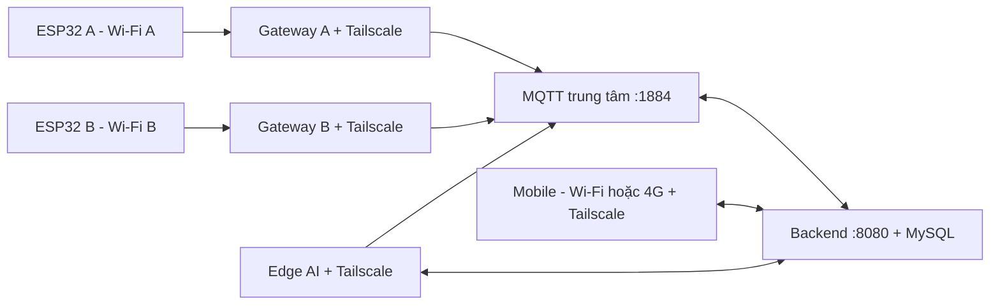

# Chạy từ đầu với Tailscale: nhiều ESP32, mobile và Edge AI khác mạng

**Khởi động demo hằng ngày bằng Expo Go:** dùng [hướng dẫn theo từng cửa sổ PowerShell](CHAY_DEMO_EXPO_GO_TU_DAU.md). Hướng dẫn đó dùng dữ liệu hiện có và luồng ghép laptop bằng tài khoản chủ cửa. Các phần cấp phát, build và reset dưới đây dành cho lúc cần chuẩn bị hoặc bảo trì thiết bị.

Quản lý thẻ/vân tay của chủ cửa và xóa thành viên trên chip: xem [hướng dẫn firmware 1.5.0](CHU_CUA_VA_XOA_THANH_VIEN.md).

Cập nhật 07/11/2026. Lệnh Windows dùng PowerShell tại `D:\DEV\IOT`. Firmware dành cho **ESP32-S3 N16R8 và sơ đồ chân của dự án**; chọn đúng COM cho từng chip.

## 1. Máy chủ, các điểm đặt cửa và đường kết nối

Một máy trung tâm chạy MySQL, MQTT, backend, web admin và Expo. Điện thoại, máy Edge AI và máy gateway đăng nhập cùng tailnet Tailscale, dù dùng Wi-Fi/4G khác nhau.

**ESP32 không tự tham gia Tailscale. Mỗi mạng đặt ESP32 cần một gateway cùng LAN với chip.** Có thể dùng máy Edge AI làm gateway. Script chuyển tiếp TCP của dự án đưa MQTT từ LAN đến broker qua Tailscale; mỗi chip vẫn có tài khoản và topic riêng. Một gateway phục vụ nhiều chip. [Tailscale giải thích gateway cho thiết bị không cài được Tailscale](https://tailscale.com/docs/features/subnet-routers). Cách chuyển tiếp TCP ở đây không cần cấu hình subnet router hoặc route trên chip.



| Dịch vụ trên máy hiện tại | Địa chỉ |
|---|---|
| Backend/admin | `http://100.111.90.116:8080` |
| Expo Go | `exp://100.111.90.116:8081` |
| MQTT giữa các máy Tailscale | `100.111.90.116:1884` |
| LAN máy hiện tại | `10.18.0.194` — kiểm tra lại khi đổi Wi-Fi |
| Xử lý ảnh đăng ký khuôn mặt | `127.0.0.1:8091` trên máy backend |
| Portal của từng ESP32 | `http://192.168.4.1` khi nối AP của chip |

Ở điểm khác, `mqttHost` của ESP32 phải là **IP LAN của gateway tại điểm đó**, ví dụ `192.168.1.20`. Không nhập IP Tailscale vào ESP32 trong mô hình này. Hai điểm có thể dùng cùng dải IP LAN vì mỗi gateway tạo kết nối riêng.

Gateway phải bật, không sleep, có Internet và Tailscale. Router phải cho thiết bị LAN kết nối với nhau; guest Wi-Fi/AP isolation có thể chặn chip đến gateway. Nên cố định IP LAN gateway bằng DHCP reservation. Tailscale bảo vệ chặng gateway–server; chặng chip–gateway dùng MQTT có mật khẩu trong LAN thử nghiệm. Muốn chip tự kết nối Internet không có gateway thì cần broker công khai có TLS, DNS và CA tin cậy; xem `infra/mosquitto/compose.tls.yml`.

## 2. Trạng thái để bắt đầu lại

Ngày 07/11/2026 đã xóa dữ liệu nghiệp vụ, giữ **nguyên tài khoản admin cũ** (ID và mật khẩu), đưa cảm biến vân tay về 0 mẫu, xóa flash và nạp firmware **1.11.0** lên COM5. Chip hiện chưa có danh tính cấp phát mới, Wi-Fi hoặc PIN. Thông tin admin nằm tại `.local/ADMIN_ACCESS.txt`.

Các chương trình dự án được dừng. MySQL 3306, Tailscale và broker hệ thống 1883 là dịch vụ nền riêng; broker dự án dùng **1884**.

Đã chạy thành công `scripts/clean-local-snapshots.ps1 -Apply`, dọn 65 file sinh ra thuộc danh sách bản sao flash/DB, file cấp phát và danh tính camera cũ, khoảng 1,69 GiB. Không cần chạy lại để bắt đầu thiết lập.

**Bắt đầu từ trạng thái vừa reset:** làm theo [hướng dẫn từng bước sau reset với Tailscale](CHAY_LAI_SAU_RESET_TAILSCALE.md). Hướng dẫn chọn một đường đăng ký CLI, chuẩn bị MQTT trước khi chạy broker, cấp phát USB, khởi động lại sau khi lưu Wi-Fi rồi mới lưu PIN.

## 3. Chuẩn bị và build

Máy hiện tại đã có dependency và cấu hình. Khi khởi động hằng ngày, bắt đầu ở bước 4; **không chạy script xóa dữ liệu mỗi lần mở dự án**.

Máy chủ mới cần Java 17+, Maven, Node phù hợp `IOT_mobile/package.json` (SDK 58), Python 3.11+, MySQL và Mosquitto:

```powershell
python -m venv .local/venv
.\.local\venv\Scripts\python.exe -m pip install -r scripts/requirements-local.txt
```

Khởi tạo lần đầu dùng `scripts/bootstrap_local.py prepare`, yêu cầu biến `MYSQL_ADMIN_PASSWORD` và `LOCAL_LAN_IP`. Script tạo database/user riêng và `.env`; không chạy khi `.local/runtime.json` đã tồn tại. Sau khi backend chạy migration, dùng `bootstrap_local.py seed` tạo admin. Chi tiết cài môi trường ở `HUONG_DAN_MAY_PHAT_TRIEN.md`. Không sao chép toàn bộ `.local` sang Edge.

Build lại source trên máy hiện tại, xử lý lỗi của từng lệnh trước khi tiếp tục:

```powershell
$env:Path = 'D:\DEV\IOT\.local\node-runtime\node_modules\node\bin;' + $env:Path
Push-Location admin-web
npm.cmd ci
npm.cmd run build
Pop-Location
Push-Location smart-access-control-backend
mvn.cmd -B clean verify
Pop-Location
Push-Location IOT_mobile
npm.cmd ci
npm.cmd run typecheck
npm.cmd test
npm.cmd run lint
Pop-Location
powershell -NoProfile -ExecutionPolicy Bypass -File scripts/build-firmware.ps1
```

`mvn verify` mặc định bỏ qua hai lớp test MySQL nếu chưa khai báo `SMART_ACCESS_DB_TEST_*`. Lượt bàn giao đã chạy cả hai lớp trên database cô lập; kết quả ở `KIEM_THU_LAI_2026-11-07.md`.

## 4. Khởi động máy chủ trung tâm

Bật MySQL và Tailscale. Kiểm tra địa chỉ rồi cập nhật cấu hình, thay IP LAN nếu đổi Wi-Fi:

```powershell
tailscale ip -4
Get-NetIPAddress -AddressFamily IPv4 | Select-Object InterfaceAlias,IPAddress
powershell -NoProfile -ExecutionPolicy Bypass -File scripts/configure-network.ps1 -Role server -LanAddress 10.18.0.194
```

Script cập nhật API mobile, địa chỉ Metro và CORS. Nếu IP Tailscale thay đổi, dùng IP mới ở các bước dưới.

Chạy **một lần trong PowerShell Run as Administrator** để tạo rule Firewall:

```powershell
cd D:\DEV\IOT
powershell -NoProfile -ExecutionPolicy Bypass -File scripts/configure-network.ps1 -Role server -LanAddress 10.18.0.194 -Firewall
```

Máy hiện tại đã có rule Smart Door LAN và Tailscale; chỉ cần tạo lại khi đổi cấu hình hoặc máy. Chính sách Tailscale phải cho điện thoại/Edge/gateway đến TCP 8080, 8081, 1884 của máy chủ. Không cần mở cổng router Internet.

Mở ba cửa sổ PowerShell riêng, cùng ở thư mục dự án:

```powershell
# Cửa sổ 1: MQTT
powershell -NoProfile -ExecutionPolicy Bypass -File scripts/start-local.ps1 -Component broker
```

```powershell
# Cửa sổ 2: backend và admin
powershell -NoProfile -ExecutionPolicy Bypass -File scripts/start-local.ps1 -Component backend
```

```powershell
# Cửa sổ 3: mobile
powershell -NoProfile -ExecutionPolicy Bypass -File scripts/start-local.ps1 -Component mobile
```

Chờ backend khởi động và kết nối MQTT. `http://100.111.90.116:8080/api/health` phải có `status: READY`. Admin: `http://100.111.90.116:8080/admin/index.html`, thông tin trong `.local/ADMIN_ACCESS.txt`.

Điện thoại bật Tailscale, dùng Expo Go Android tương thích SDK 58, mở `exp://100.111.90.116:8081`. QR Expo mở app; QR sản phẩm ở bước 5 để nhận cửa. Web mobile: `http://100.111.90.116:8081`; dùng cùng hostname Tailscale với API để cookie phiên hoạt động.

## 5. Đăng ký và cấp phát từng ESP32

1. Cắm chip qua USB vào máy nạp. Xác định COM bằng `Get-CimInstance Win32_SerialPort` hoặc `pio device list`.
2. Nếu đã có firmware dự án: `.\.local\venv\Scripts\python.exe scripts/device_tool.py --port COM5 info` để đọc MAC. Chip mới chưa có firmware: đọc MAC bằng esptool trên máy nạp:

```powershell
& "$env:USERPROFILE\.platformio\penv\Scripts\python.exe" "$env:USERPROFILE\.platformio\packages\tool-esptoolpy\esptool.py" --chip esp32s3 --port COM5 read_mac
```
3. Trong admin, đăng ký đúng factory MAC, đặt tên, **tải file cấp phát ngay và lưu/in QR bàn giao**. Secret chỉ cấp một lần; UID từng chip là `ESP32-<MAC>`.
4. Trên máy chủ, thêm tài khoản MQTT cho chip và tạo file kết nối. `--host` là LAN gateway cùng mạng với chip:

```powershell
# Chip tại điểm A, gateway LAN 192.168.1.20
.\.local\venv\Scripts\python.exe scripts/configure_local_device.py --uid ESP32-80B54EC8149C --host 192.168.1.20
```

File tạo ở `.local/ESP32-80B54EC8149C-connection.json`. Dừng **riêng broker** bằng Ctrl+C rồi chạy lại cửa sổ broker để nạp tài khoản; backend/chip tự nối lại. Thêm hết chip trước một lần restart giúp giảm gián đoạn.

Cách CLI thay cho đăng ký bằng admin ở mục 3–4:

```powershell
.\.local\venv\Scripts\python.exe scripts/register_local_device.py --mac 80:B5:4E:C8:14:9C --name 'Cửa điểm A' --mqtt-host 192.168.1.20
```

CLI tạo `.local/FACTORY_ESP32-80B54EC8149C.json` và file connection. Chỉ chọn một cách đăng ký. Nếu đã tải file admin, dùng `register_local_device.py --factory-file <file-đã-tải.json> --mqtt-host 192.168.1.20` để chuẩn bị MQTT mà không đăng ký lại. Với CLI, dùng `activationCode` trong file để nhập mã nhận cửa; admin UI thuận tiện để in QR.

5. Trên máy có PlatformIO, nạp firmware đúng COM:

```powershell
cd D:\DEV\IOT\firmware
pio run -c platformio.connected.ini -t upload --upload-port COM5
```

Nếu `pio` chưa trong PATH, tạo alias trong cửa sổ PowerShell đó rồi chạy lại lệnh:

```powershell
Set-Alias pio "$env:USERPROFILE\.platformio\penv\Scripts\platformio.exe"
```

Firmware COM mặc định không thay thế `--upload-port` khi bạn cắm chip khác.

6. Chuyển **hai file đúng chip đó** đến máy USB: factory và connection. Đóng serial monitor. Trên máy nạp mới, cài pyserial một lần bằng `python -m pip install pyserial`; máy hiện tại dùng `.\.local\venv\Scripts\python.exe` thay `python`:

```powershell
cd D:\DEV\IOT
python -X utf8 scripts/device_tool.py --port COM5 provision --device .\ESP32-80B54EC8149C.json --connection .\ESP32-80B54EC8149C-connection.json
```

Nếu dùng CLI đăng ký, đường dẫn factory trên máy chủ là `.local/FACTORY_ESP32-80B54EC8149C.json`. Phải thấy `FACTORY_PROVISIONED`. Factory chỉ nạp vào chip chưa có danh tính; `provision` không ghi đè chip đã cấp phát.

Không dùng cùng factory file cho hai chip. USB trên web admin là USB **của máy backend**; nếu backend ở xa, chạy CLI trên máy đang cắm chip. Người dùng chọn Wi-Fi tại portal, không đặt mật khẩu Wi-Fi trong source.

## 6. Gateway tại mỗi điểm đặt ESP32

Máy gateway cần Python và Tailscale, có thể chỉ sao chép `scripts/mqtt_gateway.py`; không cần database hay tài khoản admin. Ví dụ gateway LAN `192.168.1.20`:

```powershell
python scripts/mqtt_gateway.py --server 100.111.90.116 --check
python scripts/mqtt_gateway.py --listen 192.168.1.20 --server 100.111.90.116
```

Giữ gateway chạy; cổng mặc định 1884. Cho phép TCP 1884 từ LAN trong Firewall. Nếu có repository, có thể chạy PowerShell Administrator:

```powershell
powershell -NoProfile -ExecutionPolicy Bypass -File scripts/configure-network.ps1 -Role site -LanAddress 192.168.1.20 -Firewall
```

Lặp lại tại mỗi điểm bằng LAN IP của gateway đó. Nếu chip cùng LAN máy chủ, cấu hình `mqttHost` bằng LAN máy chủ và dùng broker trực tiếp; không chạy thêm gateway trùng địa chỉ/cổng 1884.

## 7. Người dùng nhận cửa và thiết lập

1. Trong app, đăng ký tài khoản người dùng mới. Dùng tài khoản thường để thử nghiệp vụ người mua.
2. Thêm thiết bị, quét QR sản phẩm hoặc nhập mã nhận cửa mới.
3. Nối điện thoại vào AP `SmartDoor-...` của đúng chip, theo mật khẩu màn hình/QR. Giữ Wi-Fi dù báo không có Internet. Mở **HTTP** `http://192.168.4.1` nếu portal chưa bật.
4. Chọn Wi-Fi 2.4 GHz tại nơi đặt cửa, nhập mật khẩu, chờ nối thành công rồi hoàn tất. ESP32 phải truy cập được gateway LAN.
5. Chờ portal báo Đã lưu Wi-Fi, nhấn/thả RST/EN hoặc rút nguồn khóa 5 giây rồi cấp lại; không khôi phục mặc định. Đưa điện thoại trở về Wi-Fi/4G có Internet, bật lại Tailscale nếu cần, trở lại app. Xác nhận đã khởi động lại, kiểm tra kết nối và chờ chip online rồi nhận cửa/đặt tên.
6. Đặt PIN mở cửa và PIN admin, mỗi PIN 6 số, hai PIN khác nhau. Chờ `ACKNOWLEDGED / PINS_CONFIGURED`.
7. App hiển thị từng bước và tự chuyển khi cửa xác nhận. Trên chip: chạm các dấu cộng; xác nhận cửa đóng rồi mở; chọn hành trình servo bằng nút `RANGE 180/360`. Nhích `±1°`/`±5°` sẽ quay ngay; quan sát chốt rồi xác nhận LOCK và OPEN. Xem [luồng quét QR mới](QUET_QR_VA_THIET_LAP.md) và [hướng dẫn căn góc servo](CAN_GOC_SERVO.md).
8. Khi báo `READY`, thử mở từ xa, PIN, RFID, vân tay và xem lịch sử. Quan sát chốt thật khi thử. Để ghép laptop tự chạy nhận diện, mở **Smart Door AI.cmd**, đăng nhập chủ cửa và chọn mã `SD-…` theo [hướng dẫn demo AI](DEMO_AI_TREN_LAPTOP.md).

Lặp lại mỗi chip, không cố định `unitId=1`. Dùng hai chủ sở hữu khác nhau để kiểm tra tài khoản A không đọc cài đặt/mở cửa B. Thử lời mời thành viên, từng quyền và thu hồi quyền. Sau khi hoàn tất thiết lập, ngắt Wi-Fi chip để thử mở offline và đồng bộ lịch sử khi nối lại.

## 8. Hồ sơ khuôn mặt và Edge AI khác máy

Bộ xử lý ảnh đăng ký chạy ở `127.0.0.1:8091` trên máy backend. Camera Edge chạy tại cửa hoặc máy khác có Tailscale, lấy mẫu qua API và gửi nhận diện qua MQTT.

Trên backend: cài `face-node/requirements.txt` và model (máy hiện tại đã có). `FACE_PROCESSOR_TOKEN` trong backend `.env` phải khớp `face-node/.env.enrollment`, dài ít nhất 32 ký tự. Token xử lý ảnh không cấp cho camera. Mở cửa sổ thứ tư:

```powershell
powershell -NoProfile -ExecutionPolicy Bypass -File scripts/start-local.ps1 -Component face-api
```

Chủ cửa vào quản lý camera trong app, xác thực mật khẩu, cấp camera mới. Lưu ba dòng `FACE_API_URL`, `FACE_DEVICE_UID`, `FACE_DEVICE_SECRET` thành `.local/camera-diem-A.identity.env` trên máy chủ. Mỗi cửa có camera riêng. Tạo tài khoản MQTT và file cấu hình:

```powershell
.\.local\venv\Scripts\python.exe scripts/configure_face_node.py --identity .local/camera-diem-A.identity.env --server 100.111.90.116
```

Restart riêng broker để nạp tài khoản. Chuyển `.local/FACE-<UUID>.env` vừa tạo sang máy Edge, lưu thành `face-node/.env`. Không dùng chung cấu hình cho nhiều node. API/MQTT phải trỏ về IP Tailscale trung tâm, không phải localhost của Edge.

Trên Edge, cài Python và Tailscale; trong thư mục `face-node`:

```powershell
python -m venv .venv
.\.venv\Scripts\python.exe -m pip install -r requirements.txt
# Lần đầu tải model, sau khi đọc/đồng ý điều khoản model:
.\.venv\Scripts\python.exe node.py --download-models --accept-model-license
.\.venv\Scripts\python.exe node.py --camera
```

Đã có dependency/model thì chỉ chạy lệnh cuối. `FACE_CAMERA_SOURCE=0` chọn webcam đầu tiên; có thể đổi camera/RTSP. Nhấn Q để dừng. Giữ `FACE_LIVENESS_ENABLED=true`, `FACE_ALLOW_UNVERIFIED_LIVENESS=false`. Trên máy backend mới, cũng chuẩn bị model bằng cùng lệnh tải trong thư mục `face-node`.

Người dùng đăng ký ảnh/video hồ sơ trong app, gửi yêu cầu dùng hồ sơ ở cửa; chủ cửa duyệt và cấp quyền Face. Thử người được duyệt, người lạ, ảnh chụp, quyền bị thu hồi và mất mạng. Camera báo nhận diện chưa chứng minh chốt đã mở: backend kiểm tra quyền, gửi lệnh và chờ ACK của ESP32.

## 9. Đọc lỗi đã gặp

Log 06/11 có 13 lệnh `SETUP_CREDENTIALS` và DB ghi tất cả `FAILED / STORAGE_ERROR`, ACK về sau khoảng 0,2–0,4 giây. Đường MQTT đã truyền lệnh; ESP32 báo lỗi lưu cấu hình. Sau reset/nạp lại, chip thật đã lưu PIN, giữ PIN sau reboot và sang bước cảm ứng. Điều kiện gây lỗi ghi đầu tiên của firmware cũ chưa được tái hiện chắc chắn.

Firmware hiện in `[STORAGE] config validation failed`, `[STORAGE] config write failed` hoặc lỗi đã bị giữ từ thao tác trước. `device_tool.py info` có `storageFault`, `configBytes`, `freeEntries`. Backend ghi UUID và ACK, không ghi PIN. App giữ lỗi thao tác để refresh mỗi 5 giây không xóa mất lỗi.

`Error parsing HTTP request header` là lỗi parser HTTP riêng. Dùng đúng `http://...:8080`, `exp://...:8081`, `http://192.168.4.1`. Gửi HTTPS/TLS vào cổng HTTP 8080 tái hiện cùng loại lỗi; log gốc thiếu request bytes/stack nên chưa xác định chắc nguồn request của bạn. Tailscale không tự biến backend 8080 thành HTTPS.

Log tiếng Việt thành `?`: script backend đặt cả `file.encoding`, `stdout.encoding`, `stderr.encoding` thành UTF-8. Java trên máy này mặc định stdout Cp1252 dù file encoding đã là UTF-8.

## 10. Dừng và thử lại từ đầu

Nhấn Ctrl+C ở các cửa sổ dịch vụ, Q ở cửa sổ camera. Hoặc trên mỗi máy có repository:

```powershell
powershell -NoProfile -ExecutionPolicy Bypass -File scripts/stop-local.ps1
```

Script dừng tiến trình dự án, kể cả camera/gateway chỉ kết nối ra ngoài. Kiểm tra cổng bằng `Get-NetTCPConnection -State Listen`. MySQL, Tailscale và broker hệ thống 1883 vẫn là dịch vụ nền.

**Reset một cửa:** làm trong app/admin bằng mật khẩu tài khoản + PIN admin + UID xác nhận. Giữ chip online để nhận `RESET_EMPTY_VERIFIED`; backend dọn riêng cửa đó và tăng generation. Cấp mã nhận mới sau reset. Chưa có ACK xóa cảm biến thì chưa coi reset thành công. Cửa khác tiếp tục hoạt động.

**Xóa toàn bộ môi trường thử:** dừng dịch vụ, reset từng chip/cảm biến thật rồi trên máy chủ chạy:

```powershell
.\.local\venv\Scripts\python.exe scripts/reset_local_data.py --confirm-database smart_access_dev_772989
.\.local\venv\Scripts\python.exe scripts/bootstrap_local.py broker
```

Script chỉ nhận tên database cô lập đúng `.local/runtime.json`, giữ admin/schema migration, xóa danh tính thiết bị và file cấp phát hiện tại. Script database không tự xóa ESP32/cảm biến.

Chip chưa đặt được PIN hoặc cần xóa cả factory: dùng bảo trì USB, thay COM đúng chip:

```powershell
cd D:\DEV\IOT\firmware
pio run -c platformio.maintenance.ini -t upload --upload-port COM5
cd ..
.\.local\venv\Scripts\python.exe -X utf8 scripts/sensor_maintenance.py --port COM5 --erase
# Phải thấy CLEANUP_FINGERPRINT_EMPTY_VERIFIED và FINGERPRINT_COUNT_AFTER=0.
cd firmware
pio run -c platformio.connected.ini -t erase --upload-port COM5
pio run -c platformio.connected.ini -t upload --upload-port COM5
```

Sau đó quay lại bước 5, đăng ký/cấp phát mới. Không dùng QR/secret cũ sau khi xóa toàn bộ DB. Khi chỉ khởi động hằng ngày, làm bước 4, 6, 8 và dùng dữ liệu hiện có.
