# Flow hệ thống Smart Door

**Cập nhật ưu tiên 05/11/2026:** luồng sản phẩm trong [LUONG_SAN_PHAM.md](LUONG_SAN_PHAM.md) thay thế toàn bộ phần demo cũ yêu cầu người mua nhập/đổi backend. Bên sản xuất nạp sẵn mã sản phẩm, QR và kết nối dịch vụ; người mua chỉ quét QR, nối Wi-Fi riêng của cửa rồi chọn Wi-Fi tại trang ESP32.

**Phiên bản:** 1.12 · **Ngày:** 04/11/2026 · **Trạng thái:** Đã có bản tích hợp để demo; xem [hướng dẫn](HUONG_DAN_TRIEN_KHAI.md) và [kết quả kiểm thử/giới hạn thực tế](KET_QUA_KIEM_THU.md). Các phần chưa được kiểm thử vật lý không mặc nhiên coi là hoàn tất.

**Nguồn đối chiếu bổ sung:** `D:\Download\PRESENTATION.pdf`, 17 trang. Các trang được dẫn theo thứ tự trang PDF. PDF là tài liệu tham khảo nghiệp vụ/kiến trúc, không thay thế yêu cầu bạn đã chốt trong trao đổi. Bảng ở mục 15 ghi rõ điểm bổ sung và khác biệt.

**Mục tiêu:** người dùng và chủ cửa dùng chung mobile, chức năng thay đổi theo vai trò ở từng cửa. Web dành cho admin quản lý nghiệp vụ tài khoản và danh mục cửa ở cấp hệ thống; backend dùng chung. ESP32 giữ khả năng mở cửa bằng PIN, RFID và vân tay khi mất mạng.

Tài liệu này là một file để duyệt nghiệp vụ, màn hình, phân quyền và cách phối hợp với phần cứng trước khi sửa app/backend/web/firmware.

**Yêu cầu đã xác nhận:** sử dụng Tailscale trong quá trình demo; mobile phải có màn hình nhập địa chỉ backend trước đăng nhập, kiểm tra kết nối, lưu địa chỉ và cho đổi server mà không cần build/nạp lại app. Người dùng và chủ cửa dùng chung mobile; admin dùng web và không can thiệp sâu vào tài khoản cá nhân, thành viên, phương thức hay quyền quản lý cửa. Các lựa chọn nghiệp vụ khác vẫn chờ duyệt.

**Flow tạo cửa đã xác nhận:** admin tạo mã tương ứng với cửa/thiết bị trên hệ thống và xuất QR hoặc mã để bàn giao cùng cửa. Manager mua cửa → đăng nhập mobile → quét QR/nhập mã để nhận và kích hoạt cửa → cấu hình Wi-Fi, PIN và hoàn tất thiết lập. Manager không tự tạo mã cửa tùy ý; admin tạo sản phẩm trong danh mục không đồng nghĩa được sở hữu hoặc quản lý truy cập cửa đó.

**Bổ sung đã xác nhận:** manager và admin đều được thực hiện **chuyển giao cửa** hoặc **reset toàn bộ** theo mục 7.6. Cả hai thao tác đều xóa dữ liệu sử dụng cũ để cửa trở về như mới; chuyển giao không giữ thành viên/PIN/vân tay/lịch sử của chủ cũ. Đây là ngoại lệ được cấp rõ ràng cho admin so với giới hạn quản trị thông thường, không cấp thêm quyền xem dữ liệu cũ hoặc điều khiển mở cửa.

**Yêu cầu khuôn mặt đã xác nhận:** người dùng tải ảnh đăng ký khuôn mặt một lần cho tài khoản; dùng chung hồ sơ đó để gửi yêu cầu mở bằng khuôn mặt tại từng cửa được cấp quyền. Chủ cửa phải duyệt riêng từng yêu cầu, sau đó mới có thể sử dụng tại cửa tương ứng. Tải ảnh, có tư cách thành viên hoặc được duyệt tại một cửa không tự cấp quyền khuôn mặt cho các cửa khác.

**Điều kiện khuôn mặt đã chốt:** FACE chỉ sử dụng khi hệ thống có kết nối mạng cần thiết để kiểm tra quyền trên backend và gửi lệnh tới ESP32. Không mở cửa bằng FACE offline hoặc bằng kết quả nhận diện đã lưu chờ gửi; PIN/RFID/vân tay vẫn dùng theo quyền cục bộ.

**Yêu cầu mạng đã xác nhận:** ESP32 và máy backend hiện có thể cùng Wi-Fi để thử, nhưng triển khai thực tế phải hoạt động khi ở các LAN khác nhau. Không lấy IP LAN/mDNS hoặc việc cùng router làm điều kiện bắt buộc của kiến trúc chính. Broker riêng qua Internet hoặc gateway VPN là phương án cần chọn, không phải hạ tầng đã triển khai.

**Trạng thái phần cứng demo sau yêu cầu làm sạch ngày 04/11/2026:** đã xóa mẫu vân tay từ 26 xuống 0, reset RC522 và xác nhận phản hồi, xóa toàn bộ flash ESP32-S3 tại COM5; kiểm chứng đủ 16 MB đều là dữ liệu trống `0xFF`. ESP32 đang ở bootloader, chưa có firmware chạy. Không còn PIN/Wi-Fi/NVS của lượt thử offline trên ESP32. Giữ định danh MAC/eFuse gốc; không xóa nội dung thẻ RFID vật lý, mã nguồn hoặc database trên máy. Đây là thao tác chuẩn bị thủ công đã thực hiện, không có nghĩa flow reset qua app/web ở mục 7.6 đã được triển khai.

## 1. Hiện trạng và hướng triển khai

| Thành phần | Hiện trạng đã xem trong repo | Hướng đề xuất |
|---|---|---|
| Khóa cửa | Mã nguồn `firmware/offline_door/offline_door.ino` đã được người dùng thử ổn; sau đó ESP32 COM5 và bộ nhớ vân tay đã được làm sạch theo yêu cầu | Dùng hành vi offline đã thử làm mốc mã nguồn; phần cứng cần được nạp firmware và thiết lập lại trước khi chạy tích hợp |
| Mobile | `IOT_mobile` dùng Expo/React Native, đã có màn hình và API cho cửa/thành viên/lịch sử | Hoàn thiện app chung cho người dùng/chủ cửa; quản lý thành viên và quyền cửa nằm trong app của chủ cửa |
| Backend | `smart-access-control-backend` dùng Spring Boot/MySQL; đã có auth, quyền theo cửa, MQTT, lệnh và lịch sử | Tận dụng nghiệp vụ đúng, bổ sung hợp đồng trạng thái, ghép cửa, đồng bộ và API còn thiếu theo flow được duyệt |
| Web admin | Repo hiện dùng cả giao diện Expo web; chưa thấy ứng dụng admin độc lập | Tạo web riêng cho nghiệp vụ tài khoản/danh mục cửa và vận hành hệ thống; không có chức năng điều khiển hoặc cấp quyền cửa |
| Face AI | Có mã nguồn trong repo, không thuộc cấu hình ESP32 offline vừa thử | Bổ sung vào phạm vi flow hiện tại: một hồ sơ khuôn mặt/tài khoản, yêu cầu và duyệt theo cửa, camera/Face node phục vụ nhận diện tại cửa |

**Ranh giới:** mã nguồn firmware offline đã thử không có Wi-Fi/MQTT hoặc hàng đợi lịch sử gửi server; ESP32 hiện đã xóa flash theo yêu cầu. Cần nạp firmware tích hợp và thiết lập lại mới có thể điều khiển qua app/backend. Số API/topic và kết quả kiểm thử nêu ở trang 17 PDF là kết quả được báo cáo trong slide, không phải chứng cứ flow mới đã được triển khai hoặc phần cứng hiện đang chạy.

## 2. Kiến trúc tổng thể

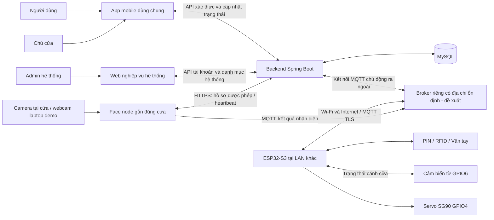

- App và web gọi backend; không kết nối thẳng MQTT và không chứa secret thiết bị.
- Backend kiểm tra tài khoản, quyền đúng cửa và điều kiện thực hiện trước mỗi thao tác.
- ESP32 tự xử lý xác thực cục bộ và tự khóa; mạng hoặc backend chậm không chặn task điều khiển cửa.
- Không thay sơ đồ chân đã thử; không tự thêm buzzer, relay, nút thoát hoặc camera vào ESP32.

Theo kiến trúc trang 6, 8 và 12 PDF: mobile/web dùng REST gửi thao tác và WebSocket nhận tín hiệu cập nhật; ESP32 và Face node gửi sự kiện qua broker, backend xử lý nghiệp vụ và lưu MySQL. Face node là thiết bị dịch vụ riêng gắn đúng cửa, không gửi trực tiếp lệnh mở servo hoặc bỏ qua backend.

## 3. Vai trò và quyền

| Chức năng | Người dùng mobile | Chủ cửa trên cùng app mobile | Admin hệ thống trên web |
|---|---|---|---|
| Xem cửa | Các cửa được cấp quyền | Các cửa mình sở hữu/quản lý | Danh mục và thông tin vận hành tối thiểu, không mở chi tiết quyền riêng |
| Mở từ xa | Khi được chủ cửa cấp quyền riêng | Cửa mình quản lý và đang bật mở từ xa | Không có trong vai trò admin hoặc web admin |
| Khóa ngay từ xa — đề xuất D12 | Chưa đề xuất cấp cho thành viên | Chờ duyệt; chỉ cửa mình và cảm biến báo đóng ổn định | Không |
| Xem lịch sử ra vào | Lịch sử của bản thân | Lịch sử cửa mình quản lý | Không xem chi tiết ra vào cá nhân |
| Thêm/xóa thành viên | Không | Cửa mình quản lý | Không |
| Cấp/thu hồi RFID, vân tay | Không tự cấp quyền | Cửa mình quản lý | Không |
| Hồ sơ khuôn mặt | Tải ảnh một lần và tự quản lý hồ sơ của mình | Có hồ sơ riêng như người dùng; không sửa ảnh của thành viên |
| Quyền mở bằng khuôn mặt | Gửi/hủy yêu cầu theo từng cửa được cấp; không tự duyệt | Duyệt/từ chối/thu hồi ở cửa mình quản lý | Không duyệt, xem ảnh hoặc cấp quyền khuôn mặt |
| Đổi PIN chung của cửa | Không | Có; không xem lại PIN hiện tại | Không |
| Hồ sơ, mật khẩu cá nhân | Tự quản lý hồ sơ của mình | Tự quản lý hồ sơ của mình | Quản lý trạng thái nghiệp vụ; không xem mật khẩu, đăng nhập thay hoặc sửa tùy ý hồ sơ |
| Tạo mã cửa / QR bàn giao | Không | Dùng mã đi kèm cửa; nhận mã mới sau reset/chuyển giao hoàn tất | Tạo mã cho cửa mới hoặc đã reset được xác nhận; không cấp mã nhận lại khi dữ liệu/chủ cũ chưa được xóa |
| Kích hoạt/ghép cửa | Không tự nhận cửa của người khác | Quét QR/nhập mã và thiết lập | Theo dõi trạng thái nghiệp vụ; không sửa trực tiếp trường chủ sở hữu để nhận cửa |
| Chuyển giao cửa, xóa dữ liệu cũ | Không | Cửa mình đang quản lý, theo mục 7.6 | Có theo flow riêng mục 7.6, không cần chủ cũ phê duyệt thêm; không được xem dữ liệu cũ |
| Reset toàn bộ thành cửa mới | Không | Cửa mình đang quản lý, theo mục 7.6 | Có theo flow riêng mục 7.6; không có quyền mở cửa hoặc đọc PIN từ quyền reset |
| Khóa/mở tài khoản cấp hệ thống | Không | Không; chỉ thu hồi tư cách thành viên ở cửa mình | Có lý do và audit, không sửa danh sách quyền cửa |
| Xem nhật ký | Sự kiện của bản thân được phép xem | Thao tác quản lý thuộc cửa mình | Nhật ký nghiệp vụ hệ thống; không truy cập dữ liệu PIN/credential riêng |
| Hiệu chuẩn cảm ứng, cảm biến từ, cơ cấu servo | Không | Thao tác tại cửa bằng PIN quản trị cục bộ | Không điều khiển hoặc hiệu chuẩn từ web |

Một tài khoản có thể là chủ cửa A nhưng chỉ là thành viên cửa B. Quyền luôn xét theo từng cửa. PIN quản trị cục bộ khác mật khẩu tài khoản và không được đưa lên app/server.

**Nguyên tắc đã chốt:** chủ cửa quyết định ai được vào cửa mình; admin quản lý nghiệp vụ toàn hệ thống. Backend không được có nhánh “là admin thì được phép mọi thao tác cửa”. Admin có quyền chuyển giao/reset được cấp riêng theo yêu cầu mới, không suy rộng sang xem/sửa dữ liệu truy cập thông thường. Nếu một người vừa là admin hệ thống vừa là chủ/thành viên một cửa, thao tác sử dụng cửa vẫn qua mobile và quan hệ hợp lệ, không dùng web để bỏ qua xác thực hoặc nhận lại dữ liệu của chủ cũ.

**Giới hạn nghiệp vụ tài khoản:** khóa tài khoản cấp hệ thống sẽ chặn phiên và quyền truy cập có hiệu lực của tài khoản đó, nhưng không xóa membership, không sửa các cờ quyền mà chủ cửa đã cấp và không đổi PIN chung. Chủ cửa được thông báo về ảnh hưởng và trạng thái chờ đồng bộ nếu cửa offline. Mở khóa tài khoản vẫn phải xét quyền hiện tại do chủ cửa quản lý, không khôi phục quyền chủ cửa đã thu hồi.

## 4. Flow tài khoản và cấp quyền ban đầu

Đăng nhập bằng **email hoặc số điện thoại và mật khẩu** theo trang 11 PDF. Tài khoản được xác thực trước, sau đó quyền theo từng cửa quyết định chức năng; việc tồn tại trong danh sách Manager không phải giấy phép quản lý mọi cửa.

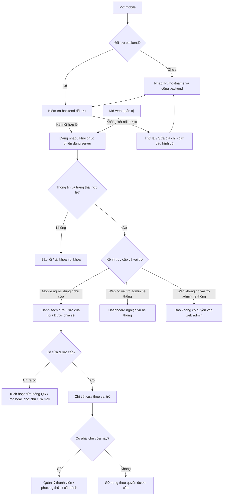

**Đề xuất giai đoạn 1:** admin quản lý việc tạo/mời và trạng thái tài khoản cấp hệ thống; người dùng nhận liên kết/mã kích hoạt dùng một lần qua kênh của chính mình và tự đặt mật khẩu. Chủ cửa mời thành viên vào cửa bằng mobile; lời mời có thể dẫn tới kích hoạt tài khoản nếu người nhận chưa có. Không dùng mật khẩu mặc định chung. Có tài khoản không đồng nghĩa được vào cửa: chỉ chủ cửa cấp quyền cửa và phương thức truy cập.

- Mã kích hoạt hết hạn hoặc đã dùng: yêu cầu cấp lại. Luồng gửi mã cần được chốt cho môi trường demo; mã đặt lại/phiên đăng nhập không được hiển thị trên web admin để đăng nhập thay người dùng.
- Quên mật khẩu: người dùng yêu cầu đặt lại và xác minh qua kênh của mình. Admin chỉ hỗ trợ trạng thái yêu cầu, không xem mật khẩu, tự đặt mật khẩu mới hoặc nhận mã đặt lại thay người dùng.
- Hết phiên: trở về đăng nhập và giữ thông báo rõ ràng, không tự gửi lại lệnh mở sau khi đăng nhập lại.
- Khóa tài khoản: thu hồi phiên ngay trên server; backend loại tài khoản không hợp lệ khỏi quyền có hiệu lực khi đồng bộ theo mục 10, vẫn giữ cấu hình membership của chủ cửa để đối chiếu.
- Backend hiện dùng session cookie + CSRF; đề xuất tận dụng và kiểm chứng trên Android/iOS thực tế. Không mặc định chuyển sang JWT trong bước duyệt này.

### 4.1. Chọn backend trước khi vào app — demo qua Tailscale

**Tên màn hình:** `Kết nối máy chủ`.

```text
             KẾT NỐI MÁY CHỦ

  IP / tên máy chủ: [100.101.102.103       ]
  Cổng:            [8080                  ]
  Giao thức:       [HTTP demo  /  HTTPS   ]

  Địa chỉ: http://100.101.102.103:8080

         [ Kiểm tra & Tiếp tục ]

  Demo qua Tailscale: bật Tailscale trên
  điện thoại và máy chạy backend.
```

`100.101.102.103` chỉ là ví dụ, phải nhập IP Tailscale thực tế của máy chạy BE. Có thể dùng IP LAN hoặc hostname/MagicDNS nếu điện thoại truy cập được; app không khóa cứng một dải IP. Cổng đề xuất mặc định `8080`, người demo đổi được. Cho phép dán URL đầy đủ, ví dụ `http://100.101.102.103:8080`, để tự tách giao thức/host/cổng; không bắt người dùng nhập `/api`.

**Flow lần đầu:** mở app → nhập IP/host + cổng → `Kiểm tra & Tiếp tục` → xác nhận đúng backend Smart Door → lưu địa chỉ trên điện thoại → màn hình đăng nhập.

**Flow lần sau:** mở app → đọc địa chỉ đã lưu → kiểm tra kết nối → khôi phục phiên còn hợp lệ của chính server đó hoặc hiện đăng nhập. Không yêu cầu nhập lại IP mỗi lần. Khi server chưa truy cập được, hiện `Thử lại` và `Sửa địa chỉ`; không bắt xóa/cài lại app.

**Các thao tác và trạng thái:**

- Validate IP/hostname, cổng `1–65535`, giao thức HTTP/HTTPS; bỏ khoảng trắng thừa, chuẩn hóa dấu `/` cuối. URL chứa tài khoản/mật khẩu, query hoặc đường dẫn tùy ý phải báo lỗi rõ ràng.
- Nút kiểm tra có trạng thái đang kết nối, timeout khoảng 5 giây; không thử đăng nhập và không gửi lệnh mở cửa trong bước kiểm tra.
- BE bổ sung endpoint kiểm tra công khai tối thiểu, đề xuất `GET /api/health`, trả định danh ứng dụng, phiên bản API và trạng thái sẵn sàng; không trả secret hoặc cấu hình nội bộ. HTTP 200 của một website bất kỳ chưa đủ để báo đúng server.
- Phân biệt lỗi nhập sai, không tới được máy chủ/timeout, sai cổng/dịch vụ, API không tương thích và lỗi chứng chỉ HTTPS. Không tự tắt kiểm tra chứng chỉ.
- Chỉ thay địa chỉ đang dùng sau khi kiểm tra server mới thành công. Kiểm tra thất bại vẫn giữ địa chỉ cũ và cho sửa ngay dữ liệu vừa nhập.
- Màn hình đăng nhập hiển thị `Máy chủ: <host>:<port>` kèm **`Đổi máy chủ`**. Trong `Cá nhân` có mục **`Kết nối máy chủ`** để đổi khi đang dùng.
- Đổi sang server khác khi đang đăng nhập: báo sẽ kết thúc phiên hiện tại; khi xác nhận và kiểm tra server mới thành công thì đóng kết nối cũ, hủy request đang chờ, xóa dữ liệu phiên/cache trong app và lấy CSRF/đăng nhập mới. Không chuyển cookie/token/mật khẩu hay kết quả lệnh của server cũ sang server mới.
- REST, WebSocket, upload và URL tài nguyên của app phải cùng dùng cấu hình server đang chọn. Không để màn hình nhập IP hoạt động nhưng một phần API vẫn gọi địa chỉ cố định trong `.env`.
- HTTP được hỗ trợ có chủ đích trong bản demo nội bộ; cấu hình bản build Android/iOS phải được kiểm tra với kiểu URL này. Đây là yêu cầu triển khai sau duyệt, không mặc định app hiện tại đã cho phép mọi kết nối HTTP.

**Mô hình khác LAN đề xuất, vẫn giữ Tailscale cho app → BE:**

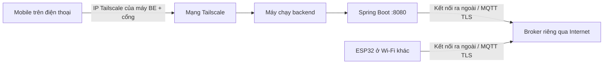

Điện thoại và máy BE cần có kết nối Tailscale và được phép truy cập dịch vụ tương ứng. Backend phải lắng nghe trên địa chỉ truy cập được, không chỉ `localhost`; firewall/chính sách mạng cần cho phép cổng BE. App không tự cài hoặc bật VPN thay người dùng.

Kết nối mobile → BE qua Tailscale là đường riêng với ESP32 → broker. Đề xuất broker riêng có hostname ổn định và dịch vụ MQTT TLS truy cập được qua Internet; ESP32 và backend đều chủ động nối ra broker, không cần cùng LAN hoặc mở cổng nhận kết nối vào router tại cửa. Backend có thể tiếp tục chạy trên máy đang tham gia Tailscale. Đây là đề xuất hạ tầng chờ duyệt, không có broker cloud đang được tạo ở bước này.

### 4.2. Khác LAN và IP thay đổi — không phụ thuộc địa chỉ mạng nội bộ của backend

#### Phương án A: broker riêng qua Internet — đề xuất ưu tiên

1. Broker đặt trên máy chủ/dịch vụ có địa chỉ Internet ổn định qua DNS, ví dụ minh họa `mqtt.smartdoor.example:8883` với TLS. Đây chưa phải hostname có dịch vụ thật; không dùng broker thử nghiệm công khai dùng chung để điều khiển cửa.
2. ESP32 kết nối Wi-Fi có Internet tại nơi lắp → phân giải DNS → xác thực broker/chứng chỉ → đăng nhập bằng credential riêng → duy trì kết nối MQTT. Backend ở mạng khác cũng nối ra cùng broker; lệnh được chuyển về qua kết nối ESP32 đã thiết lập.
3. IP LAN và IP WAN của nơi đặt cửa có thể đổi; sau khi kết nối lại, ESP32 vẫn dùng hostname broker. Máy backend đổi LAN cũng không yêu cầu sửa IP trong ESP32.
4. Broker có tài khoản/ACL riêng theo thiết bị, TLS và kiểm chứng máy chủ. App không chứa secret MQTT; không tự bỏ kiểm tra chứng chỉ để chữa lỗi kết nối. Host/cổng và thông tin tin cậy được cấp trong bước chuẩn bị/thiết lập; thay đổi hợp lệ được lưu runtime, không phải nạp lại firmware.
5. Khi manager mang cửa sang nhà khác, chỉ cấu hình lại Wi-Fi. Ownership, mã sản phẩm, PIN và quyền đã có không thay đổi. IP Tailscale nhập ở app là địa chỉ BE, không tự trở thành địa chỉ broker của ESP32.

Backend/broker/Face node vẫn cần hoạt động và truy cập nhau; đưa broker lên Internet không có nghĩa máy backend đang tắt cũng xử lý được lệnh. Face node tải hồ sơ qua đường BE được cấp phép, ví dụ laptop chạy Tailscale, và gửi kết quả qua broker được xác thực.

#### Phương án B: toàn bộ đường thiết bị qua Tailscale — cần gateway tại nơi đặt cửa

ESP32 → LAN → gateway/router chạy Tailscale tại nơi lắp → tailnet → broker/BE ở mạng khác. Cần cấu hình IP forwarding, route từ LAN của ESP32 tới đích, đường trả về và chính sách truy cập. Chỉ bật subnet router hoặc điền IP `100.x` vào firmware không tự tạo đủ các đường này. Gateway phải hoạt động liên tục; phần cứng/vận hành bổ sung là lý do chưa chọn mặc định cho cửa chỉ có ESP32.

Hai phương án cần lựa chọn rõ trước triển khai hạ tầng. A không cần gateway Tailscale tại mỗi cửa; B giữ broker trong mạng riêng nhưng đòi hỏi gateway và định tuyến phù hợp. Nếu tiếp tục dùng laptop demo làm broker riêng không có địa chỉ Internet truy cập được, phải dùng B hoặc cơ chế trung chuyển được thiết kế riêng, không coi DNS/mDNS là giải pháp xuyên mạng.

#### Demo cùng LAN và cấu hình dự phòng

IP LAN/mDNS, ví dụ `smartdoor-demo.local:1884`, chỉ là tùy chọn thử trong cùng LAN; máy chủ phải công bố dịch vụ và mạng cho phép multicast. DHCP reservation chỉ giúp tại router cố định. Cả hai không giải quyết yêu cầu triển khai khác LAN.

Trong `Quản lý cửa → Kết nối thiết bị`, có thể cập nhật host/cổng broker qua kênh thiết lập cục bộ được xác thực khi cần; ESP32 kiểm chứng đúng dịch vụ rồi mới lưu. Không reset toàn bộ cửa hoặc mất quyền chỉ vì đổi mạng. Không tự kết nối một broker do quảng bá nội bộ mà chưa xác thực.

Tham khảo [MQTT TLS của Espressif](https://docs.espressif.com/projects/esp-mqtt/en/latest/esp32/), [cấu hình xác thực/TLS của Mosquitto](https://www.mosquitto.org/man/mosquitto-conf-5.html) và [định tuyến của Tailscale](https://tailscale.com/docs/route).

## 5. App mobile dùng chung cho người dùng và chủ cửa

**Điều hướng chính:** `Cửa của tôi` · `Lịch sử` · `Thông báo` · `Cá nhân`.

| Màn hình | Nội dung và thao tác |
|---|---|
| Kết nối máy chủ | Nhập IP/hostname + cổng hoặc dán URL; kiểm tra và lưu backend trước đăng nhập; hỗ trợ Tailscale/LAN |
| Đăng nhập / kích hoạt | Hiện server đang dùng và nút đổi server; đăng nhập, dùng mã kích hoạt, đặt mật khẩu lần đầu |
| Cửa của tôi | Nhóm Cửa tôi quản lý / Cửa được chia sẻ; nhãn Chủ cửa/Thành viên ở từng cửa; tên, vị trí, kết nối và quyền mở từ xa |
| Chi tiết cửa | Cánh cửa đóng/mở; lệnh chốt gần nhất; phương thức được cấp; nút mở khi đủ điều kiện; mục Quản lý chỉ có khi là chủ cửa đó |
| Kích hoạt cửa | Quét QR hoặc nhập mã đi kèm cửa do admin cấp → xác nhận cửa → thiết lập Wi-Fi/PIN → kiểm tra hoàn tất; không tự tạo mã/hồ sơ cửa ngoài danh mục |
| Lời mời | Xem chủ cửa mời, cửa và quyền đề xuất; chấp nhận/từ chối; chủ cửa theo dõi hoặc hủy lời mời |
| Quản lý cửa | Chủ cửa mời/xóa thành viên, chỉnh quyền, đăng ký/thu hồi RFID-vân tay, đổi PIN và theo dõi đồng bộ |
| Khuôn mặt của tôi | Tải ảnh đăng ký một lần cho tài khoản, xem kết quả kiểm tra ảnh; xem/xóa hoặc thay hồ sơ có xác nhận |
| Yêu cầu khuôn mặt theo cửa | Trong chi tiết cửa: gửi/hủy yêu cầu dùng hồ sơ đã có, xem trạng thái và lý do từ chối; không tải lại ảnh cho mỗi cửa |
| Xác nhận mở | Tên/vị trí cửa và nút xác nhận; không yêu cầu nhập PIN chung của cửa vào app |
| Kết quả mở | Đang gửi → đang chờ thiết bị → thiết bị xác nhận hoặc lỗi/không rõ kết quả |
| Lịch sử | Thành viên xem của bản thân; chủ cửa xem cửa mình quản lý; PIN chung chỉ có trong lịch sử cửa của chủ cửa |
| Thông báo | Thành viên: lời mời, kết quả duyệt khuôn mặt và thay đổi quyền; chủ cửa: yêu cầu khuôn mặt chờ duyệt, cảnh báo cửa và đồng bộ; giai đoạn 1 là thông báo trong app |
| Cá nhân | Hồ sơ, đổi mật khẩu, cấu hình kết nối máy chủ, đăng xuất |

### Flow mở cửa từ mobile

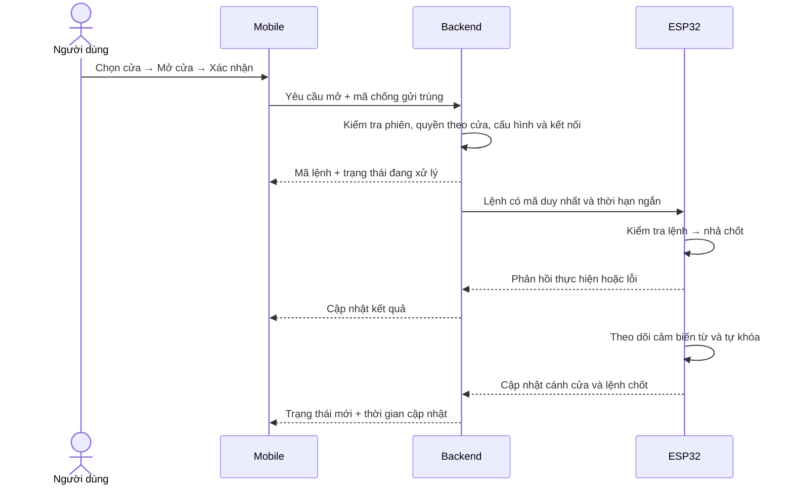

**Quy tắc bắt buộc của flow mở:**

1. Backend từ chối nếu tài khoản/quyền không hợp lệ, cửa tắt mở từ xa hoặc thiết bị offline. App ẩn/vô hiệu hóa nút là hỗ trợ giao diện; server vẫn kiểm tra độc lập.
2. Nhấn nhiều lần hoặc request bị gửi lại vẫn là một lệnh, không kéo dài nhả chốt. Nút bị khóa khi đang chờ kết quả.
3. “Yêu cầu đã tiếp nhận” chưa phải “đã mở”. Khi ACK thành công, hiển thị **“Thiết bị đã nhận và thực hiện lệnh nhả chốt”**. Cánh cửa chỉ chuyển sang “Mở” khi cảm biến từ báo mở.
4. Hết thời gian chờ mà chưa có phản hồi: hiển thị **“Chưa xác nhận kết quả — kiểm tra trạng thái cửa”**, không kết luận chắc chắn cửa chưa mở và không tự gửi lệnh khác.
5. Thiết bị không thực hiện lệnh đã hết hạn khi kết nối lại. ACK đến muộn có thể bổ sung kết quả của lệnh gốc, không kích hoạt lại servo.
6. Mất mạng sau khi nhả chốt: ESP32 vẫn tự khóa theo hành vi đã test. App hiển thị dữ liệu cũ kèm thời gian, không đoán trạng thái mới.

### 5.1. Flow quản lý cửa của chủ cửa trên mobile

Đăng nhập app chung → chọn một cửa có nhãn **Chủ cửa** → **Quản lý cửa**.

| Mục quản lý trên mobile | Flow chính |
|---|---|
| Thành viên | Mời bằng định danh tài khoản/liên hệ → người nhận chấp nhận → cấp quyền theo cửa; không có danh bạ toàn hệ thống để duyệt tùy ý |
| Quyền truy cập | Bật/tắt quyền RFID, vân tay và mở từ xa theo thành viên; quyền FACE cấp qua yêu cầu/duyệt riêng mục 5.3; hiện Đã áp dụng/Chờ đồng bộ/Lỗi |
| Phương thức | Bắt đầu đăng ký RFID/vân tay tại cửa, thu hồi credential, đổi PIN chung có xác nhận; không xem lại PIN |
| Duyệt khuôn mặt | Xem yêu cầu thuộc cửa, thông tin người gửi và ảnh tham chiếu được phép; duyệt/từ chối với lý do, thu hồi quyền đã duyệt; không yêu cầu tải ảnh mới cho từng cửa |
| Lịch sử và cảnh báo | Lọc các sự kiện thuộc cửa, xem người/phương thức được phép biết, cửa mở lâu, lỗi thiết bị và kết quả lệnh |
| Thiết bị | Kích hoạt bằng QR/mã cửa, thiết lập Wi-Fi/PIN, trạng thái module/kết nối, thay thiết bị có xác nhận sở hữu; không chia sẻ secret qua giao diện |
| Cài đặt | Tên/vị trí cửa, bật/tắt mở từ xa; thay đổi có ảnh hưởng thiết bị phải chờ ACK |
| Chuyển giao cửa | Chọn người nhận → xác nhận xóa toàn bộ dữ liệu cũ → thiết bị và backend hoàn tất reset → bàn giao quyền kích hoạt mới; người nhận tự thiết lập từ đầu |
| Reset toàn bộ thiết bị | Xác thực lại và xác nhận xóa → reset thiết bị/cảm biến và dữ liệu cửa trên BE → cửa chưa có chủ, có mã nhận mới; xem mục 7.6 |

Người dùng có thể đồng thời quản lý cửa A và được chia sẻ cửa B, không cần đổi ứng dụng hoặc chuyển vai trò toàn cục. Ở cửa B, các nút quản lý không hiện và backend cũng từ chối nếu gọi trực tiếp API quản lý. Thu hồi tư cách chủ cửa phải làm mất quyền quản lý ngay trên server và cập nhật lại giao diện.

### 5.2. Flow thêm thành viên và phương thức trên mobile của chủ cửa

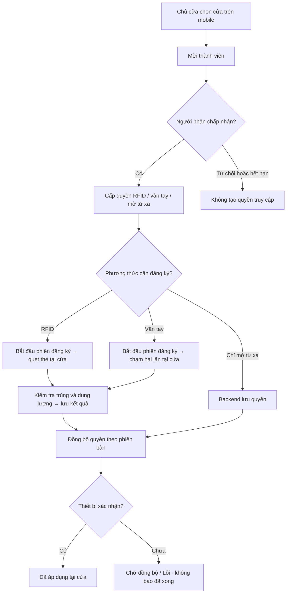

- Vân tay phải được quét trên cảm biến ở cửa; vân tay hệ điều hành điện thoại không phải mẫu để đưa vào cảm biến UART.
- Backend chỉ lưu liên kết người–cửa–ID mẫu–thiết bị, không lấy ảnh/mẫu vân tay khỏi cảm biến.
- Phiên đăng ký gắn với một người, một cửa, một mã thao tác; hết hạn/hủy thì không tự cấp quyền. Lệnh trùng không tạo thêm mẫu.
- Lệnh đăng ký khi offline bị từ chối, không xếp chờ để bất ngờ kích hoạt lúc thiết bị nối lại.
- Giới hạn ban đầu theo bản offline: tối đa 32 thẻ và 32 vân tay được cấp quyền trên một ESP32; giao diện phải chặn khi hết dung lượng.
- PIN mở cửa hiện là **PIN chung của cửa**, không phải PIN riêng từng tài khoản. Không gán log PIN cho một người cụ thể. Chủ cửa đổi PIN trên mobile; thành viên và admin hệ thống không có chức năng xem lại hoặc đổi PIN cửa.
- Khuôn mặt không theo luồng chủ cửa tạo mẫu riêng cho mỗi cửa: người dùng đăng ký ảnh chung và chủ động gửi yêu cầu, chủ cửa duyệt theo mục 5.3.

### 5.3. Đăng ký khuôn mặt một lần, xin phép riêng từng cửa

**Hai dữ liệu tách biệt:**

- **Hồ sơ khuôn mặt theo tài khoản:** một bộ dữ liệu đăng ký dùng chung, gồm ảnh tham chiếu riêng tư và đặc trưng nhận diện được hệ thống xử lý; có phiên bản, trạng thái và người sở hữu.
- **Yêu cầu/quyền khuôn mặt theo cửa:** liên kết tài khoản, cửa, phiên bản hồ sơ, người duyệt và kết quả. Quyền ở cửa A không được suy ra thành quyền ở cửa B.

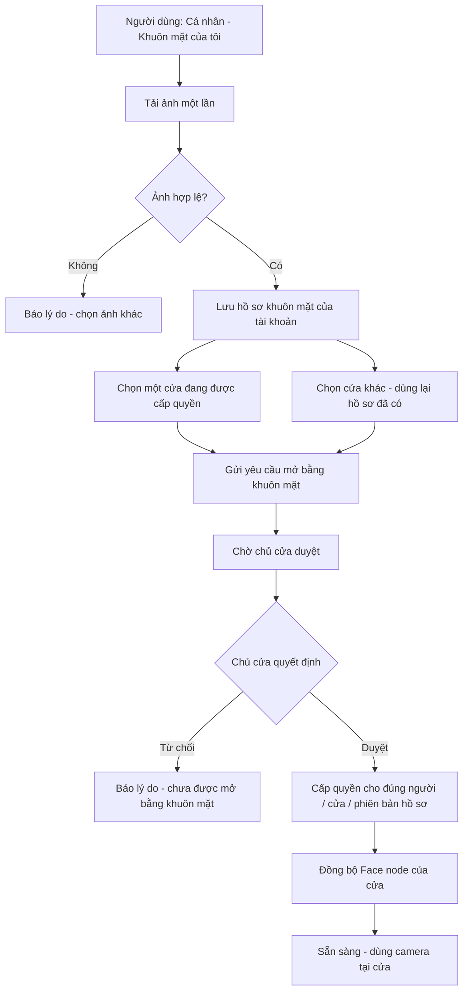

#### 5.3.1. Người dùng đăng ký và gửi yêu cầu

1. `Cá nhân → Khuôn mặt của tôi → Tải ảnh`: chọn ảnh của chính mình, xác nhận sử dụng để đăng ký nhận diện. Kiểm tra định dạng/dung lượng, có đúng một khuôn mặt và chất lượng phù hợp; chưa đạt thì không tạo hồ sơ sẵn sàng hoặc quyền mở.
2. Ảnh hợp lệ được xử lý thành hồ sơ dùng chung. Không buộc người dùng chụp/tải lại khi tham gia thêm cửa; không sao chép một hồ sơ độc lập cho từng cửa.
3. `Chi tiết cửa → Phương thức truy cập → Khuôn mặt → Gửi yêu cầu`. Nếu chưa đăng ký ảnh, app hướng dẫn đến bước đăng ký rồi quay lại đúng cửa.
4. Chỉ gửi được khi tài khoản còn hoạt động, có tư cách thành viên hợp lệ và cửa hỗ trợ nhận diện khuôn mặt. Người dùng không được nhập ID một cửa bất kỳ để tự xin hoặc lấy dữ liệu của cửa không được cấp.
5. Yêu cầu gắn với phiên bản hồ sơ đã gửi. Mỗi người/cửa chỉ có một yêu cầu đang chờ; nhấn lặp không tạo bản sao. Người dùng được hủy yêu cầu đang chờ; sau từ chối/thu hồi có thể gửi yêu cầu mới để chủ cửa xét lại, không tự phục hồi quyền cũ.
6. Ví dụ: một ảnh đã đăng ký → xin cửa A và B → A duyệt, B đang chờ → chỉ A có quyền khuôn mặt. Khi B duyệt thì dùng cùng hồ sơ tại B, không tải ảnh lần nữa.

#### 5.3.2. Chủ cửa duyệt trên mobile

1. `Quản lý cửa → Yêu cầu khuôn mặt` → danh sách chờ duyệt của đúng cửa.
2. Xem người gửi, thời điểm, phiên bản hồ sơ và ảnh tham chiếu trong phạm vi yêu cầu → **Duyệt** hoặc **Từ chối**; từ chối có lý do hiển thị cho người gửi.
3. Backend kiểm tra lại chủ cửa hiện tại, thành viên/tài khoản và phiên bản hồ sơ trước khi ghi quyết định. Nếu người gửi đã rời cửa, hồ sơ bị xóa/thay hoặc yêu cầu đã hủy, quyết định cũ không được cấp quyền.
4. Duyệt tạo quyền khuôn mặt cho đúng cửa, sau đó đồng bộ dữ liệu cần thiết cho Face node của cửa đó. Hiện **Đã duyệt - chờ sẵn sàng** nếu camera/node chưa nhận cấu hình; không giả là đã mở cửa.
5. Chủ cửa có thể thu hồi quyền khuôn mặt bất cứ lúc nào; không cần xóa ảnh chung của người dùng và không làm mất quyền khuôn mặt ở các cửa khác.

**Admin hệ thống không tham gia duyệt.** Chủ cửa chỉ xem ảnh/thông tin gắn với yêu cầu hoặc quyền thuộc cửa mình, không có thư viện ảnh toàn hệ thống, không tải lại/đổi ảnh của người dùng. Ảnh không có URL công khai; các API ảnh/đặc trưng phải kiểm tra quyền như API hồ sơ.

#### 5.3.3. Nhận diện để mở cửa

Ảnh tải lên là ảnh **đăng ký**, không phải bằng chứng trực tiếp để mở cửa và không có chức năng tải một ảnh lên rồi lập tức mở cửa.

`Camera tại cửa → Face node gắn với cửa → nhận diện và kiểm tra người thật theo cấu hình → MQTT broker → backend kiểm tra quyền hiện tại → MQTT broker → lệnh ESP32 → ACK → trạng thái cánh cửa`.

- Cấu hình phần cứng hiện tại chưa có camera nối ESP32; đề xuất demo dùng webcam laptop/Face node đã có trong repo, gắn rõ với cửa đang thử. Không coi camera/Face node của cửa A là nguồn được mở cửa B.
- Face node chỉ nhận hồ sơ cần thiết của người đã được duyệt tại đúng cửa và đúng phiên bản, không tải toàn bộ ảnh người dùng của hệ thống.
- Trước mỗi lệnh mở, backend kiểm tra lại tài khoản, membership, quyền khuôn mặt đã duyệt, phiên bản hồ sơ, thiết bị/cửa và thế hệ sử dụng; chỉ nhận diện trùng mặt mà không có quyền vẫn bị từ chối.
- Quyền khuôn mặt tách khỏi quyền mở bằng nút trên app. Không bắt cấp quyền mở từ xa cho thành viên chỉ để người đó dùng khuôn mặt; Face node được xác thực gửi kết quả, backend tạo lệnh theo quyền FACE riêng.
- **Yêu cầu đã xác nhận: FACE chỉ dùng online.** Camera/Face node phải truy cập được backend, backend phải hoạt động và đường gửi lệnh tới ESP32 qua broker phải khả dụng. Điện thoại có mạng một mình chưa đủ để kết luận cửa dùng được FACE.
- Mất một đường kết nối cần thiết: hiện **“Khuôn mặt tạm không khả dụng — vui lòng dùng PIN/thẻ/vân tay”**. Không mở bằng quyền cache, không lưu kết quả nhận diện thành lệnh chờ để mở lúc nối mạng lại. Khi nối lại phải có lần nhận diện mới và kiểm tra quyền hiện tại.
- Lệnh FACE đã phát vẫn có thời hạn ngắn và chống gửi trùng; nếu ESP32 đã nhả chốt trước khi mất mạng, task tự khóa vẫn hoàn tất độc lập. Không gửi thêm lệnh mở để bù một ACK bị mất.
- Đăng ký ảnh, gửi yêu cầu và duyệt quyền cũng cần kết nối backend; không hiển thị thành công cho thay đổi chưa được server lưu. Ở đây online là truy cập được các dịch vụ cần thiết qua LAN/Tailscale hoặc hạ tầng triển khai, không bắt buộc mọi trường hợp đều cần Internet công cộng. Không có luồng FACE offline.

#### 5.3.4. Trạng thái, thay đổi hồ sơ và reset cửa

| Nhóm | Trạng thái / hành vi |
|---|---|
| Hồ sơ tài khoản | Chưa đăng ký / Đang xử lý / Sẵn sàng / Không hợp lệ / Đã xóa |
| Yêu cầu theo cửa | Chưa gửi / Chờ duyệt / Đã duyệt-chờ sẵn sàng / Được sử dụng / Từ chối / Đã hủy / Bị thu hồi / Cần gửi lại |
| Bị từ chối hoặc đang chờ | Không được mở bằng khuôn mặt, nhưng các phương thức khác vẫn theo quyền riêng |
| Đã duyệt nhưng mất kết nối | Giữ kết quả duyệt, hiện Tạm không khả dụng; không mở bằng FACE. Nối lại cần nhận diện mới, không cần upload ảnh hoặc xin duyệt lại chỉ vì mất mạng |
| Xóa hồ sơ khuôn mặt | Xóa ảnh/đặc trưng chung và vô hiệu hóa mọi quyền/yêu cầu FACE liên quan; không xóa tài khoản hoặc quyền RFID/vân tay |
| Thay ảnh chủ động | Không yêu cầu trong sử dụng thông thường. Đề xuất tạo phiên bản hồ sơ mới; sau khi xử lý thành công, quyền cũ cần yêu cầu/duyệt lại theo cửa, không tự cấp quyền cho một khuôn mặt thay thế |
| Rời cửa / tài khoản bị khóa | Chặn mở FACE theo kiểm tra hiện tại, thu hồi quyền có hiệu lực và xóa dữ liệu tương ứng khỏi cache node; không chờ người dùng gửi lại ảnh để chặn |
| Reset/chuyển giao một cửa | Xóa yêu cầu, phê duyệt, liên kết FACE và cache node thuộc cửa/lượt cũ. Giữ hồ sơ khuôn mặt chung của tài khoản và quyền ở các cửa khác; muốn dùng cửa sau kích hoạt lại phải được cấp membership và xin duyệt mới |

Quyền cần xét lại khi cập nhật ảnh là phương án bảo vệ phiên bản để duyệt; yêu cầu cốt lõi đã chốt là **một lần đăng ký ảnh, nhiều cửa được phép, duyệt riêng từng cửa**. Chưa có thay đổi mã nguồn trong bước cập nhật tài liệu này.

### 5.4. Khóa từ xa — bổ sung theo trang 3 và 10 PDF, chờ duyệt

PDF có cả khóa và mở khóa từ xa; flow trước mới mô tả mở. Đề xuất thêm **Khóa ngay** cho manager ở cửa mình quản lý, không mặc định cấp thao tác này cho mọi thành viên và không cấp cho web admin.

`Manager chọn cửa → Khóa ngay → xác nhận → backend kiểm tra quyền/trạng thái → ESP32 kiểm tra cảm biến tại thời điểm thực hiện → phát lệnh khóa hoặc từ chối → ACK → cập nhật mobile`.

- Không gọi đây là “đóng cửa từ xa”: SG90 điều khiển chốt, không có cơ cấu kéo cánh cửa đóng lại.
- Cánh cửa phải đóng ổn định và cảm biến hợp lệ; ESP32 kiểm tra lần cuối ngay trước thao tác, dù app/backend vừa thấy trạng thái đóng. Cửa đang mở hoặc trạng thái không rõ: từ chối khóa, không xếp chờ để tự khóa bất ngờ về sau.
- Lệnh có mã duy nhất/thời hạn, cùng cơ chế ACK và chống trùng với lệnh mở. Gửi lệnh thành công không chứng minh chốt đã khóa vật lý.
- Tự khóa theo mục 9 vẫn hoạt động độc lập, kể cả manager không dùng nút này. Khi reset/bảo trì, không cho thao tác điều khiển thông thường.

## 6. Web admin — nghiệp vụ tài khoản và cửa ở cấp hệ thống

**Menu:** `Tổng quan hệ thống` · `Tài khoản` · `Danh mục cửa` · `Thiết bị` · `Yêu cầu hỗ trợ` · `Nhật ký hệ thống`.

| Nhóm màn hình | Phạm vi nghiệp vụ |
|---|---|
| Tổng quan hệ thống | Số tài khoản/cửa/thiết bị, số online/offline, lỗi kết nối và dịch vụ; không trình bày lịch sử di chuyển của từng người |
| Tài khoản | Tạo/mời, theo dõi kích hoạt, khóa/mở cấp hệ thống với lý do, xem định danh/trạng thái cần thiết; không sửa hồ sơ tùy ý hoặc đăng nhập thay |
| Manager | Lọc tài khoản đang sở hữu/quản lý cửa, trạng thái nghiệp vụ và số hồ sơ liên quan; không sửa quyền bên trong cửa hoặc gán mình thành manager qua màn hình này |
| Danh mục cửa | Tạo hồ sơ cửa/thiết bị → sinh mã nhận cửa và QR → in/xuất bàn giao; xem mã định danh, chủ sở hữu, ngày tạo và trạng thái kích hoạt; không sửa quyền bên trong cửa |
| Thiết bị | Danh mục, firmware, heartbeat/lỗi kỹ thuật; thao tác Chuyển giao hoặc Reset toàn bộ theo mục 7.6, không thay owner trực tiếp hoặc đọc credential |
| Yêu cầu hỗ trợ | Theo dõi yêu cầu tài khoản, thông tin hồ sơ cửa hoặc lỗi kỹ thuật; hỗ trợ không tự cấp quyền vào cửa |
| Nhật ký hệ thống | Thao tác nghiệp vụ của admin, lý do khóa/mở tài khoản, xử lý hồ sơ/hỗ trợ; không chứa PIN, UID/mẫu vân tay hoặc chi tiết quyền thành viên |

Web admin **không có** nút mở/khóa cửa, danh sách thành viên của cửa, cấp/thu hồi phương thức, đổi PIN hoặc xem lịch sử ra vào cá nhân. Riêng **Chuyển giao cửa** và **Reset toàn bộ** được phép theo mục 7.6; không thực hiện bằng cách sửa owner trực tiếp hoặc phát lại mã nhận cũ. Thông tin chủ sở hữu trên danh mục chỉ để tra cứu nghiệp vụ.

Thao tác lưu trữ/đóng hồ sơ thông thường không phải reset. Chức năng reset/chuyển giao có xác nhận riêng và chủ đích xóa toàn bộ dữ liệu cũ, không thay bằng thao tác ẩn hồ sơ hoặc soft-delete. Admin được tự khởi tạo hai flow này sau khi xác thực lại, không bắt buộc xin PIN hoặc sự phê duyệt của manager; manager chỉ được thực hiện với cửa mình quản lý.

Backend phải tách API quản trị hệ thống và API của chủ cửa, trả đúng dữ liệu tối thiểu cho từng nhóm. Quyền admin không được mặc định đi qua kiểm tra ownership/membership. Các API cũ có quyền rộng cần được rà soát và thu hẹp khi triển khai flow mới.

## 7. Admin cấp mã cửa → manager kích hoạt trên app → thiết lập

**Manager trong tài liệu là chủ cửa.** Đây là vai trò theo từng cửa sau khi nhận quyền sở hữu hợp lệ, không phải một ứng dụng riêng hoặc quyền admin toàn hệ thống.

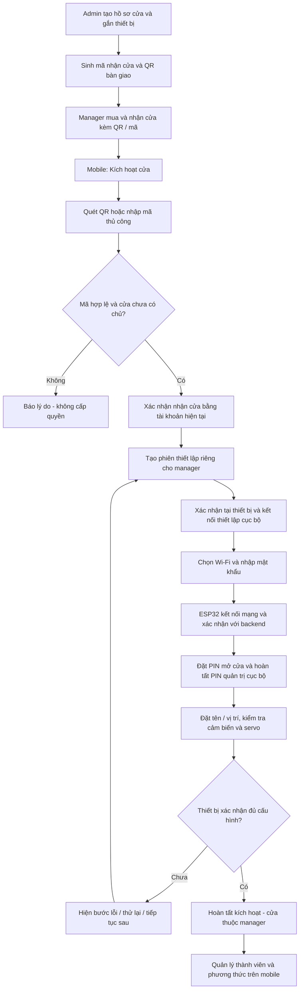

### 7.1. Admin chuẩn bị cửa trên hệ thống

1. Trên web, chọn **Danh mục cửa → Tạo cửa mới**; nhập thông tin sản phẩm cần thiết và gắn với đúng ESP32/thiết bị.
2. Hệ thống tạo **mã định danh cửa** duy nhất để tra cứu và **mã nhận cửa/kích hoạt** ngẫu nhiên, khó đoán. QR bàn giao biểu diễn cùng thông tin nhận cửa để người mua không cần gõ tay.
3. Admin in/xuất QR và mã nhận cửa để bàn giao kèm sản phẩm. Cửa có trạng thái **Chưa kích hoạt**, chưa thuộc manager nào; admin không điền PIN hoặc Wi-Fi thay người mua.
4. Web theo dõi trạng thái Chưa kích hoạt/Đang thiết lập/Đã kích hoạt và chủ sở hữu. Không xuất lại mã nhận một cửa đang thuộc chủ cũ bằng thao tác danh mục; muốn bàn giao lại phải thực hiện reset/chuyển giao theo mục 7.6, xóa và xác nhận dữ liệu trước khi cấp mã mới.

**Phân biệt mã:** mã định danh cửa có thể hiện trên danh sách để tra cứu; mã nhận cửa là thông tin dùng một lần để nhận quyền sở hữu. Biết mã định danh công khai không được đủ để nhận cửa. QR/mã nhận cửa không chứa PIN, mật khẩu Wi-Fi hoặc secret MQTT của thiết bị; sau khi sử dụng không dùng như mã mở cửa. Cơ chế xuất/kiểm chứng mã cần được chốt khi thiết kế API.

#### 7.1.1. Làm sao biết mã cửa thuộc đúng chip ESP32 nào?

**Cần có bước chuẩn bị/đăng ký thiết bị trước khi bán.** Web không thể tự biết một chip chưa được đưa vào hệ thống. Đề xuất cho demo: cắm từng ESP32 vào máy chuẩn bị qua USB, đọc định danh chip, đăng ký với BE bằng tài khoản admin, rồi mới tạo hồ sơ cửa và mã bàn giao.

ESP32-S3 có địa chỉ MAC gốc do Espressif ghi sẵn trong eFuse; dùng giá trị factory này làm định danh phần cứng chuẩn hóa, thay vì IP Wi-Fi, IP Tailscale, cổng COM hoặc MAC của từng giao diện. Cổng COM/IP chỉ giúp kết nối ở thời điểm đó, không phải mã sản phẩm. Tham khảo [tài liệu MAC/eFuse ESP32-S3 của Espressif](https://docs.espressif.com/projects/esp-idf/en/stable/esp32s3/api-reference/system/misc_system_api.html).

**Flow chuẩn bị thiết bị đề xuất:**

1. Cắm ESP32 qua USB → công cụ chuẩn bị đọc factory MAC trực tiếp từ chip và hiển thị để đối chiếu. Công cụ này là phần cần bổ sung, chưa có trong web hiện tại; không cần thiết bị đã có Wi-Fi của người mua.
2. Firmware tạo thông tin xác thực gốc riêng cho thiết bị, đề xuất một cặp khóa: khóa riêng nằm trong vùng cấu hình gốc của thiết bị, khóa công khai đăng ký lên BE qua phiên chuẩn bị được admin xác thực. Không dùng một secret chung cho toàn bộ sản phẩm, không đưa khóa riêng vào QR/log.
3. Backend tạo bản ghi `deviceUid ↔ factoryMac ↔ publicKey`; ràng buộc duy nhất để cùng chip không trở thành hai thiết bị độc lập. Admin chọn đúng bản ghi này khi tạo hồ sơ cửa.
4. Backend gắn `doorId ↔ deviceUid`, sinh mã nhận cửa dùng một lần rồi xuất QR. Mã nhận chỉ ánh xạ tới bản ghi này, không nhận `deviceUid` tùy ý do app gửi lên để đổi sang chip khác.
5. Khi manager quét mã và kết nối thiết lập, BE phát thử thách gắn với phiên, thiết bị và lượt sử dụng; ESP32 chứng minh bằng khóa riêng. Backend chỉ hoàn tất khi chữ ký/thiết bị khớp bản ghi mã nhận cửa. Quét mã cửa A rồi cấu hình ESP32 B phải báo sai thiết bị.

Ví dụ minh họa liên kết:

| Mục | Giá trị ví dụ | Mục đích |
|---|---|---|
| Factory MAC | `80:B5:4E:C8:14:9C` | Nhận diện phần cứng đã đọc khi chuẩn bị |
| Device UID | `ESP32-80B54EC8149C` | Định danh thiết bị trong hệ thống |
| Mã định danh cửa | `DOOR-0001` | Hồ sơ sản phẩm gắn với thiết bị đó |
| Mã nhận/QR | Token ngẫu nhiên dùng một lần | Cho người mua bắt đầu nhận đúng cửa |
| Khóa gốc riêng thiết bị | Không hiển thị | Chứng minh đúng thiết bị khi ghép; MAC công khai tự nó không đủ để xác thực |

Factory reset tại mục 7.6 giữ định danh và khóa gốc để nhận diện đúng sản phẩm, đồng thời xóa toàn bộ dữ liệu sử dụng và thu hồi credential phiên cũ. Khi thay chip vật lý, phải đăng ký chip mới và hoàn tất nghiệp vụ thay thiết bị; không sao chép mã nhận/khóa riêng của chip cũ sang chip mới.

### 7.2. Manager quét QR hoặc nhập mã trên mobile

1. Nhập địa chỉ BE/Tailscale và đăng nhập như mục 4.1 → **Cửa của tôi → Kích hoạt cửa**.
2. Chọn **Quét QR** hoặc **Nhập mã cửa**. Nếu không cấp quyền camera vẫn dùng nhập tay được; màn hình giải thích cần mã nhận cửa đi kèm sản phẩm, không chỉ mã tra cứu.
3. Backend kiểm tra mã, trạng thái hồ sơ, thiết bị tương ứng và quyền nhận cửa. Mã sai/đã dùng/bị thu hồi hoặc cửa đã thuộc tài khoản khác: báo rõ lý do phù hợp, không lộ danh sách thành viên hay thông tin riêng của chủ hiện tại.
4. App hiển thị thông tin sản phẩm/mã định danh để đối chiếu → manager nhấn **Nhận cửa & Thiết lập**.
5. Backend giữ chỗ cho tài khoản hiện tại bằng một phiên thiết lập; hai tài khoản không thể cùng nhận một cửa. App hiện **“Đã nhận yêu cầu — cần hoàn tất thiết lập”**, chưa báo cửa sẵn sàng hoặc cho mở từ xa.

### 7.3. Thiết lập Wi-Fi, PIN và kiểm tra cửa

| Bước trong trình thiết lập mobile | Hành vi |
|---|---|
| 1. Xác nhận đang ở cạnh cửa | Bật chế độ thiết lập trên TFT; với cửa đã chạy offline phải xác thực PIN quản trị cục bộ. Xác nhận đúng thiết bị bằng phiên ghép, không chỉ dựa vào tên Wi-Fi |
| 2. Cấu hình Wi-Fi | Chọn mạng Wi-Fi phù hợp ESP32, nhập mật khẩu, gửi trực tiếp qua kênh thiết lập cục bộ có xác thực và mã hóa; không lưu mật khẩu lên backend/admin |
| 3. Chờ thiết bị kết nối | ESP32 phân giải hostname broker và nối MQTT TLS qua mạng được cấp phát theo mục 4.2, rồi xác nhận đúng thiết bị/phiên với backend ở LAN khác; chỉ dùng LAN/mDNS trong chế độ demo cùng mạng, không lấy IP Tailscale của BE làm broker mặc định |
| 4. PIN mở cửa | Manager đặt PIN 6 số và nhập lại; gửi tới đúng thiết bị, chỉ hoàn tất khi thiết bị lưu và ACK. Với cửa đã thử offline, cho chọn giữ PIN cũ hoặc chủ động thay; không hiện lại PIN cũ |
| 5. PIN quản trị cục bộ | Thiết lập/xác nhận trực tiếp trên TFT theo cơ chế offline; app hướng dẫn và theo dõi đã hoàn tất, không nhận hoặc hiển thị PIN quản trị |
| 6. Tên và vị trí | Manager tự đặt tên/vị trí sử dụng; không thay mã định danh sản phẩm admin đã tạo |
| 7. Kiểm tra hoạt động | Hiệu chuẩn touch nếu thiếu, đóng cửa để xác nhận mức cảm biến; thử servo có chủ đích và quan sát không tải/góc cơ khí. Giữ kết quả đã có nếu không yêu cầu chỉnh lại |
| 8. Hoàn tất | Backend xác nhận chủ sở hữu và thiết bị đã nhận cấu hình → chuyển Đã kích hoạt; hiển thị cửa trong Cửa tôi quản lý, cho thêm thành viên/thẻ/vân tay |

**Đề xuất kỹ thuật để duyệt:** dùng kênh thiết lập Wi-Fi cục bộ của ESP32, ví dụ SoftAP có bảo vệ và phiên ghép xác thực; chưa đưa BLE vào giai đoạn 1. Giao thức bảo vệ, nhận diện thiết bị và cách chuyển mạng trên Android/iOS sẽ thiết kế khi triển khai; không coi SoftAP mở hoặc tên SSID là bằng chứng sở hữu. Bản firmware offline hiện tại chưa có kênh cấu hình này.

Khi điện thoại chuyển sang Wi-Fi thiết lập của ESP32, đường tới BE/Tailscale có thể tạm gián đoạn. App giữ nguyên phiên/bước đang làm, hướng dẫn quay lại mạng có BE rồi tiếp tục; không xóa địa chỉ BE, không coi đó là hết phiên và không tự bắt đầu một lần kích hoạt khác. Sau khi Wi-Fi lỗi, cửa giữ cấu hình đang hoạt động trước đó thay vì ghi đè bằng thông tin chưa kết nối thành công.

### 7.4. Trạng thái kích hoạt, thử lại và quyền sở hữu

| Trạng thái nghiệp vụ | Ý nghĩa và xử lý |
|---|---|
| Chưa kích hoạt | Admin đã cấp hồ sơ/mã, chưa có chủ cửa |
| Đang xác nhận nhận cửa | Một tài khoản đang giữ chỗ; chưa có quyền điều khiển. Giữ chỗ có hạn trước khi thiết bị xác nhận, chống hai người nhận đồng thời |
| Đang thiết lập | Đã xác nhận với thiết bị, gắn phiên với đúng manager; còn Wi-Fi/PIN/kiểm tra. Chỉ tài khoản đó được tiếp tục, không tự trả cửa về mã dùng chung khi mất mạng |
| Đã kích hoạt | Hoàn tất liên kết chủ cửa và cấu hình thiết bị; mã nhận cửa đã dùng không được nhận lại bởi tài khoản khác |
| Bị thu hồi trước kích hoạt | Không dùng mã để nhận cửa; cấp lại theo nghiệp vụ chỉ áp dụng cửa chưa có chủ và không còn phiên thiết lập hợp lệ |

- Tắt app, mất điện hoặc mất mạng giữa chừng: manager đăng nhập lại → **Tiếp tục thiết lập**, trở lại bước còn thiếu; không tạo cửa mới, không phải mua/nhận mã mới và không tự xóa cấu hình đã lưu.
- Bấm nhận cửa/gửi cấu hình lặp: cùng phiên, không tạo nhiều chủ hoặc nhiều hồ sơ. Mã bàn giao được khóa cho phiên đã xác nhận thiết bị; kết thúc kích hoạt thì đánh dấu dùng xong vĩnh viễn.
- Chỉ quét mã không đủ để mở cửa vật lý. Trước khi hoàn tất, phiên thiết lập chỉ được cấu hình đúng thiết bị, không được dùng API mở từ xa thông thường; thao tác thử cơ cấu là bước được xác nhận riêng tại cửa.
- Hủy/hoàn hàng hoặc chuyển chủ sau khi thiết bị đã xác nhận: manager/admin dùng flow reset/chuyển giao tại mục 7.6; không chỉ chờ timeout, tự sửa owner hoặc quét lại QR bàn giao cũ.
- Quên mật khẩu Wi-Fi, đổi router: chủ cửa vào **Quản lý cửa → Wi-Fi**, xác thực quyền và cấu hình lại tại cửa; không kích hoạt lại, không mất thành viên hoặc PIN.
- Đổi Wi-Fi/IP tại nơi lắp: kết nối lại theo hostname broker ổn định; trong demo LAN có thể phân giải/tìm dịch vụ hoặc sửa host/cổng theo mục 4.2. Không sửa code, nạp lại hay reset toàn bộ chỉ để đổi mạng.

### 7.5. Thiết bị demo sau khi làm sạch và trường hợp nhập quyền cũ

ESP32 demo hiện đã xóa flash và mẫu vân tay, nên sẽ bắt đầu bằng firmware mới, hồ sơ/mã do admin cấp và thiết lập từ đầu; không có quyền/PIN/hiệu chuẩn cũ để nhập lại. Không khôi phục dữ liệu đã xóa khi nạp firmware.

Với các cửa khác còn đang dùng offline, admin tạo hồ sơ/mã cho đúng ESP32, manager kích hoạt như flow mới; trước khi chuyển quản lý tập trung:

1. Giữ hiệu chuẩn touch, mức cảm biến từ, góc servo, PIN và dữ liệu NVS đã thử; đổi firmware không đồng nghĩa xóa dữ liệu.
2. ESP32 gửi danh mục UID/ID mẫu cục bộ; không xuất PIN quản trị, PIN mở cửa hoặc mẫu sinh trắc.
3. Mobile của chủ cửa hiện **“Chưa gán người — đang giữ quyền cục bộ”**. Chủ cửa gán hoặc thu hồi từng mục; web admin không nhận danh mục credential này.
4. Chỉ sau xác nhận nhập quyền và thiết bị ACK mới chuyển chế độ. Nếu nhập dở/hủy, giữ danh sách cục bộ cũ; không đẩy snapshot rỗng làm mất quyền hàng loạt.

Không có lịch sử quá khứ để nhập từ bản offline hiện tại; không tạo log giả hoặc suy đoán người sở hữu credential. Bản kết nối cũ trong `firmware/src` dùng dữ liệu khác, không thể nạp lên rồi coi dữ liệu offline tự tương thích.

### 7.6. Chuyển giao cửa hoặc reset toàn bộ — manager và admin

**Hai nút thao tác riêng:**

- **Manager trên mobile:** `Quản lý cửa → Cài đặt → Chuyển giao cửa` hoặc `Reset toàn bộ thiết bị`.
- **Admin trên web:** `Danh mục cửa / Thiết bị → Chuyển giao cửa` hoặc `Reset toàn bộ thiết bị`.

| Thao tác | Kết quả |
|---|---|
| Chuyển giao cửa | Xóa toàn bộ dữ liệu sử dụng cũ, bỏ chủ/thành viên cũ; tạo lượt kích hoạt mới dành cho manager nhận bàn giao; người nhận cấu hình lại Wi-Fi/PIN như mua cửa mới |
| Reset toàn bộ | Xóa toàn bộ dữ liệu sử dụng cũ và bỏ liên kết chủ; cửa về **Chưa kích hoạt**, sinh mã nhận/QR mới để chính người reset hoặc người mua sau kích hoạt lại |

Chuyển giao ở đây **không phải** chỉ đổi owner rồi giữ lại quyền cũ. Cả hai thao tác đều đi qua quy trình xóa bên dưới. Thao tác này không thể hoàn tác để lấy lại PIN, mẫu vân tay hoặc lịch sử đã xóa.

#### 7.6.1. Flow thao tác

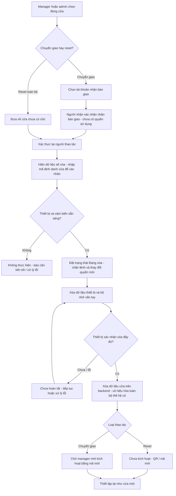

1. Kiểm tra quyền: manager phải là chủ cửa hiện tại; admin phải có quyền reset/chuyển giao cấp hệ thống. Thành viên không được dùng hai thao tác này, kể cả gọi API trực tiếp.
2. Chuyển giao chọn định danh người nhận và yêu cầu người đó chấp nhận; việc chấp nhận chỉ dành quyền kích hoạt sau reset, chưa mở quyền điều khiển. Admin không cần chủ cũ phê duyệt thêm; manager không được chọn cửa của người khác.
3. Yêu cầu xác thực lại tài khoản đang thao tác, nhập mã định danh cửa và xác nhận nội dung **“Xóa toàn bộ dữ liệu cửa, không thể khôi phục”**. Admin ghi lý do nghiệp vụ; không yêu cầu biết PIN của chủ cũ.
4. Kiểm tra khả năng kết nối/xóa của ESP32 và cảm biến vân tay. Khi chưa gửi bước xóa, có thể hủy và giữ dữ liệu cũ. Cửa offline: không xếp lệnh phá hủy âm thầm chờ chạy lúc bất kỳ, không cấp QR mới và không báo hoàn tất.
5. Khi bắt đầu xóa, đóng các phiên đăng ký/điều khiển và không cho tạo lệnh mở, sửa quyền hoặc nhận chủ mới. Firmware từ chối credential cũ từ khi vào chế độ reset; quá trình không tự mở hoặc tự đóng cơ cấu để minh họa reset. Lệnh cơ khí đang chạy phải kết thúc an toàn trước bước xóa cấu hình.
6. Xóa và kiểm chứng từng nhóm dữ liệu trên thiết bị, bao gồm bộ nhớ của cảm biến vân tay. Có lỗi ở một nhóm thì giữ trạng thái chưa hoàn tất, không quay lại sử dụng quyền cũ hoặc cho người nhận kích hoạt sớm.
7. Xóa dữ liệu cửa trên backend; vô hiệu hóa mã, phiên, lệnh và thông tin xác thực cũ. Chỉ sau khi hai phía đã hoàn tất mới chuyển thành cửa mới và sinh mã/QR mới.
8. Sau chuyển giao, mã mới chỉ cho tài khoản đã nhận bàn giao kích hoạt trong thời hạn; không tạo ngay trạng thái đang sử dụng. Sau reset không chỉ định người nhận, giao mã mới theo quyền nhận mã của lượt reset. QR cũ không hoạt động trở lại.

#### 7.6.2. Dữ liệu phải xóa

| Nơi lưu | Xóa toàn bộ dữ liệu thuộc lượt sử dụng cũ của cửa |
|---|---|
| Backend | Liên kết chủ/thành viên, lời mời, quyền truy cập, credential và liên kết ID vân tay, PIN/hash PIN cửa, tên/vị trí do chủ cũ đặt, cấu hình cá nhân, lệnh/kết quả, lịch sử ra vào, cảnh báo, nhật ký quản lý cửa và dữ liệu đồng bộ cũ |
| ESP32 | PIN mở cửa và PIN quản trị cục bộ, salt/hash, danh sách thẻ/vân tay được phép, Wi-Fi và mật khẩu, thông tin phiên chủ cũ, chính sách, log chờ gửi, ACK/lệnh đã nhớ, số lần sai PIN và cấu hình người dùng trong NVS |
| Module vân tay | Toàn bộ template đã lưu trên chính cảm biến, kể cả mẫu cũ chưa gán người; kiểm tra bộ nhớ không còn mẫu trước khi báo thành công |
| Face node / dữ liệu FACE theo cửa | Yêu cầu/phê duyệt, liên kết và cache khuôn mặt thuộc cửa/lượt sử dụng cũ; giữ hồ sơ chung của tài khoản và quyền tại các cửa khác như mục 5.3 |
| Cấu hình lắp đặt | Hiệu chuẩn touch, mức cảm biến từ và góc servo riêng của lượt dùng cũ; trả về trạng thái cần thiết lập, không tự quay servo theo góc mặc định chưa kiểm chứng |
| Mobile / kết nối đang mở | Xóa cửa và cache dữ liệu cũ khỏi giao diện, đóng kênh theo dõi cũ; thông báo cho chủ/thành viên bị thu hồi khi họ kết nối. Không thể bảo đảm xóa tức thì bản cache trên điện thoại đang offline |

**Phạm vi “cửa hoàn toàn mới”:** xóa dữ liệu của cửa, không xóa tài khoản người dùng toàn hệ thống hoặc dữ liệu/quyền ở các cửa khác. Thẻ RFID vật lý không bị ghi/xóa nội dung; UID của thẻ cũ chỉ mất quyền tại cửa này. Dữ liệu vân tay trên các cảm biến của cửa khác không bị ảnh hưởng.

Giữ firmware, serial/mã định danh phần cứng và cấu hình gốc tối thiểu để thiết bị có thể chạy chế độ thiết lập như sản phẩm mới. Thông tin xác thực gắn với lượt sử dụng cũ phải bị thu hồi/thay mới; định danh gốc để ghép lại không cho truy cập quyền cũ. Có thể lưu **biên nhận reset mới tối thiểu** gồm mã thao tác, thiết bị, tiến độ/kết quả và thời điểm để xử lý mất kết nối; biên nhận không giữ nội dung PIN, credential, thành viên hay lịch sử đã xóa. Bản sao lưu/xuất dữ liệu nếu tồn tại cũng phải có cơ chế xóa hoặc vô hiệu hóa dữ liệu lượt cũ; chỉ ẩn trên UI không được coi là xóa hết.

#### 7.6.3. Mất kết nối và chống khôi phục dữ liệu cũ

- Reset có mã thao tác duy nhất và tiến độ bền vững. Gửi lại request, ACK trùng hoặc bật nguồn lại chỉ tiếp tục lần reset đó, không reset lần nữa sau khi cửa đã thuộc lượt sử dụng mới.
- Xóa Wi-Fi/secret phiên cũ phải được sắp xếp sau bước có thể lưu và trả bằng chứng reset; không xóa đường liên lạc rồi mặc định coi ESP32 đã hoàn tất. Thiết bị có thể trả biên nhận qua phiên hiện tại hoặc kênh thiết lập cục bộ được xác thực.
- Module vân tay mất kết nối, xóa template lỗi, mất điện giữa chừng hoặc backend chưa xóa xong: hiện **“Reset chưa hoàn tất”**; cửa không được phát mã kích hoạt mới, không phục hồi quyền cũ. Khi kết nối lại tiếp tục xóa/kiểm chứng.
- Mỗi lượt sử dụng có thế hệ riêng. Sau reset, lệnh, snapshot, event/ACK và QR của thế hệ cũ bị từ chối, kể cả bản tin MQTT đến muộn; không nhập lại log hoặc danh sách quyền vừa xóa.
- Sau khi bắt đầu xóa không có nút “Hoàn tác”. Nếu người nhận chuyển giao đổi ý sau đó, cửa giữ trạng thái mới chưa kích hoạt; chỉ thay người nhận qua một thao tác hợp lệ, không khôi phục dữ liệu chủ cũ.
- Sau reset phải thiết lập Wi-Fi, PIN và hiệu chuẩn lại trước sử dụng. Thành viên/thẻ/vân tay cũ đều phải được cấp/đăng ký mới nếu muốn tiếp tục dùng.

## 8. Các trạng thái giao diện phải phân biệt

| Nhóm | Giá trị hiển thị | Ý nghĩa |
|---|---|---|
| Reset / chuyển giao | Chờ xác nhận / Kiểm tra thiết bị / Đang xóa / Chưa hoàn tất / Đã reset / Chờ chủ mới kích hoạt | Chỉ báo thành công sau khi đã kiểm chứng xóa dữ liệu thiết bị, cảm biến và backend |
| Kích hoạt cửa | Chưa kích hoạt / Đang xác nhận / Đang thiết lập / Đã kích hoạt / Mã bị thu hồi | Tách việc admin tạo mã, manager nhận cửa và thiết bị hoàn tất cấu hình; xem chi tiết mục 7 |
| Kết nối | Online / Offline / Chưa có dữ liệu | Dựa vào heartbeat, không dựa vào việc app có mạng |
| Cánh cửa | Đóng / Mở / Không rõ | Từ cảm biến từ; dữ liệu quá cũ phải chuyển Không rõ hoặc ghi rõ là lần cuối |
| Chốt | Đã gửi lệnh khóa / Đã gửi lệnh nhả / Lỗi / Không rõ | Trạng thái lệnh servo; không phải xác nhận chốt vật lý |
| Lệnh mở | Đang tạo / Đã gửi / Thiết bị xác nhận / Thất bại / Chưa rõ kết quả | Theo mã lệnh và ACK, có thời hạn |
| Quyền | Đã lưu trên server / Chờ đồng bộ / Đã áp dụng / Lỗi / Xung đột | Gắn với phiên bản quyền mà thiết bị xác nhận |
| Đăng ký vân tay | Chờ lần 1 / Nhấc tay / Chờ lần 2 / Đang lưu / Hoàn tất / Hủy hoặc lỗi | Có timeout, không báo hoàn tất trước khi kết quả được lưu và xác nhận |

Thiết bị phần cứng hiện tại không có cảm biến chốt. Mobile/web không được ghi “chốt đã khóa an toàn” chỉ vì servo nhận lệnh hoặc cánh cửa báo đóng.

### 8.1. Vòng đời lệnh — đối chiếu trang 14 PDF

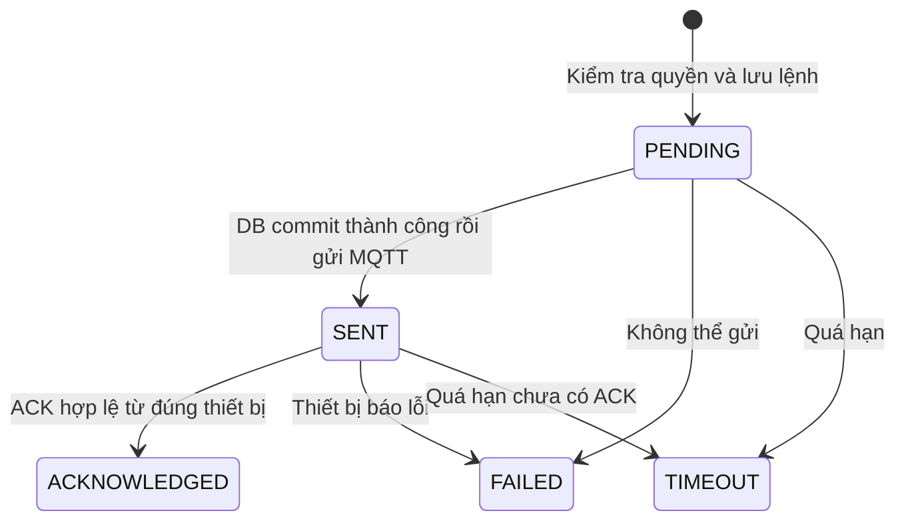

| Trạng thái | Cách hiểu trên giao diện |
|---|---|
| PENDING | Backend đã tiếp nhận và lưu, chưa xác nhận gửi xuống thiết bị |
| SENT | Đã gửi qua broker; chưa khẳng định thiết bị đã thực hiện |
| ACKNOWLEDGED | Đúng thiết bị xác nhận thao tác tương ứng; cập nhật kết quả/credential/PIN theo loại lệnh |
| FAILED | Có lỗi gửi hoặc ACK lỗi, kèm mã lỗi; lỗi đường truyền vẫn có thể cần kiểm tra trạng thái thực tế |
| TIMEOUT | Chưa có phản hồi đúng hạn; không đồng nghĩa chắc chắn cửa chưa nhả chốt |

- **Tham số tham chiếu từ slide, chờ chốt khi triển khai:** heartbeat dưới 90 giây để xem online, chờ lệnh mở 15 giây, lệnh thông thường khác 60 giây, quét timeout mỗi 5 giây. Đăng ký vân tay giữ timeout thao tác 45 giây; reset/chuyển giao có tiến độ riêng, không được coi là hoàn tất chỉ vì qua 60 giây.
- Hạn dùng lệnh tại ESP32 và thời gian app chờ ACK là hai điều kiện cần quản lý riêng: TTL ngăn thực thi lệnh quá cũ; timeout ACK thông báo thiếu kết quả. Không kéo dài TTL do reconnect/gửi lại.
- Chỉ gửi sau khi transaction DB đã commit; nếu rollback thì không có lệnh vật lý. ACK đối chiếu mã lệnh, thiết bị, thế hệ sử dụng và loại thao tác, không chỉ tin một cờ `success`.
- ACK muộn chỉ bổ sung kết quả của lệnh gốc, đánh dấu xác nhận muộn để đối soát; không phát lệnh mới. ACK trùng không đổi quyền lần hai hoặc mở servo lần hai.
- Lệnh thay đổi PIN/vân tay không báo đã áp dụng khi mới lưu yêu cầu trên server. Nếu thiếu phản hồi phải hiện Chờ xác nhận/Lỗi và có cách đối soát, không đoán đã tạo hoặc đã xóa mẫu.

### 8.2. Vòng đời thiết bị — đối chiếu trang 16 PDF, chờ duyệt chi tiết

**Ba nhóm độc lập:** vòng đời thiết bị, lượt kích hoạt/chủ sở hữu và kết nối online/offline. Không dùng một trường “trạng thái” để thay cả ba.

| Vòng đời | Ý nghĩa / giới hạn đề xuất |
|---|---|
| REGISTERED | Admin đã đăng ký chip và định danh gốc, chưa đủ điều kiện sử dụng |
| PROVISIONED | Thiết bị đã gắn với hồ sơ sản phẩm và thông tin cấp phát; chưa tự cấp quyền chủ cửa |
| ACTIVE | Đã có heartbeat xác thực hợp lệ và đủ điều kiện vận hành; điều khiển còn phải kiểm tra Đã kích hoạt, đúng chủ/quyền và online |
| MAINTENANCE | Bảo trì có chủ đích; không nhận lệnh điều khiển/đăng ký thông thường. Chính sách thao tác tại chỗ phải thể hiện rõ, không tự mở/đóng cửa |
| SUSPENDED | Tạm dừng dịch vụ kết nối theo nghiệp vụ, có lý do và thông báo manager; không cho mở từ app/FACE hoặc đăng ký mới |
| DECOMMISSIONED | Ngừng sử dụng vĩnh viễn trong hệ thống, thu hồi credential dịch vụ; không đồng nghĩa reset để bán/nhận lại |

- Heartbeat đầu tiên không tự chọn chủ cửa, không tự hoàn tất PIN/Wi-Fi và không bỏ qua flow QR. ACTIVE nhưng chưa kích hoạt xong vẫn không được dùng API mở cửa.
- ACTIVE có thể offline; mất mạng không tự biến thành SUSPENDED hay DECOMMISSIONED. UI hiển thị cả vòng đời và thời điểm heartbeat cuối.
- Admin quản lý vòng đời nghiệp vụ không được xem hoặc sửa trực tiếp danh sách quyền/ảnh/PIN của manager. Tạm dừng dịch vụ cloud không chứng minh đã chặn xác thực cục bộ trên một cửa offline; phải báo giới hạn này, không tuyên bố khóa vật lý tức thì.
- Đưa vào bảo trì/thay đổi trạng thái có audit và hiển thị tác động trước khi thực hiện. Ranh giới ai được chọn từng trạng thái và chính sách cục bộ là đề xuất cần duyệt, không ngầm mở rộng quyền admin.
- **Reset/chuyển giao khác ngừng sử dụng:** reset hợp lệ mở một lượt sử dụng mới sau khi xóa được xác nhận, giữ chip và định danh sản phẩm để kích hoạt lại. DECOMMISSIONED là trạng thái kết thúc, không dùng cho thao tác reset thông thường. Thay chip thực hiện đăng ký/thay thiết bị riêng.

## 9. Cơ chế tự khóa giữ theo bản offline

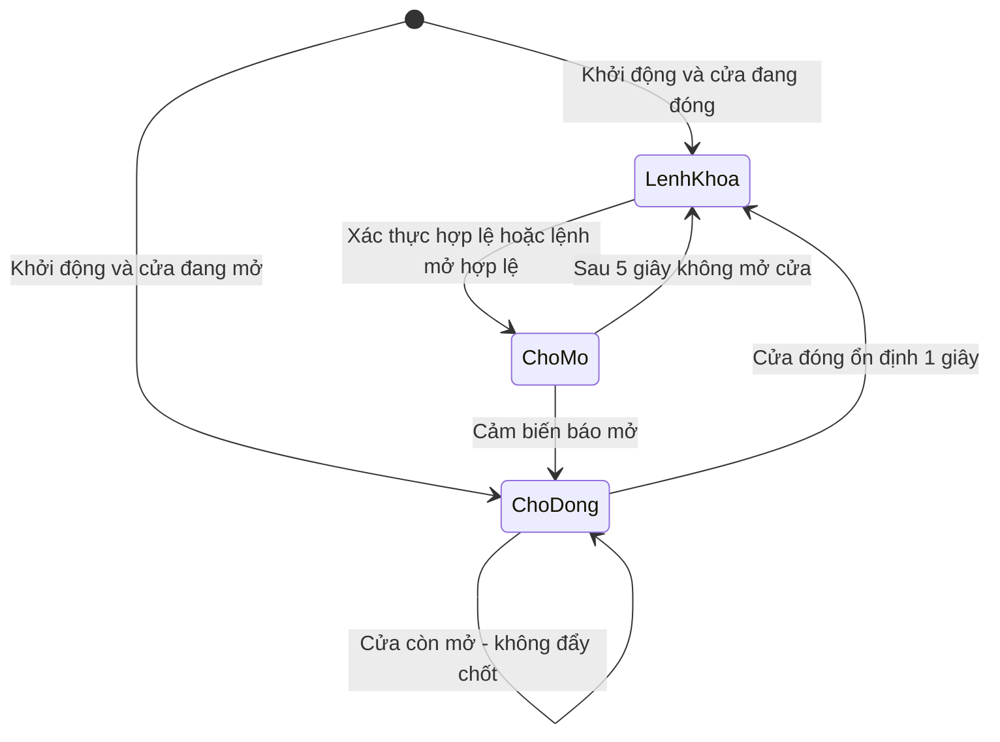

- Cảm biến từ lọc nhiễu; mở lại trong lúc chờ đóng ổn định sẽ tính lại thời gian.
- Cửa mở liên tục quá 20 giây: cảnh báo màn hình và gửi sự kiện khi có kết nối.
- Task servo hoạt động riêng, không chờ HTTP/MQTT/UART. Cấu hình cơ khí vẫn chỉnh trực tiếp tại cửa để người chỉnh quan sát cơ cấu.

### 9.1. Luồng xác thực cục bộ RFID, vân tay và PIN — trang 9 PDF

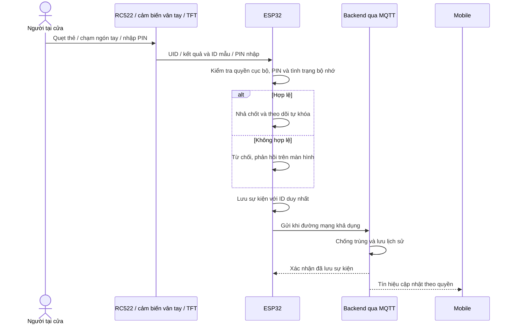

- Quyết định cục bộ không chờ backend; sự kiện có kết quả đã thực hiện và phiên bản quyền tại thời điểm đó. Thu hồi quyền trên server sau này không được sửa một lần mở thực tế trong quá khứ thành lần bị từ chối.
- PIN chung không định danh cá nhân; vân tay không khớp/UID không có hồ sơ không được gán bừa người dùng. Lịch sử quản trị và lịch sử ra vào vẫn tách biệt.
- Ghi sự kiện bền vững gắn với quyết định trước khi kết thúc xử lý truy cập khi bộ nhớ còn hoạt động. Tình huống đầy hàng đợi theo lựa chọn D7; lỗi ghi bộ nhớ phải báo rõ, không tuyên bố đã lưu log thành công.
- Không ghi PIN rõ, ảnh hoặc template vân tay vào payload sự kiện. Chỉ xóa log đã gửi sau ACK lưu DB; gửi lại không tạo thêm lịch sử. Giới hạn dung lượng/chu kỳ ghi cần kiểm thử với flash thực tế.

## 10. Mất mạng, thu hồi quyền và đồng bộ lại

| Tình huống | Hành vi đề xuất |
|---|---|
| Face node / backend / đường lệnh tới ESP32 mất kết nối | FACE tạm không khả dụng; không mở offline và không gửi lại kết quả nhận diện cũ sau reconnect. Dùng PIN/RFID/vân tay được cấp tại cửa |
| ESP32 mất mạng | PIN/RFID/vân tay tiếp tục theo quyền cục bộ gần nhất; mở từ app không khả dụng |
| Điện thoại mất mạng | Có thể xem cache được đánh dấu cũ; không cho mở từ xa; dùng phương thức tại cửa |
| Chủ cửa sửa quyền trên mobile khi cửa offline | Server lưu thay đổi và hiện Chờ đồng bộ; chưa tuyên bố đã thu hồi tại thiết bị |
| Admin khóa tài khoản cấp hệ thống | Chặn phiên và mở từ app; loại tài khoản khỏi quyền có hiệu lực khi đồng bộ, báo chủ cửa; không sửa/xóa quyền gốc do chủ cửa cấp |
| ESP32 nối lại | Đồng bộ thời gian, phiên bản và thay đổi bảo mật trước; gửi log tồn; phản hồi phiên bản đã áp dụng |
| Lệnh mở cũ | Hết hạn thì bỏ, không phát lại như một lệnh mới |
| Reset ESP32 | Giữ quyền/cấu hình đã lưu, giữ cơ chế sai PIN và hành vi khởi động theo trạng thái cửa |
| Hàng đợi log đầy | Đề xuất vẫn cho mở cục bộ bằng quyền hợp lệ, ghi nhận khoảng mất log và cảnh báo chủ cửa; không giữ cửa bất khả dụng chỉ vì server mất lâu |

### Quyền thay đổi từ mobile của chủ cửa và ngay tại TFT

- Sau khi chuyển sang quản lý tập trung, chủ cửa quản lý quyền trên mobile; backend lưu và đồng bộ chính sách. Web admin không phải nơi cấp quyền cửa. Thao tác tạo quyền mới/PIN mở cửa trên TFT được thực hiện qua phiên bảo trì do chủ cửa xác thực và đồng bộ được xác nhận.
- Khi mất mạng, TFT vẫn cho **thu hồi khẩn cấp** quyền đang có bằng PIN quản trị cục bộ. Thay đổi được lưu bền vững cùng dấu thu hồi, gửi lên server khi nối lại.
- Snapshot cũ không được tự cấp lại một quyền đã thu hồi khẩn cấp. Nếu hai phía có thay đổi chồng nhau, giữ trạng thái hạn chế hơn, hiện Xung đột và yêu cầu chủ cửa giải quyết trên mobile; cấp lại phải là thao tác mới có xác nhận.
- Không bổ sung credential mới từ xa khi offline. Chế độ offline độc lập vẫn là một chế độ riêng; không âm thầm hòa trộn hai danh sách quyền.
- Thu hồi tức thời tại cửa đang mất mạng không thể bảo đảm chỉ bằng thao tác mobile. Khi cần gấp, chủ cửa phải thực hiện tại cửa bằng quyền quản trị cục bộ.

### Lịch sử khi offline

- Bổ sung hàng đợi bền vững vào firmware kết nối: mỗi sự kiện có ID duy nhất, phương thức, kết quả, định danh credential nếu có và chất lượng thời gian.
- Backend chống trùng khi nhận lại; thiết bị chỉ bỏ sự kiện sau xác nhận lưu thành công. Bật lại điện không tự mất phần hàng đợi đã lưu.
- Nếu chưa có giờ tin cậy, lưu giờ nhận server và cờ “Thời gian thiết bị chưa đồng bộ”; không tạo thời điểm ra vào chính xác giả.
- Log cũ không được dùng để ghi đè trạng thái cánh cửa hiện tại. Thu hồi riêng một credential vẫn giữ lịch sử phù hợp; riêng reset toàn bộ/chuyển giao tại mục 7.6 xóa cả lịch sử lượt sử dụng cũ và từ chối gửi lại.

### 10.1. Phân biệt mất Internet, mất LAN và mất dịch vụ — trang 15 PDF

| Kịch bản demo | PIN/RFID/vân tay cục bộ | FACE | Mobile điều khiển |
|---|---|---|---|
| Đủ kết nối cần thiết | Theo quyền cục bộ | Phải đã được duyệt và đủ dịch vụ | Theo quyền, ACK và trạng thái thiết bị |
| ESP32 ở LAN khác backend, cả hai tới được broker ổn định | Tiếp tục | Dùng nếu node cũng có đủ đường BE/broker | Dùng khi điện thoại tới được BE; không yêu cầu cùng Wi-Fi |
| Nơi đặt cửa mất Internet, broker ở ngoài LAN theo phương án A | Tiếp tục | Tạm ngừng vì không gửi được lệnh tới ESP32 | Không mở từ xa dù điện thoại và BE vẫn online |
| Mất Internet công cộng nhưng LAN, broker, BE và node còn truy cập nhau | Tiếp tục | Vẫn online với BE nội bộ nên được dùng | Chỉ dùng nếu điện thoại thực sự còn tới được BE/thiết bị; không mặc định đường Tailscale luôn còn khả dụng |
| ESP32 mất Wi-Fi / broker không tới được ESP32 | Tiếp tục theo quyền đã lưu | Không mở được vì không gửi được lệnh tới cửa | Không mở từ xa |
| BE hoặc broker dừng | Tiếp tục | Tạm ngừng | Không điều khiển; không báo thành công từ cache |
| Camera/Face node dừng, phần còn lại bình thường | Tiếp tục | Tạm ngừng | Các thao tác được cấp khác vẫn có thể hoạt động |
| Chỉ điện thoại mất kết nối BE | Tiếp tục | Vẫn có thể dùng tại cửa nếu node, BE và ESP32 còn kết nối đủ | Không điều khiển bằng điện thoại đó |

Vì vậy “FACE chỉ online” nghĩa là đủ đường tới backend để kiểm tra quyền và gửi lệnh; không đổi thành FACE offline khi mạng nội bộ còn hoạt động nhưng Internet công cộng bị ngắt. Khi reconnect, đồng bộ lại quyền và log, không phát lại thao tác mở hoặc kết quả nhận diện cũ.

## 11. Backend cần cung cấp cho hai giao diện

| Nhóm nghiệp vụ | Trách nhiệm |
|---|---|
| Kiểm tra kết nối | Endpoint health tối thiểu trước đăng nhập, nhận diện đúng Smart Door/API và trạng thái sẵn sàng; cấu hình truy cập demo Tailscale |
| Auth và hồ sơ | Người dùng tự quản lý hồ sơ/mật khẩu; admin quản lý trạng thái tài khoản và audit, không đăng nhập thay |
| Danh mục hệ thống | Admin tạo hồ sơ cửa/thiết bị, sinh mã nhận cửa/QR bàn giao trước khi có chủ; API web trả metadata/trạng thái, không trả credential hay lịch sử ra vào cá nhân |
| Kích hoạt và sở hữu | Kiểm chứng QR/mã, giữ chỗ nhận cửa, xác nhận tại thiết bị, tiếp tục thiết lập, chống nhận đồng thời và chốt chủ sở hữu; mã đã dùng không cho nhận lại |
| Reset và chuyển giao | API riêng cho manager/admin có xác thực lại; tiến độ xóa ESP32/cảm biến/BE, thế hệ sử dụng, chống lặp, thu hồi dữ liệu cũ và cấp QR mới chỉ sau khi hoàn tất |
| Cửa và thành viên | API mobile của chủ cửa kiểm tra ownership theo từng cửa; lời mời, quyền riêng theo phương thức, rời/thu hồi membership |
| Thiết bị | Ghép/thay thế thông thường do chủ cửa xác nhận; reset/chuyển giao manager/admin qua flow riêng; heartbeat và phiên bản phục vụ vận hành, không nhận quyền bằng sửa metadata |
| Điều khiển | Kiểm tra quyền, chống gửi trùng, lệnh có hạn dùng, ACK, trạng thái chưa rõ và tra cứu kết quả |
| Credential | RFID, liên kết ID vân tay, đổi PIN chung; phiên đăng ký và thu hồi có theo dõi kết quả |
| Hồ sơ khuôn mặt | Một hồ sơ chung theo tài khoản, upload/kiểm tra ảnh/phiên bản; API xem ảnh riêng tư, xóa hồ sơ và cache liên quan |
| Yêu cầu FACE theo cửa | Người dùng gửi/hủy; đúng chủ cửa duyệt/từ chối/thu hồi; kiểm tra membership và phiên bản, chống trùng và không vượt quyền giữa các cửa |
| Nhận diện tại cửa | Xác thực và gắn Face node với cửa; cấp đúng hồ sơ đã được duyệt; kiểm tra quyền FACE hiện tại trước lệnh mở và theo dõi ACK |
| Đồng bộ | Phiên bản chính sách, xác nhận áp dụng, nhập quyền cũ, xung đột và thu hồi khẩn cấp |
| Lịch sử và cảnh báo | Chống trùng, phân quyền xem, phân biệt thời gian sự kiện/nhận, cửa mở lâu và lỗi thiết bị |
| Nhật ký | Tách nhật ký quản lý cửa cho chủ cửa và nghiệp vụ hệ thống cho admin; mỗi API chỉ trả phạm vi tương ứng |
| Cập nhật giao diện | Đẩy tín hiệu cập nhật và tải lại dữ liệu theo quyền; có lấy lại dữ liệu khi reconnect |

Tận dụng các nhóm API hiện có: `/api/auth`, `/api/accounts/me`, `/api/units`, `/api/manager`, `/api/admin/devices`, `/api/admin/accounts`, `/api/access-logs`, `/api/alerts` và `/ws/updates`. Nhóm `/api/manager` phục vụ chủ cửa trên mobile; nhóm `/api/admin` chỉ phục vụ nghiệp vụ hệ thống. Cần rà soát kiểm tra quyền và dữ liệu trả về của cả API cũ; ẩn nút trên web không đủ. Đây là nền để đối chiếu, không phải cam kết mọi flow mới đã có endpoint. Chốt API chi tiết sau khi duyệt nghiệp vụ.

Mật khẩu tài khoản, PIN và secret không được lưu rõ trong log/audit. PIN mới chỉ truyền qua kênh mã hóa tới đúng thiết bị, không để plaintext trong bản ghi lệnh bền vững. Phương án lưu/gửi dữ liệu nhạy cảm phải được kiểm thử trước khi dùng thật.

### 11.1. Phiên đăng nhập và ranh giới bảo mật — trang 11 PDF

- Mật khẩu tài khoản băm BCrypt; PIN có cơ chế băm riêng phù hợp ở server/ESP32, không dùng chung với mật khẩu đăng nhập hoặc PIN quản trị cục bộ.
- Session cookie + CSRF: lấy token trước request cần bảo vệ, thay session ID khi đăng nhập và lấy lại CSRF sau khi đổi phiên. API không trả `passwordHash`, PIN/hash PIN hoặc device secret trong dữ liệu danh sách.
- Mỗi request kiểm tra tài khoản còn ACTIVE và đúng quyền đối tượng. Khóa tài khoản hoặc đổi mật khẩu thu hồi mọi phiên cũ; WebSocket tương ứng cũng phải bị đóng. Phương thức FACE kiểm tra quyền hiện tại trước từng lệnh, không chỉ khi cache hồ sơ.
- REST, ảnh/upload và WebSocket đều kiểm tra quyền; Origin/CORS theo danh sách nguồn cần dùng cho web. CORS không thay thế xác thực/phân quyền và không dùng ký tự đại diện để chữa mọi lỗi demo.
- Admin vẫn chỉ có phạm vi ở mục 3/6, ngoại lệ reset/chuyển giao ở 7.6. Trang 4 PDF ghi “giám sát toàn hệ thống” không được diễn giải thành quyền đọc mọi ảnh hoặc lịch sử cá nhân.
- Cấu hình server và secret ở môi trường triển khai, không đóng gói credential đặc quyền vào mobile/web. Địa chỉ BE được nhập trên app là cấu hình kết nối, không phải bí mật xác thực.

### 11.2. Hợp đồng truyền thông ở mức flow — trang 8, 10 và 12 PDF

| Luồng | Dữ liệu tối thiểu / điều kiện |
|---|---|
| REST mobile/web → BE | Phiên, CSRF khi cần, đối tượng cửa/tài khoản, dữ liệu thao tác; server tự xác định người thực hiện |
| BE → ESP32 qua MQTT | Mã lệnh, loại lệnh, đúng thiết bị, thế hệ sử dụng, thời điểm phát/thời hạn và dữ liệu cần thiết |
| ESP32 → BE: ACK | Mã lệnh, định danh/xác thực thiết bị, thế hệ, kết quả và lý do; không dùng ACK của thiết bị khác |
| ESP32 → BE: trạng thái | Heartbeat, trạng thái cánh cửa, lệnh chốt gần nhất, cảm biến/lỗi và phiên bản quyền đã áp dụng |
| ESP32 → BE: sự kiện | ID sự kiện duy nhất, phương thức/kết quả, thông tin định danh phù hợp, thời gian/chất lượng thời gian và phiên bản quyền |
| BE → ESP32: quyền và xác nhận lưu | Snapshot đúng cửa/thế hệ/phiên bản, ACK lưu log và xác nhận ACK lệnh; không tự khôi phục dữ liệu đã reset |
| Face node → BE qua MQTT | Node được xác thực và gắn đúng cửa, mã lần nhận diện, phiên bản hồ sơ, thời điểm và kết quả kiểm tra người thật; không gửi trực tiếp lệnh tới ESP32 |
| BE → mobile/web qua WebSocket | Tín hiệu cần cập nhật theo phiên/quyền; client tải lại dữ liệu được phép qua REST, có reconnect/lấy lại trạng thái |

Broker có quyền theo thiết bị; command mở và kết quả nhận diện không retained. Phản hồi/phát lại ở tầng ứng dụng phải chống trùng; thông điệp đến muộn hoặc thuộc thế hệ cũ không được mở cửa hay ghi lại dữ liệu đã xóa. Số topic trong bản mới chốt theo các luồng thực tế, không ép giữ con số “4 topic” của slide kết quả cũ.

## 12. Thứ tự thực hiện sau khi được duyệt

1. **Chốt hợp đồng chung:** vai trò, trạng thái, dữ liệu và API; lưu bản firmware offline đã test làm mốc có thể quay lại.
2. **Backend:** quyền, tài khoản, ghép thiết bị, lệnh và đồng bộ; hồ sơ khuôn mặt chung, yêu cầu/duyệt theo cửa và tích hợp Face node; kiểm thử quyền chéo cửa, gửi trùng và timeout.
3. **Web admin:** đăng nhập, trạng thái tài khoản, tạo hồ sơ cửa/thiết bị, QR bàn giao, reset/chuyển giao có xác nhận và tiến độ; giữ giới hạn không xem/sửa dữ liệu truy cập thông thường.
4. **Mobile dùng chung:** cấu hình BE Tailscale, kích hoạt/thiết lập cửa; đăng ký ảnh một lần, gửi yêu cầu FACE và chủ cửa duyệt trên cùng app; quản lý theo vai trò, chuyển giao/reset và kích hoạt lại.
5. **Firmware kết nối:** chế độ thiết lập cục bộ, Wi-Fi, ACK và hàng đợi log; thêm quy trình xóa NVS/template cảm biến có kiểm chứng, tiếp tục sau mất điện và từ chối dữ liệu thế hệ cũ. Giữ dữ liệu offline khi nâng cấp bình thường, chỉ xóa khi có thao tác reset/chuyển giao rõ ràng.
6. **Kiểm thử xuyên suốt trên cửa:** cấp mã → kích hoạt → dùng cửa; đăng ký mặt → xin từng cửa → duyệt → nhận diện; mất mạng/thu hồi và reset/chuyển giao → kiểm chứng dữ liệu cũ không còn → chủ mới thiết lập.

Web/mobile có thể phát triển dựa trên API trước; chức năng điều khiển được coi là hoàn tất khi đã xác nhận trên ESP32, không chỉ qua dữ liệu demo. Face AI đã được bổ sung vào phạm vi hiện tại theo yêu cầu mới; cần kiểm thử camera/Face node riêng với cửa. Giai đoạn 2 mới xem xét push khi app đóng, BLE, OTA và quyền truy cập theo lịch.

## 13. Tiêu chí để duyệt nghiệm thu sau triển khai

- Cài app lần đầu nhập được IP BE + cổng; kết nối thành công qua Tailscale rồi mới tới đăng nhập. Đóng/mở app giữ địa chỉ, không cần build lại khi đổi IP.
- Sai IP/cổng, Tailscale chưa kết nối hoặc backend dừng có thông báo và nút sửa/thử lại; cấu hình cũ không bị mất khi thử server mới thất bại.
- Đổi backend không mang phiên/cache/WebSocket/request cũ sang server mới; mọi API và tài nguyên dùng đúng địa chỉ được chọn.
- Admin tạo hồ sơ và xuất được QR/mã bàn giao; không tự có ownership, PIN hoặc quyền điều khiển từ thao tác tạo sản phẩm.
- Manager nhận được đúng cửa bằng quét QR hoặc nhập tay; mã sai/đã dùng/cửa có chủ bị từ chối, hai tài khoản không thể đồng thời nhận một cửa.
- Cấu hình Wi-Fi/PIN có xác nhận thiết bị; sai mật khẩu, tắt app, reset hoặc chuyển Wi-Fi không mất bước đã lưu và không báo kích hoạt xong trước khi đủ điều kiện.
- Mã tra cứu công khai, QR đã dùng hoặc tự xóa flash không cho tài khoản khác chiếm cửa; mã nhận mới chỉ cấp sau reset/chuyển giao hợp lệ được thiết bị và BE xác nhận, không sửa thẳng owner.
- Người dùng chỉ thấy đúng cửa và lịch sử được phép; đổi `unitId`/ID tài khoản không vượt quyền.
- Người dùng/chủ cửa dùng chung mobile, quyền đổi theo cửa được chọn; chủ cửa A không quản lý được cửa B nếu chỉ là thành viên B.
- Một hồ sơ khuôn mặt được dùng để gửi yêu cầu cho nhiều cửa, không bắt upload lại; chỉ các cửa được chủ cửa duyệt mới cho mở bằng FACE.
- Chờ duyệt/từ chối/hủy/thu hồi không mở được bằng khuôn mặt; duyệt ở A không mở B. Chỉ đúng chủ cửa được quyết định, admin và thành viên khác bị từ chối API duyệt/xem ảnh.
- Ảnh không hợp lệ, hồ sơ bị thay/xóa, membership bị thu hồi và reset cửa không để yêu cầu cũ cấp lại quyền; cache node cũ không vượt được kiểm tra hiện tại trên backend.
- Kết quả nhận diện phải từ node gắn đúng cửa, theo kiểm tra người thật đã cấu hình; tải ảnh đăng ký không trực tiếp mở cửa. Ngắt Face node/BE/broker/ESP32 đều phải làm FACE không khả dụng; reconnect không tự mở từ kết quả cũ, quyền duyệt còn hợp lệ không bắt upload/xin duyệt lại chỉ vì mất mạng.
- Admin không mở cửa, đổi riêng PIN, xem lịch sử ra vào cá nhân hoặc sửa thành viên/quyền bằng API quản trị. Chuyển giao/reset là quyền riêng theo mục 7.6; gọi API khác không được suy rộng quyền này.
- Manager chỉ reset/chuyển giao cửa mình quản lý; admin có flow tương ứng trên web, thành viên bị từ chối. Cả hai vai trò phải xác thực lại và xác nhận xóa.
- Reset/chuyển giao xóa PIN, RFID, template trên cảm biến, Wi-Fi, hiệu chuẩn, chủ/thành viên, lịch sử và dữ liệu cửa cũ ở BE; không xóa tài khoản hoặc dữ liệu cửa khác.
- Thiết bị offline, cảm biến không xóa được hoặc mất điện giữa chừng không báo thành công; tiếp tục đúng tiến độ, không phát QR mới sớm hoặc phục hồi quyền cũ.
- Chủ mới không dùng được PIN/thẻ/vân tay cũ; snapshot/lệnh/log đến muộn không tái tạo dữ liệu đã xóa. QR mới yêu cầu thiết lập lại; admin không nhận được nội dung dữ liệu cũ qua flow reset.
- Khóa tài khoản cấp hệ thống có audit và thông báo ảnh hưởng nhưng giữ nguyên cấu hình quyền của chủ cửa; mở khóa không khôi phục quyền đã bị chủ cửa thu hồi.
- Thêm/xóa thẻ và vân tay có kết quả đúng ở cả server lẫn thiết bị; giữ trạng thái chờ/lỗi nếu chưa ACK.
- Mở từ app đúng cửa, không mở lại khi bấm lặp, không thực hiện lệnh hết hạn sau reconnect.
- UI phân biệt cánh cửa, kết nối và lệnh servo; phản hồi muộn không biến thành một lần mở mới.
- Mất mạng/backend/đọc UART chậm không làm mất tự khóa; đóng/mở lại và reboot giữ hành vi bản đã test.
- Đồng bộ/nâng cấp bình thường giữ cấu hình cơ khí và quyền cục bộ; chỉ reset/chuyển giao đã được manager/admin xác nhận mới xóa toàn bộ theo mục 7.6.
- Thu hồi offline được trình bày đúng giới hạn; quyền đã thu hồi tại TFT không bị snapshot cũ cấp lại.
- Lịch sử chống trùng và không gán người cho PIN chung; mất log phải được thể hiện rõ.
- Không để mật khẩu/secret/PIN rõ trong app bundle, repo, response danh sách hoặc audit.

## 14. Yêu cầu đã xác nhận và các lựa chọn còn chờ duyệt

D1, D8 và flow nghiệp vụ D9–D11 đã được bạn xác nhận qua trao đổi; D2 được cập nhật để bao gồm khuôn mặt. Các mục còn lại là **đề xuất** chờ duyệt, trong đó D12/D13 mới được đối chiếu từ PDF. D10 bổ sung ngoại lệ reset/chuyển giao cho admin so với giới hạn D8 ban đầu. Yêu cầu nhập địa chỉ backend/Tailscale ở mục 4.1 cũng đã được xác nhận. Kênh thiết lập Wi-Fi cục bộ, cách xóa có kiểm chứng và cơ chế đổi phiên bản ảnh cần duyệt chi tiết khi triển khai.

| Mã | Nội dung | Phương án đề xuất |
|---|---|---|
| D1 | Chia vai trò giao diện — **đã xác nhận** | Người dùng và chủ cửa dùng chung mobile; web chỉ cho admin nghiệp vụ hệ thống |
| D2 | Phạm vi hiện tại — bổ sung FACE theo D11 | PIN/RFID/vân tay, mở từ xa, thành viên, lịch sử/cảnh báo; thêm hồ sơ khuôn mặt chung, yêu cầu/duyệt theo cửa và nhận diện bằng camera/Face node |
| D3 | Tạo tài khoản | Admin tạo/mời + mã kích hoạt một lần; không tự đăng ký rồi tự có quyền cửa |
| D4 | Quyền tại TFT khi đã quản lý tập trung | Duy trì PIN quản trị cục bộ; thu hồi khẩn cấp offline, tạo quyền mới qua phiên bảo trì/đồng bộ |
| D5 | PIN mở cửa | Giữ PIN chung 6 số như bản đã test, tách PIN quản trị; chủ cửa được đặt/đổi trên mobile nhưng không xem lại PIN đã lưu |
| D6 | Chuyển quyền cũ | Chủ cửa nhập danh mục trên mobile, gán người hoặc thu hồi có xác nhận; giữ quyền cũ tới khi chuyển chế độ thành công |
| D7 | Hàng đợi lịch sử đầy | Ưu tiên cửa tiếp tục dùng offline; báo khoảng mất log thay vì chặn mở cục bộ |
| D8 | Giới hạn admin — **đã xác nhận, bổ sung D10** | Quản lý nghiệp vụ tài khoản/danh mục cửa; không xem/sửa quyền cửa/PIN/credential hoặc mở cửa thông thường; có ngoại lệ reset/chuyển giao xóa dữ liệu theo D10 |
| D9 | Tạo và kích hoạt cửa — **đã xác nhận flow nghiệp vụ** | Admin tạo mã/QR tương ứng cửa → manager mua cửa và quét/nhập mã trên mobile → thiết lập Wi-Fi/PIN → thiết bị xác nhận → hoàn tất kích hoạt |
| D10 | Chuyển giao / reset toàn bộ — **đã xác nhận yêu cầu** | Manager và admin được thực hiện; xóa toàn bộ dữ liệu sử dụng của cửa ở thiết bị/cảm biến/BE, bỏ chủ cũ, cấp mã mới sau khi hoàn tất và thiết lập lại như cửa mới |
| D11 | Khuôn mặt — **đã xác nhận yêu cầu, chỉ online** | Tải ảnh một lần; xin và duyệt riêng từng cửa; chỉ dùng khi node/BE/đường lệnh ESP32 có kết nối. Không FACE offline hoặc mở lại từ nhận diện cũ sau reconnect |
| D12 | Khóa từ xa — **bổ sung từ PDF, chờ duyệt** | Nút Khóa ngay cho manager; ESP32 chỉ khóa khi cảm biến báo đóng ổn định. Không có cơ cấu đóng cánh cửa và không cấp thao tác này cho admin |
| D13 | Vòng đời thiết bị — **bổ sung từ PDF, chờ duyệt chi tiết** | REGISTERED/PROVISIONED/ACTIVE/MAINTENANCE/SUSPENDED/DECOMMISSIONED; tách trạng thái kết nối, kích hoạt và reset để tái sử dụng |
| D14 | Khác LAN — **yêu cầu đã chốt, phương án hạ tầng chờ duyệt** | Ưu tiên broker riêng có DNS/TLS qua Internet, ESP32 và BE đều nối ra; nếu giữ broker riêng trong tailnet phải có gateway/route phía cửa. LAN/mDNS chỉ phục vụ demo, không là kiến trúc triển khai chính |

Bạn có thể duyệt các mục còn lại hoặc trả lời theo mã, ví dụ: “Duyệt, riêng D7 cần lưu đủ lịch sử”. Sau khi bạn chốt, bản flow sẽ được cập nhật rồi mới bắt đầu triển khai theo phạm vi đã duyệt.

## 15. Đối chiếu PRESENTATION.pdf và yêu cầu đã chốt

| Trang PDF | Nội dung tài liệu | Áp dụng vào flow hiện tại |
|---|---|---|
| 2–3 | Xác thực đa phương thức, quản lý, điều khiển, giám sát; bảo mật/hiệu năng/độ tin cậy/mở rộng/dễ dùng | Giữ đủ PIN/RFID/vân tay/FACE và điều khiển theo quyền; bổ sung ma trận nghiệm thu, không coi mục tiêu định tính là kết quả đã đo |
| 4–5 | Admin quản lý Manager/thiết bị; Manager quản lý User, quyền, sinh trắc, PIN, lịch sử; User xin FACE và dùng phương thức được cấp | Phù hợp mô hình mobile dùng chung, web admin cấp hệ thống. Bổ sung mục Manager để tra cứu nghiệp vụ, không quyền truy cập mọi cửa |
| 6, 8 | Mobile/web ↔ BE/MySQL; MQTT cho ESP32 và Edge AI; WebSocket cập nhật app | Làm rõ luồng và hợp đồng ở mục 2/11.2; app không cầm secret broker |
| 7 | ESP32-S3, TFT, RC522, AS608, servo và buzzer 5V | Giữ phần cứng đã xác nhận trong README/test; cảm biến UART đang dùng được xác nhận qua giao tiếp, chưa coi tên AS608 trong slide là xác nhận model thực tế. Buzzer chưa thuộc cấu hình đã nối, không tự thêm GPIO/báo đã hoạt động |
| 9 | RFID/vân tay xác thực cục bộ → servo; gửi kết quả qua MQTT → lịch sử app | Bổ sung mục 9.1, kết quả xác thực cục bộ không phụ thuộc phản hồi BE; giữ phân biệt UID/ID mẫu/PIN chung và người dùng |
| 10 | Gửi khóa/mở từ app, kiểm tra quyền/TTL, MQTT, servo và ACK | Hoàn thiện vòng đời lệnh; khóa từ xa là đề xuất D12, không mặc định được duyệt chỉ vì có trong slide |
| 11 | Email/điện thoại, BCrypt, session/CSRF, thu hồi phiên, quyền theo cửa, CORS, biến môi trường và audit | Cụ thể hóa mục 4/11.1; không mặc định tài khoản admin vượt ownership |
| 12 | Camera laptop → Edge AI/OpenCV/InsightFace/liveness → broker → BE → ESP32/ACK | Giữ kiến trúc Edge AI; bổ sung yêu cầu mới của bạn là ảnh đăng ký một lần và duyệt theo từng cửa. Ảnh đăng ký không thay bước kiểm tra người thật khi mở |
| 14 | PENDING/SENT/ACKNOWLEDGED/FAILED/TIMEOUT; heartbeat 90s, mở 15s, khác 60s, quét 5s | Mục 8.1 dùng làm tham chiếu chờ chốt; timeout không khẳng định chưa mở và reset không dùng timeout chung để báo xong |
| 15 | Mất mạng vẫn xác thực cục bộ, đồng bộ log; FACE chỉ chạy khi BE nội bộ còn hoạt động | Mục 10.1 phân biệt mất Internet với mất đường dịch vụ; phù hợp yêu cầu FACE chỉ online, không bật cache offline |
| 16 | REGISTERED → PROVISIONED → ACTIVE; MAINTENANCE/SUSPENDED/DECOMMISSIONED | Bổ sung D13/mục 8.2. Không dùng heartbeat để chiếm chủ; reset bán lại khác ngừng sử dụng vĩnh viễn |
| 17 | Báo cáo hơn 20 API, 4 topic, 154 test/144 pass/10 bỏ qua và 3 tầng kiểm thử | Chỉ là số liệu trong tài liệu. Chưa chạy lại suite ở bước đọc PDF; cần chạy và báo số thực tế khi triển khai bản mới |
| Không nêu chi tiết trong PDF | Nhập IP BE/Tailscale, QR bán cửa, reset/chuyển giao xóa dữ liệu, hồ sơ mặt chung và duyệt riêng từng cửa | Giữ các yêu cầu bạn đã chốt, không bỏ hoặc sửa ngược theo slide cũ |

Các trang 1/13 là trang giới thiệu/kết thúc. Tham chiếu trang PDF giúp truy vết nguồn, không đồng nghĩa toàn bộ nội dung slide là yêu cầu bạn đã duyệt. D12/D13 và các tham số thời gian mới vẫn được đánh dấu đề xuất.

## 16. Ma trận demo/nghiệm thu sau triển khai

| Mã | Tình huống | Kết quả cần quan sát |
|---|---|---|
| DEMO-01 | Admin đăng ký chip, cấp QR; manager nhận đúng cửa | Liên kết chip/mã/owner đúng, admin không tự có quyền mở; quét A ghép B bị từ chối |
| DEMO-02 | Nhập BE Tailscale → đăng nhập bằng email/điện thoại → đổi BE | Giữ đúng server/phiên, không gửi request/credential của server cũ sang mới |
| DEMO-03 | Thiết lập Wi-Fi/PIN, sai mật khẩu hoặc tắt app giữa chừng | Không báo hoàn tất sớm; tiếp tục đúng bước, không mất cấu hình đã lưu |
| DEMO-04 | Owner cửa A, thành viên cửa B; thử gọi API quản lý B | App thay chức năng theo cửa và server chặn vượt quyền; admin web không đọc credential/lịch sử riêng |
| DEMO-05 | RFID/vân tay/PIN hợp lệ và không hợp lệ, có/mất mạng | Kết quả tại chỗ đúng, tự khóa độc lập; log đồng bộ lại đúng người/phương thức hoặc không gán người nếu không biết |
| DEMO-06 | App gửi mở, nhấn lặp, broker chậm, mất ACK hoặc ACK muộn | Không mở lặp, không kéo dài TTL; hiển thị chưa rõ kết quả khi cần, đối soát lệnh gốc |
| DEMO-07 | Nếu duyệt D12: khóa từ xa khi cửa đóng/mở/cảm biến lỗi | Chỉ phát lệnh khóa khi đóng ổn định; trạng thái không rõ hoặc cửa mở phải từ chối |
| DEMO-08 | Upload một ảnh, xin FACE ở A/B; A duyệt, B từ chối/chờ | Chỉ A được dùng, không upload lại ở B; ảnh không hợp lệ hoặc người không có membership không được cấp quyền |
| DEMO-09 | Thu hồi FACE/đổi ảnh/xóa hồ sơ, node còn cache | BE chặn quyền cũ trước lệnh mở; ảnh thay thế không tự thừa hưởng phê duyệt theo phương án phiên bản |
| DEMO-10 | Lần lượt ngắt Internet, Wi-Fi ESP32, broker, BE, node hoặc mạng điện thoại | Hành vi đúng ma trận 10.1, không mở bằng nhận diện cache; kết nối lại không tự phát lệnh mở |
| DEMO-11 | Khóa tài khoản/đổi mật khẩu trong lúc REST/WebSocket đang dùng | Phiên cũ mất hiệu lực; không xóa cấu hình quyền chủ cửa đã cấp, không phục hồi quyền đã thu hồi |
| DEMO-12 | Hàng đợi log gần đầy, gửi trùng, thời gian thiết bị chưa đồng bộ | Không tạo log trùng/thời gian giả; cảnh báo thiếu log và hành vi theo D7, không sửa sai sự kiện đã xảy ra |
| DEMO-13 | Manager/admin reset/chuyển giao, cảm biến lỗi hoặc mất điện giữa chừng | Không báo xong/cấp QR mới sớm; kiểm chứng xóa cả template module và dữ liệu BE; quyền/lệnh cũ không quay lại |
| DEMO-14 | Nếu duyệt D13: ACTIVE nhưng offline, bảo trì/tạm dừng/ngừng sử dụng | UI tách đúng trạng thái; không tự gán owner, không tái kích hoạt thiết bị đã ngừng sử dụng bằng QR cũ |
| DEMO-15 | ESP32 ở Wi-Fi A, backend ở Wi-Fi B, điện thoại tới BE qua Tailscale; đổi Wi-Fi/IP của ESP32 | Vẫn điều khiển/ACK qua broker theo phương án đã chọn; không sửa firmware hoặc yêu cầu hai đầu cùng LAN. Ngắt Internet phía cửa thì giữ xác thực cục bộ và ngừng mở từ xa/FACE |

**Tầng kiểm thử theo trang 17:** unit cho quy tắc; API có đầy đủ xác thực/phân quyền; tích hợp DB/broker/ACK; cuối cùng kiểm tra vật lý ESP32/servo/cảm biến và camera. Test dùng gateway giả không thay được bằng chứng servo/cửa thực hiện thật.

**Chỉ tiêu cần chốt/đo:** độ trễ xác thực cục bộ, độ trễ FACE và lệnh app, thời gian phát hiện offline, thời gian áp dụng thu hồi, dung lượng hàng đợi và mức dùng flash/RAM. Hiển thị mốc đo từ lúc nhận yêu cầu tới ACK/cảm biến; không lấy TTL 15 giây làm cam kết độ trễ mở cửa. Kiểm tra nhiều tài khoản/cửa theo phạm vi dự kiến triển khai trước khi tuyên bố đáp ứng khả năng mở rộng.
