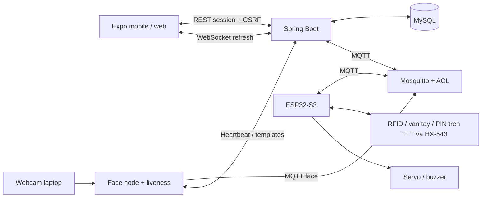

# Smart Access Control — Tổng hợp triển khai

**Bản tích hợp mới:** xem [hướng dẫn triển khai, thêm thiết bị và reset](../docs/HUONG_DAN_TRIEN_KHAI.md) và [kết quả kiểm thử](../docs/KET_QUA_KIEM_THU.md). Admin dùng `/admin/index.html`; thông tin đăng nhập bàn giao lưu riêng ở `.local/ADMIN_ACCESS.txt`. Cảm biến từ chưa được nối trong lượt kiểm thử hiện tại; không xem ACK là bằng chứng cơ khí đã chạy.

Hệ thống cửa thông minh sử dụng ESP32-S3 N16R8, MQTT, Spring Boot/MySQL, React Native/Expo và nhận diện khuôn mặt trên laptop. Tài liệu tổng hợp chức năng, các hàm chính, cách triển khai và môi trường đã cấp phát ngày **03/11/2026** tại `D:\DEV\IOT`.

## 1. Cấu trúc và kiến trúc

| Thành phần | Mã nguồn / tài liệu | Vai trò |
|---|---|---|
| ESP32-S3 | [firmware](../firmware/README.md) | RFID, vân tay, PIN, TFT/touch, servo, Wi-Fi, MQTT, xác thực offline |
| Backend | [smart-access-control-backend](../smart-access-control-backend/README.md) | Tài khoản, phân quyền, thiết bị, điều khiển, lịch sử, Face API và WebSocket |
| Mobile/web | [IOT_mobile](../IOT_mobile/README.md) | Đăng nhập, cửa, thành viên, phương thức xác thực và điều khiển từ xa |
| Face AI | [face-node](../face-node) | Webcam, InsightFace/ONNX, liveness, đồng bộ mẫu và gửi kết quả nhận diện |
| Công cụ chạy cục bộ | [scripts](../scripts) | Cấp phát DB/broker, chạy dịch vụ, kiểm tra kết nối |
| Broker | [infra/mosquitto](../infra/mosquitto) | Mẫu cấu hình Mosquitto, tài khoản riêng và ACL theo thiết bị |
| Phần cứng | [docs/integration.md](../docs/integration.md) | Bảng chân, sơ đồ, MQTT và kiểm thử trên bàn mạch |



## 2. Các chức năng đã triển khai

| Nhóm | Chức năng và cách làm |
|---|---|
| Tài khoản | Đăng ký/đăng nhập, thông tin cá nhân, đổi mật khẩu, admin khóa tài khoản. Mật khẩu BCrypt; session cookie và CSRF; thu hồi phiên khi cần. |
| Quyền theo cửa | Kiểm tra manager/thành viên theo từng access unit; quyền RFID, vân tay, face và remote độc lập. Thành viên được mở từ xa nếu có allowRemoteUnlock và cửa bật remote. |
| RFID | Đọc UID RC522, chuẩn hóa để so với danh sách đã đồng bộ; chỉ credential và quyền hợp lệ mới có trong snapshot. |
| Vân tay | Quét tại cảm biến UART; manager gửi FP_ENROLL/FP_DELETE. Đăng ký hai lần, timeout 45 giây; đọc bitmap và checksum để tránh đè slot đang có mẫu. |
| PIN | PIN cửa 6 số dùng chung cho TFT (C xóa, E xác nhận) và HX-543 phía trong nhà (* xóa, # xác nhận, chỉ HOME; firmware ≥ 1.11.0). ESP32 lưu salt + SHA-256; backend BCrypt. Sai 5 lần chặn 30 giây, bộ đếm giữ qua reboot. Hai bàn phím tuân theo cờ bật/tắt PIN lưu NVS và trạng thái tạm khóa/tạm ngưng/thu hồi. Phần nhập HX-543 hết hạn sau 15 giây; đổi nguồn nhập xóa phần mã dở. Xem [hướng dẫn HX-543](BAN_PHIM_TRONG_NHA.md). |
| Servo | DOOR_UNLOCK điều khiển góc mở, task riêng tự khóa sau thời gian cấu hình; boot đưa về góc khóa. Chưa có cảm biến xác nhận vị trí chốt. |
| Wi-Fi | Firmware connected quét/chọn mạng 2.4GHz qua captive portal, giữ tối đa 5 mạng trong NVS và luân phiên thử lại khi mất kết nối. Cửa đã có PIN yêu cầu admin PIN trên TFT để vào Wi-Fi và nhập lại trên portal cho mỗi lần đổi. Mạng mới chỉ lưu khi kết nối thành công. |
| Offline | Quyền lưu NVS; RFID/vân tay/PIN tiếp tục kiểm tra cục bộ. Hàng đợi tối đa63 sự kiện, chỉ bỏ sau backend xác nhận commit; hàng đợi đầy/lỗi lưu sẽ chặn mở cục bộ. |
| Lệnh MQTT | UUID + TTL, theo dõi PENDING/SENT/ACKNOWLEDGED/FAILED/TIMEOUT. ESP lưu16 kết quả gần nhất, gửi lại ACK tới khi có ack-confirm. |
| Bản tin thiết bị | Xác thực secret/lifecycle/type; từ chối retained/topic sai. Backend chống trùng eventUuid và giữ timestamp offline khi thiết bị có giờ hợp lệ. |
| Quản trị thiết bị | Admin tạo UID, cấp secret một lần, đổi secret, thay vòng đời. Backend chỉ lưu hash; DECOMMISSIONED là trạng thái cuối. |
| Cập nhật ứng dụng | WebSocket gửi tín hiệu refresh; app tải dữ liệu qua REST đã phân quyền. Có reconnect và polling dự phòng10 giây. |
| Face AI | Webcam → phát hiện/đặc trưng/liveness → MQTT face → backend kiểm tra quyền → command ESP → ACK. Không tự cho phép bỏ liveness. |
| Cảnh báo tự sinh | `AlertRuleService` chạy 30 giây/lần, ghi vào `events`; app hỏi `/api/alerts` 30 giây/lần và hiện thông báo WARNING/CRITICAL. `DEVICE_OFFLINE` (mất heartbeat > 5 phút), `DOOR_LEFT_OPEN` (cửa mở quá `door_open_timeout_sec`), `SENSOR_FAULT` (cảm biến vân tay không sẵn sàng > 60 giây) tự đóng khi hết lỗi. `REPEATED_WRONG_PIN` (≥ 5 lần sai PIN trong 5 phút) và `REPEATED_AUTH_FAILED` (≥ 5 lần vân tay/thẻ/khuôn mặt bị từ chối trong 2 phút, nội dung ghi số lần theo từng loại) phải do chủ cửa xử lý; chỉ đếm lượt xảy ra sau cảnh báo cùng loại gần nhất, và bỏ qua các lỗi do hệ thống (`DOOR_BUSY`, `FACE_DISABLED`, `MODEL_MISMATCH`). Cần firmware ≥ 1.9.0 thì lượt PIN sai và vân tay lạ mới được gửi lên. Thay cho `REPEATED_DENIED` gộp chung trước đây. |
| Người chưa có tài khoản | Chủ cửa tạo hồ sơ chỉ dùng tại cửa (họ tên, phòng) qua `POST /api/manager/units/{id}/member-profiles`. Backend tạo tài khoản với email giả `profile-<UUID>@noapp.local` và mật khẩu ngẫu nhiên không lưu ở đâu, nên không đăng nhập được; quyền vân tay + thẻ bật, mở từ xa tắt. Email giả không hiện trên app, và hồ sơ không xuất hiện khi tìm người để mời. |
| Thu hồi thiết bị | Admin chuyển sang DECOMMISSIONED: backend xóa secret rồi gửi `DEVICE_DECOMMISSION` (không lưu bảng `commands`). Chip ghi cờ `retired` vào namespace NVS riêng `doorretire` (không hàm reset nào xóa), đưa chốt về góc khóa, xóa PIN/thẻ/vân tay/Wi-Fi/secret rồi khởi động lại. Mỗi lần khởi động chip kiểm tra cờ trước tiên: xóa tiếp nếu còn sót, hiện "DEVICE RETIRED" và dừng hẳn, không bật Wi-Fi. Chip offline lúc thu hồi được báo lại khi bản tin đầu tiên của nó bị từ chối (tối đa 1 lần/60 giây). Nạp lại firmware qua USB vẫn xóa được cờ, nhưng chip trắng không kết nối lại được vì secret đã xóa. Cần firmware ≥ 1.10.0. |
| Tạm ngưng (SUSPENDED) | Heartbeat của thiết bị SUSPENDED nhận cấu hình rút gọn `lifecycle: SUSPENDED` (không có quyền, không ghi telemetry). Chip từ chối mọi lượt mở kể cả nút TEST OPEN trong menu quản trị, nhưng giữ dữ liệu; ACTIVE lại thì heartbeat kế tiếp gỡ chặn. MAINTENANCE không đổi: chip vẫn mở cục bộ. Xóa thành viên bị chặn (409) khi cửa không ACTIVE. |
| Tạm khóa cửa (chủ cửa) | `GET/POST/DELETE /api/manager/units/{id}/lockdown`, chỉ chủ cửa, cửa phải online. Lệnh `DOOR_LOCKDOWN`/`DOOR_RELEASE`; trạng thái suy ra từ lệnh gần nhất đã ACK hoặc đang chờ của generation hiện tại (reset/chuyển giao tự bỏ khóa). Chip lưu `restrict` trong NVS, chỉ nhận vân tay/thẻ của chủ cửa (`ownerRfid`, `ownerFingerprints` trong config); PIN dùng chung bị chặn. Backend chặn mở từ xa và khuôn mặt của thành viên (lý do `LOCKDOWN`, không tính vào cảnh báo xác thực sai). Không tự hết hạn. |

Đây là chức năng đã có trong mã nguồn; phạm vi kiểm chứng thực tế được nêu tại mục9, không đồng nghĩa tất cả cảm biến/cơ cấu đã được thử đầy đủ.

## 3. Các hàm và lớp chính

### Firmware — `firmware/src/main.cpp`

| Hàm | Cách xử lý |
|---|---|
| setup() | Khởi tạo SPI/TFT/touch/RC522, servo, task auto-lock, UART vân tay, NVS, MQTT và Wi-Fi. |
| loop() | Poll cảm ứng/cảm biến/mạng; gửi heartbeat, sự kiện và ACK còn chờ. |
| drawHome(), drawPin(), message() | Vẽ giao diện cửa/PIN; không ghi đè màn hình khi đang cấu hình Wi-Fi. |
| pollTouch() | Ánh xạ tọa độ touch đã đảo trục; xử lý keypad, nút Wi-Fi và khóa nhập PIN. |
| pollFinger(), slotFree(), finishEnroll() | So khớp hoặc chạy enrollment từng bước; kiểm tra slot trước lưu và trả ACK kết quả. |
| allowedCard(), allowedFinger() | Kiểm tra danh sách quyền trong snapshot NVS. |
| digest(), uuid(), canonical() | Băm PIN có salt, sinh UUID ngẫu nhiên và chuẩn hóa UID RFID. |
| access() | Ghi sự kiện vào hàng đợi trước khi mở servo; từ chối nếu không lưu được. |
| head(), tail(), queueFull(), flushEvent() | Quản lý vòng đệm NVS và gửi lại sự kiện chưa xác nhận. |
| unlockDoor(), lockDoor() | Điều khiển servo qua mutex; task auto-lock kiểm tra mỗi10ms, độc lập chờ MQTT. |
| onMqtt() | Nhận config, command và xác nhận; kiểm tra requestId/UUID/TTL; xử lý các loại lệnh. |
| publish(), ack(), replayAck() | Gửi JSON, lưu kết quả lệnh và phản hồi bản sao mà không mở cửa lại. |

### Wi-Fi — `firmware/src/WifiSettings.cpp`

| Hàm | Cách xử lý |
|---|---|
| begin() | Ưu tiên cấu hình NVS; nếu chưa có mới dùng WIFI_SSID/WIFI_PASSWORD; khởi động NTP. |
| open(), render(), tap() | Điều hướng danh sách mạng, bàn phím và trang chờ kết nối. |
| scan() | Bắt đầu quét không chặn vòng lặp; poll() thu kết quả, lọc SSID trùng, tối đa20 mạng. |
| connectCandidate() | Kiểm tra SSID/mật khẩu rồi thử kết nối; chưa thay bản ghi mạng cũ. |
| poll() | Lưu một bản ghi NVS khi kết nối mới thành công; timeout 20 giây; thử reconnect mỗi15 giây. |
| restore() | Hủy thử mạng mới, xóa mật khẩu đang nhập và nối lại cấu hình cũ. |
| keyRow(), validPassword() | Bố trí bàn phím ba chế độ; chấp nhận passphrase 8–63 ký tự,64 ký tự hex hoặc mạng mở. |

### Backend, mobile và Face AI

| Lớp / hàm | Tệp | Vai trò |
|---|---|---|
| LocalAccessPolicyService.snapshot() | `service/LocalAccessPolicyService.java` | Lọc quyền theo tài khoản ACTIVE, membership, phương thức và thiết bị; không xuất hash PIN/tài khoản. |
| MqttDeviceGateway.send()/handle()/reply() | `service/MqttDeviceGateway.java` | Gửi command, xác thực bản tin vào, trả snapshot/ACK-confirm; publish phản hồi trên executor riêng để tránh chặn Paho callback. |
| AccessEventService.recordLocal() | `service/AccessEventService.java` | Khóa theo thiết bị, chống trùng UUID, ghi RFID/vân tay/PIN, giữ thời gian và kết quả thiết bị đã thực hiện. |
| DeviceCommandService.dispatch()/sendAfterCommit() | `service/DeviceCommandService.java` | Tạo lệnh trong transaction; chỉ gửi MQTT sau commit và cập nhật trạng thái gửi. |
| CommandAckService.handleAck() | `service/CommandAckService.java` | Đối chiếu thiết bị/command, cập nhật PIN/credential/lịch sử sau ACK hợp lệ. |
| ManagerAccessGuard.requireRemoteUnit() | `service/ManagerAccessGuard.java` | Cho manager hoặc thành viên được cấp quyền remote sử dụng cửa tương ứng. |
| AdminDeviceController.register()/rotate()/lifecycle() | `controller/AdminDeviceController.java` | Cấp phát, đổi secret, thu hồi thiết bị và ghi audit. |
| RealtimeConfig.changed()/push() | `config/RealtimeConfig.java` | Gộp tín hiệu thay đổi, gửi refresh; đóng socket khi session hết hiệu lực/tài khoản khóa. |
| subscribeUpdates() | `IOT_mobile/src/services/api/realtime.ts` | Kết nối WebSocket bằng phiên hiện tại, gọi refresh, retry sau 5 giây và cleanup khi rời phiên. |
| Backend.sync() | `face-node/backend.py` | Gửi heartbeat và tải mẫu bằng header định danh thiết bị; lỗi thì xóa cache. |
| Engine.analyze(), LatestCamera, run() | `face-node/engine.py`, `node.py` | Lấy frame mới, kiểm tra chất lượng/liveness, nhận diện ổn định và gửi MQTT. |
| prepare()/broker()/seed() | `scripts/bootstrap_local.py` | Tạo DB/user riêng, sinh cấu hình và secret; tạo broker, admin, cửa và hai thiết bị. |
| start-local.ps1 | `scripts/start-local.ps1` | Nạp cấu hình cục bộ, chạy riêng broker/backend/mobile/face. |
| verify-local.py, check-web.py | `scripts` | Kiểm tra session/CSRF, DB/Flyway, MQTT, heartbeat và bundle web; không gửi lệnh mở cửa. |

Các đường dẫn `service/`, `controller/`, `config/` trong bảng backend nằm dưới `smart-access-control-backend/src/main/java/com/smartaccess/`.

## 4. Tài khoản và cấu hình đã tạo

| Loại | Định danh | Phạm vi / nơi dùng |
|---|---|---|
| Ứng dụng | admin@smartdoor.local | Admin thử nghiệm, quản lý cửa Cua ESP32-S3 (unitId 1). |
| MySQL | iot_dev_772989@localhost | Chỉ có quyền trên database smart_access_dev_772989; backend dùng tài khoản này. |
| MQTT backend | backend | Đọc status/ack/access/face; gửi command/config và bản tin xác nhận. |
| MQTT ESP32 | door-80b54ec8149c | Username bằng UID; chỉ truy cập các topic thiết bị này theo ACL. |
| MQTT Face AI | face-laptop-772989 | Tài khoản riêng của camera node đã gắn cùng cửa. |
| Quản trị MySQL lúc cấp phát | root | Chỉ dùng tạo DB/user ban đầu; mật khẩu root không được lưu vào cấu hình project. |

**Mật khẩu tài khoản:** xem [README tài khoản cục bộ](../.local/README.md) hoặc [ACCESS.txt](../.local/ACCESS.txt). Mật khẩu ứng dụng khác mật khẩu MySQL/MQTT. Secret thiết bị nằm trong `.local/runtime.json`, dùng xác thực với backend, khác mật khẩu đăng nhập broker.

| File cấu hình | Nội dung |
|---|---|
| `.local/runtime.json` | Thông số môi trường, mật khẩu và secret đã sinh. |
| `smart-access-control-backend/.env` | JDBC/user DB, broker, CORS; được start-local.ps1 nạp vì Spring Boot không tự đọc .env. |
| `IOT_mobile/.env` | EXPO_PUBLIC_API_BASE_URL; không chứa mật khẩu server. |
| `firmware/include/smartdoor_config.h` | UID/secret, broker IP/port/user/password; Wi-Fi mặc định có thể để trống. |
| `face-node/.env` | API, UID/secret và tài khoản MQTT camera. |
| `.local/mosquitto/` | Cấu hình broker, password file đã băm, ACL và dữ liệu persistence. |

Những file chứa thông tin đăng nhập đều được Git bỏ qua. README chính lưu tên tài khoản và chỉ dẫn tới bản mật khẩu cục bộ.

## 5. Địa chỉ và chạy dịch vụ

| Thành phần | Địa chỉ của môi trường đã tạo |
|---|---|
| Web trên laptop | http://localhost:8081 |
| Web trên điện thoại cùng LAN | http://10.18.3.64:8081 |
| Expo Go | exp://10.18.3.64:8081 |
| Backend REST | http://10.18.3.64:8080 |
| WebSocket | ws://10.18.3.64:8080/ws/updates |
| Broker riêng | 10.18.3.64:1884 |
| MySQL | 127.0.0.1:3306, database smart_access_dev_772989 |

Môi trường hiện có cần Java 17+, Maven, MySQL 8, Node/npm, Python và PlatformIO. Các đường dẫn Mosquitto/venv trong scripts là cấu hình của máy này. Đã cài dependency mobile và Face AI; model đã tải, kiểm tra checksum và sao chép cho mobile/web.

Mở **ba terminal riêng** tại `D:\DEV\IOT`, chạy theo thứ tự:

```powershell
# Terminal 1: broker riêng, không thay broker hệ thống port 1883
powershell -ExecutionPolicy Bypass -File .\scripts\start-local.ps1 -Component broker

# Terminal 2: backend; chờ thông báo Started SmartAccessApplication
powershell -ExecutionPolicy Bypass -File .\scripts\start-local.ps1 -Component backend

# Terminal 3: Expo mobile/web
powershell -ExecutionPolicy Bypass -File .\scripts\start-local.ps1 -Component mobile
```

Chỉ bật webcam khi cần, ở terminal thứ tư:

```powershell
powershell -ExecutionPolicy Bypass -File .\scripts\start-local.ps1 -Component face
```

**Camera đã được dừng theo yêu cầu người dùng.** Không cần bật Face AI để dùng RFID/vân tay/PIN/remote. Với các lệnh chạy foreground trên, Ctrl+C dừng dịch vụ tương ứng. Không mở thêm bản chạy khi cổng đã có tiến trình sử dụng.

Nếu sửa backend, build JAR trước rồi khởi động lại backend:

```powershell
cd D:\DEV\IOT\smart-access-control-backend
mvn package -DskipTests
```

Rule Firewall `Smart Access local development` từng được mở cho LocalSubnet tới 1884/8080/8081, sau đó **đã gỡ theo yêu cầu thu hồi quyền LAN**. Các rule khác giữ nguyên. Web/backend trên laptop vẫn chạy; ESP32 và điện thoại có thể không kết nối được nếu không có rule cho phép khác. Khi laptop đổi IP, cấu hình broker/mobile/CORS cũng cần cập nhật. Xem [hướng dẫn chạy và đăng ký thiết bị](../docs/local-development.md).

## 6. Nạp ESP32 và đổi Wi-Fi

Board đã nhận dạng: ESP32-S3, flash 16 MB, PSRAM 8 MB; cổng USB CH343 thực tế lúc nạp là **COM6**. Luôn liệt kê lại cổng nếu rút/cắm USB.

```powershell
cd D:\DEV\IOT\firmware
$pio = 'C:\Users\ACER\.platformio\penv\Scripts\pio.exe'
& $pio device list
& $pio run -e esp32-s3
& $pio run -e esp32-s3 --target upload --upload-port COM6
```

Đã có `include/smartdoor_config.h` chứa cấu hình của môi trường này; không chép đè bằng file mẫu. Khi cấp phát một board mới, sao chép `config.example.h` thành `smartdoor_config.h` và điền đúng UID/secret/tài khoản broker. Các lệnh nạp phía trên tự biên dịch và nạp cả bootloader/partition/firmware.

Đổi Wi-Fi không cần nạp lại: **WI-FI → chọn mạng → nhập mật khẩu → CONNECT → BACK TO DOOR**. Chọn HIDDEN nếu SSID ẩn; ABC/#+=/abc đổi chế độ bàn phím, SPACE nhập khoảng trắng, DEL xóa. Chỉ hỗ trợ mạng2.4GHz; thiết bị tự nối lại mạng đã lưu sau reboot. Nếu thử mạng mới không được trong 20 giây, thiết bị giữ cấu hình cũ.

| Module | Các chân ESP32-S3 |
|---|---|
| TFT | SCK 41, MOSI 42, CS 47, DC 2, RESET 1 |
| XPT2046 | CLK 41, DIN 42, DO 21, CS 48; IRQ không dùng |
| RC522 | SCK 41, MOSI 42, MISO 21, SS 10, RST 9; nguồn3V3 |
| Vân tay | TX cảm biến → RX 17; RX cảm biến ← TX 18; UART 57600 |
| Servo | Tín hiệu GPIO4; nguồn5V ngoài phù hợp tải, GND chung |
| Buzzer | GPIO5 qua transistor/module driver phù hợp |

GPIO servo/buzzer là phân bổ đề xuất mới. LCD mặc định ST7789 theo tài liệu thử nghiệm tại `D:\BTLIOT`; có tùy chọn ILI9341. Phải đối chiếu đúng module, nguồn và [sơ đồ đấu nối](../docs/integration.md).

## 7. Luồng hoạt động và giao thức

**Mở cục bộ:** cảm biến/PIN → kiểm tra snapshot/quyền → ghi sự kiện NVS → servo mở → task tự khóa. Khi có mạng, gửi access; backend lưu DB rồi trả access-ack, ESP mới bỏ sự kiện. UUID giúp không ghi log hai lần khi gửi lại.

**Mở từ ứng dụng:** REST có session/CSRF → kiểm tra quyền cửa → tạo command trong transaction → gửi MQTT sau commit → ESP kiểm tra UUID/TTL và điều khiển → ACK → backend cập nhật kết quả → WebSocket refresh ứng dụng.

**Khuôn mặt:** webcam lấy frame mới → kiểm tra chất lượng/liveness → đối chiếu mẫu đã đồng bộ → gửi face → backend quyết định quyền → command cho ESP. Không có backend/mẫu hợp lệ thì không mở bằng face.

Gốc topic: `smartdoor-iot/{deviceUid}`. Không retain command, snapshot, access và ACK.

| Topic | Chiều | Mục đích |
|---|---|---|
| status | ESP → backend | Heartbeat kèm secret và requestId. |
| config | Backend → ESP | Snapshot rfid/fingerprints/pinEnabled/unlockDurationSec, khớp requestId. |
| cmd | Backend → ESP | commandUuid, commandType, data, issuedAt, ttlSec. |
| ack / ack-confirm | Hai chiều | Kết quả thực thi / xác nhận backend đã xử lý. |
| access / access-ack | Hai chiều | Sự kiện truy cập / xác nhận backend đã lưu. |
| face | Face node → backend | Kết quả nhận diện kèm secret camera. |

PubSubClient publish QoS 0; access và ACK có xác nhận/gửi lại ở tầng ứng dụng. Backend gửi command/response QoS 1. Chi tiết payload/API tại [integration.md](../docs/integration.md), [Manager API](../smart-access-control-backend/docs/manager-api.md) và [Account API](../smart-access-control-backend/docs/account-api.md).

## 8. API quản trị thiết bị

Yêu cầu session admin và CSRF cho thao tác thay đổi dữ liệu.

| Method/path | Chức năng |
|---|---|
| GET /api/admin/devices | Liệt kê, không trả secret/hash. |
| POST /api/admin/devices | Tạo deviceUid/deviceName/deviceType; trả secret một lần. |
| POST /api/admin/devices/{uid}/rotate-secret | Đổi secret, thu hồi secret cũ. |
| PATCH /api/admin/devices/{uid}/lifecycle | Đổi status; không khôi phục thiết bị DECOMMISSIONED. |

## 9. Kiểm thử và xác nhận thực tế

| Hạng mục | Kết quả đã ghi nhận |
|---|---|
| Backend tự động | 181 bài: 171 đạt,10 bài cần MySQL thực bỏ qua,0 lỗi. |
| Mobile | TypeScript đạt;17/17 test đạt; lint 0 lỗi,9 cảnh báo. |
| Face node | 9/9 test đạt; model checksum khớp; đã chạy webcam và có heartbeat trước khi được dừng. |
| Firmware | Build thành công; đã nạp COM6, xác minh hash flash và reset board. |
| Tích hợp MySQL | DB/user mới kết nối được; Flyway migration thành công. |
| Tích hợp API/web | Đăng nhập session/CSRF thành công, hai thiết bị được cấp phát; HTML và bundle web HTTP 200. |
| MQTT/ESP32 | Ba tài khoản broker xác thực được; người dùng xác nhận Wi-Fi Connected and saved; backend đã nhận ESP32 ACTIVE. |

Chạy kiểm tra môi trường không gửi lệnh mở cửa:

```powershell
cd D:\DEV\IOT
.\.local\venv\Scripts\python.exe scripts\verify-local.py
.\.local\venv\Scripts\python.exe scripts\check-web.py
```

Chạy lại kiểm thử mã nguồn trong từng thư mục tương ứng:

```powershell
# smart-access-control-backend
mvn test
# IOT_mobile
npm run typecheck
npm run lint
npm test
# face-node, dùng Python của môi trường đã cài
..\.local\venv\Scripts\python.exe -m unittest discover -s tests
# firmware
pio run
```

Chưa đăng ký RFID/vân tay/khuôn mặt/PIN cho tài khoản mới; chưa kiểm tra thao tác mở servo và toàn bộ tình huống mất điện/mất mạng trên phần cứng. Không coi heartbeat online là bằng chứng chốt đã khóa đúng vị trí. Xem [kết quả và giới hạn kiểm chứng](../docs/verification.md).

## 10. Giới hạn và phần nâng cấp

- Cửa đang offline tiếp tục dùng snapshot cũ; quyền thu hồi chỉ áp dụng sau đồng bộ. Snapshot firmware tối đa11KB JSON.
- Lệnh MQTT cần giờ NTP hợp lệ; sự kiện chưa có giờ được đánh dấu DEVICE_CLOCK_UNSYNCED và dùng giờ nhận backend.
- Xóa NVS cần đặt lại PIN/đồng bộ quyền; mạng đã lưu, PIN và sự kiện không nên bị xóa khi chỉ cần đổi Wi-Fi.
- Chưa hỗ trợ captive portal/Wi-Fi doanh nghiệp, provisioning BLE, OTA an toàn, cảm biến cửa/chốt và nguồn dự phòng trong firmware tích hợp.
- Cấu hình đang chạy là LAN phát triển HTTP/MQTT; triển khai qua mạng không tin cậy cần HTTPS/WSS/MQTT TLS và cấu hình chứng chỉ.
- Lint còn9 cảnh báo đã mô tả trong verification.md; chưa sửa toàn bộ các màn hình cũ.

Tài liệu chi tiết: [Firmware](../firmware/README.md), [đấu nối và tích hợp](../docs/integration.md), [chạy cục bộ](../docs/local-development.md), [backend](../smart-access-control-backend/README.md), [mobile](../IOT_mobile/README.md).
