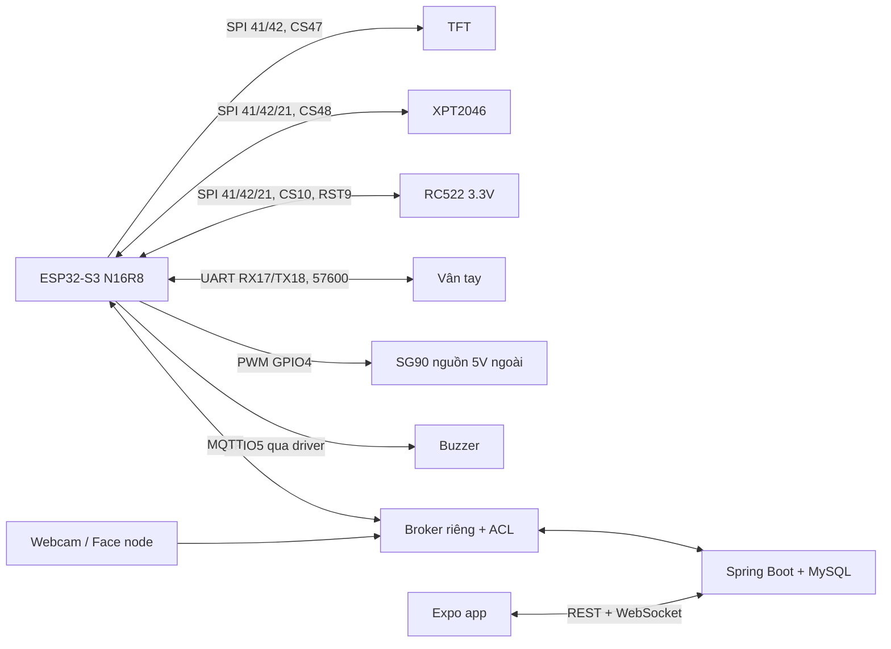

# Đấu nối và chạy tích hợp

## 1. Kết nối phần cứng

Tham chiếu `D:\BTLIOT\README.md`, `So_do_noi_chan_RC522.md`, `So_do_noi_chan_Cam_bien_van_tay.md` và sketch cũ. LCD dùng ST7789 đã hiển thị đầy màn hình; mã IC vật lý chưa xác minh. Firmware cho phép chọn ILI9341.

| Module | Chân module | GPIO ESP32-S3 |
|---|---|---|
| TFT | SCK / MOSI | 41 / 42 |
| TFT | CS / DC / RESET | 47 / 2 / 1 |
| XPT2046 | CLK / DIN / DO | 41 / 42 / 21 |
| XPT2046 | CS / IRQ | 48 / IRQ không nối (polling) |
| RC522 | SCK / MOSI / MISO | 41 / 42 / 21 |
| RC522 | SDA (SS) / RST | 10 / 9 |
| RC522 | 3.3V / GND | 3V3 / GND |
| Vân tay | TX → RX ESP / RX ← TX ESP | 17 / 18 |
| Vân tay | V+ / GND | 3V3 theo cấu hình đã thử / GND |
| SG90 | Signal | 4, **đề xuất mới** |
| Buzzer active qua transistor | Điều khiển transistor | 5, **đề xuất mới** |

Không nối VA/TCH/D+/D− của cảm biến khi chưa xác minh module. Nguồn TFT/LED theo module thực tế. SG90 dùng nguồn 5 V ngoài phù hợp dòng tải, không lấy từ GPIO/3V3. Tất cả nguồn và module chung GND. Buzzer 5 V cần transistor/module driver và điện trở phù hợp; không đưa tải 5 V trực tiếp vào GPIO. Tắt nguồn trước khi thay dây.



## 2. Broker và backend

Mosquitto: dùng `infra/mosquitto/mosquitto.conf` và `acl`. Đường dẫn cấu hình kiểu container; chạy native Windows cần đổi password_file, acl_file, persistence_location sang đường dẫn thực. Tạo password file bằng `mosquitto_passwd -c <file> backend`, thêm thiết bị bằng `mosquitto_passwd <file> door-s3-01` (không dùng lại `-c`). Mỗi thiết bị dùng username bằng UID. Không commit file passwords.

```powershell
$env:DB_URL='jdbc:mysql://localhost:3306/smart_access?serverTimezone=Asia/Ho_Chi_Minh'
$env:DB_USERNAME='<db-user>'
$env:DB_PASSWORD='<db-password>'
$env:MQTT_BROKER_URL='tcp://127.0.0.1:1883'
$env:MQTT_USERNAME='backend'
$env:MQTT_PASSWORD='<broker-password>'
cd smart-access-control-backend
mvn spring-boot:run
```

Tạo database trước theo README backend. Spring Boot không tự nạp `.env`. Port 1883 chỉ dành cho LAN thử nghiệm. Triển khai cần TLS (backend `ssl://host:8883` và JVM truststore; ESP `MQTT_TLS=true` và CA PEM), HTTPS/WSS và ACL. Prefix firmware/backend/face-node/ACL phải trùng nhau.

## 3. Cấp phát thiết bị

Đăng nhập admin bằng session/CSRF theo `smart-access-control-backend/docs/account-api.md`. Tài khoản đầu tiên không tự trở thành admin; dùng bootstrap DB hiện có.

| API admin | Dữ liệu |
|---|---|
| `GET /api/admin/devices` | Danh sách không có hash/secret |
| `POST /api/admin/devices` | `deviceUid`, `deviceName`, `deviceType`: DOOR_CONTROLLER hoặc FACE_CAMERA_NODE |
| `POST /api/admin/devices/{uid}/rotate-secret` | Cấp secret mới, thu hồi secret cũ |
| `PATCH /api/admin/devices/{uid}/lifecycle` | `status`: REGISTERED, PROVISIONED, ACTIVE, MAINTENANCE, SUSPENDED, DECOMMISSIONED |

POST tạo/đổi secret trả `{device, deviceSecret}`. Lưu secret vào cấu hình thiết bị ngay; backend chỉ lưu BCrypt, không đọc lại được. DECOMMISSIONED là trạng thái cuối. Gắn UID vào cửa qua app/Manager API rồi bật board. Heartbeat hợp lệ đưa REGISTERED/PROVISIONED thành ACTIVE. Thiết bị chưa gắn cửa không xác thực được.

Firmware tích hợp không mở menu quản trị vân tay cho khách tại TFT. Manager bắt đầu qua app, sau đó quét hai lần. Slot có mẫu thử nghiệm cũ bị từ chối ghi đè; cần quản trị bộ nhớ cảm biến có chủ đích trước khi nhập lại.

## 4. MQTT

Gốc `smartdoor-iot/{deviceUid}`. Không retain command, snapshot, access hoặc ACK.

| Hậu tố | Chiều | Payload chính |
|---|---|---|
| `cmd` | Backend → ESP | commandUuid, commandType, data, issuedAt epoch giây, ttlSec |
| `ack` | ESP → backend | deviceSecret, commandUuid, success, message |
| `ack-confirm` | Backend → ESP | commandUuid sau khi xử lý ACK |
| `status` | ESP → backend | deviceSecret, requestId UUID, fingerReady, unlocked |
| `config` | Backend → ESP | requestId, rfid (UID), fingerprints (templateId), pinEnabled, unlockDurationSec |
| `access` | ESP → backend | deviceSecret, eventUuid, method RFID/FINGERPRINT/PIN, result GRANTED/DENIED, occurredAt epoch giây; rfidUid hoặc templateId |
| `access-ack` | Backend → ESP | eventUuid sau khi commit DB |
| `face` | Face node → backend | Hợp đồng Face AI hiện có, kèm deviceSecret |

Backend từ chối retained, sai loại thiết bị, secret sai và lifecycle không hợp lệ. Event offline giữ kết quả thực hiện tại thiết bị; credential thay đổi được đánh dấu `OFFLINE_CREDENTIAL_CHANGED`. `occurredAt=0` dùng giờ nhận và đánh dấu `DEVICE_CLOCK_UNSYNCED`; đó không phải thời điểm đo chính xác. Snapshot không chứa hash tài khoản/PIN. PIN là mã chung, log không gán account giả.

## 5. Mobile / Face AI

Wi-Fi ESP32 có thể chọn/đổi trực tiếp trên TFT bằng nút **WI-FI**: chọn mạng hoặc **HIDDEN**, nhập mật khẩu và **CONNECT**. Lưu thành công mới thay cấu hình cũ; tự nối lại mạng đã lưu sau reboot. Xem [firmware/README.md](../firmware/README.md) để biết thao tác bàn phím. Nếu đổi sang LAN khác, bảo đảm MQTT_HOST vẫn truy cập được.

Trong `IOT_mobile`: `npm ci`, điền EXPO_PUBLIC_API_BASE_URL theo `.env.example`, `npm start`. Điện thoại cần IP LAN của backend.

`/ws/updates` xác thực cookie session, kiểm tra Origin và đóng kết nối khi session thu hồi/tài khoản khóa. `{type:"refresh"}` chỉ yêu cầu app tải lại dữ liệu qua REST đã phân quyền, không phát dữ liệu cá nhân giữa các cửa. App retry WebSocket và polling dự phòng 10 giây; lịch sử/cảnh báo tải qua API riêng. Proxy cần chuyển tiếp Upgrade/Connection. Thành viên có allowRemoteUnlock được mở khi cửa bật remote và controller online.

Trong `face-node`: cài requirements.txt, sao chép `.env.example` thành `.env`, cấp FACE_CAMERA_NODE riêng gắn cùng cửa, cấu hình broker và chạy `python node.py`. Giữ kiểm tra liveness/model như cấu hình hiện có. Face không mở offline khi backend không kiểm tra quyền được.

## 6. Kiểm thử bàn mạch

1. Thử riêng LCD/touch, RC522, UART; kiểm tra nguồn, CS, hiệu chuẩn và góc servo.
2. Cấp phát/gắn cửa, kiểm tra online. Gán RFID, cấp quyền, thử đúng/sai. Đăng ký vân tay hai lần; thử PIN và khóa nhập sau 5 lần sai.
3. Mở app: chỉ ACKNOWLEDGED sau phản hồi; ngắt mạng trong lúc mở và kiểm tra tự khóa.
4. Mất mạng: thử RFID/vân tay/PIN đã đồng bộ, reboot rồi thử tiếp. Nối lại: log chỉ xuất hiện một lần; giữ timestamp offline khi có NTP.
5. Gửi lại eventUuid/commandUuid: không trùng log/không mở lại. Lệnh hết TTL hoặc chưa có giờ phải thất bại. Thử mất nguồn khi ghi hàng đợi/enroll.
6. Thu hồi quyền/khóa tài khoản/xóa credential, chờ snapshot rồi thử lại. ACK giả, secret sai, topic sai/retain phải bị từ chối. Tài khoản broker thiết bị không được publish cmd hoặc đọc thiết bị khác.
7. Thử WebSocket qua login/logout/đổi mật khẩu và Origin ngoài danh sách; kiểm tra lịch sử đúng từng người/cửa.

Kiểm thử tự động không xác minh nguồn, chốt servo, dây hay độ chính xác sinh trắc. Cảm biến cửa/chốt, nguồn dự phòng và OTA thuộc phần nâng cấp cần thêm phần cứng.
