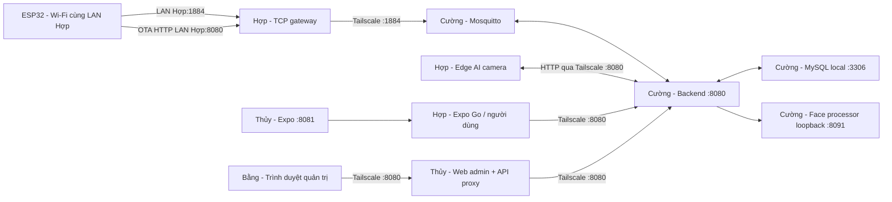

# Nhóm 4 laptop: thứ tự chạy và sơ đồ kết nối

Bản bàn giao ngày 08/11/2026. Mọi lệnh chạy ở thư mục gốc source mới nhất của dự án, ví dụ `D:\DEV\IOT`; đổi đường dẫn nếu clone nơi khác. Không sao chép `.local/runtime.json` cũ sang máy khác. Mỗi người nhận đúng gói riêng và file hướng dẫn mang tên mình.

| Người | Tailscale | Việc chạy |
|---|---|---|
| Cường | 100.95.248.100 | MySQL + một MQTT broker + backend Java + AI xử lý ảnh/video đăng ký |
| Thủy | 100.109.158.8 | Web quản trị + API proxy :8080, Expo/mobile :8081 |
| Bằng | 100.115.154.86 | Trình duyệt đăng nhập quản trị, không cần chạy server |
| Hợp | 100.111.90.116 | ESP32, app người dùng, edge AI camera, cầu nối LAN MQTT/HTTP |

Không bắt buộc dùng máy Bằng: có thể đăng nhập quản trị ngay trên máy Thủy. Cường và Thủy phải bật máy khi demo. Hợp không chạy backend Java, MySQL hoặc MQTT broker.

## Thứ tự lần đầu

1. Tất cả bật Tailscale trong cùng tailnet, xác nhận đúng IP bằng `tailscale ip -4`. Tailnet phải cho Hợp/Thủy/Bằng/điện thoại đến Cường TCP 8080; Hợp đến Cường TCP 1884; Bằng/Hợp/điện thoại đến Thủy TCP 8080,8081. IP Tailscale đúng chưa đủ nếu ACL/grants hoặc Firewall chặn.
2. Cường làm toàn bộ phần khởi tạo DB và SQL trong CUONG.md. Chạy backend một lần để Flyway tạo bảng, chạy seed admin + thiết bị, bật MQTT và face processor; báo `/api/health` READY. Thiết bị có thể còn OFFLINE vì chưa chọn Wi-Fi: bình thường.
3. Thủy chạy THUY.md, build admin, bật web/API proxy và Expo. Gửi `http://100.109.158.8:8080/admin/index.html` cho Bằng và `exp://100.109.158.8:8081` cho Hợp.
4. Bằng đăng nhập bằng gói tài khoản riêng, kiểm tra kho có `ESP32-80B54EC8149C`, trạng thái INVENTORY. Không cần kết nối USB; không đăng ký lại chip hoặc sinh lại QR.
5. Hợp làm HOP.md: bật hai TCP gateway trước, dùng app tài khoản người dùng quét QR trên chip, chọn Wi-Fi, nhận cửa, đặt PIN và hiệu chỉnh. Sau khi cửa READY mới ghép edge AI bằng tài khoản chủ cửa.
6. Cả nhóm thử mở/khóa từ app, PIN, cảm biến, ảnh đăng ký và camera edge. Chỉ chạy các thao tác cơ khí khi Hợp đang kiểm tra tại thiết bị.

## Chạy hằng ngày

Cường: MySQL → MQTT → face-api → backend. Thủy: web → Expo. Hợp: gateway MQTT/OTA → app → edge AI. Bằng mở web. Không seed/reset/nạp lại mỗi lần bật máy.

## Địa chỉ, broker và danh tính

Chỉ có **một broker thực sự trên máy Cường**. Backend dùng `tcp://127.0.0.1:1884`; ESP32 dùng `10.18.0.194:1884` (IP Wi-Fi Hợp hiện tại), gateway chuyển nguyên TCP đến `100.95.248.100:1884`. Hợp không dùng Mosquitto bridge và không đổi username/topic: chip vẫn đăng nhập bằng UID `ESP32-80B54EC8149C`, mật khẩu riêng. Backend có tài khoản `backend`. ACL chỉ cho chip ghi topic của chính nó và đọc lệnh/cấu hình của chính nó.

ESP32 không tự cài Tailscale. Đây là TCP relay trên laptop Hợp, không phải cấu hình subnet-router. Chặng Hợp–Cường được Tailscale mã hóa; chặng ESP32–Hợp dùng MQTT có mật khẩu trong LAN demo. Không mở port router ra Internet. [Tài liệu thiết bị không chạy Tailscale](https://tailscale.com/docs/features/subnet-routers), [cấu hình xác thực/ACL Mosquitto](https://mosquitto.org/man/mosquitto-conf-5.html).

Edge AI qua portal laptop dùng HTTP để đồng bộ và gửi kết quả nhận diện tới backend, nên không cần tài khoản MQTT riêng cho camera. Face processor :8091 chỉ chạy trên Cường, không mở cổng 8091 ra tailnet. MySQL :3306 cũng chỉ dùng local trên Cường. App và web không kết nối trực tiếp MySQL/MQTT.

## Gói gửi riêng

- Cường: `cuong.zip` gồm server.json, SQL tạo DB/user và SQL INSERT admin/thiết bị, ADMIN_ACCESS.txt. Có thêm gói model AI riêng dùng chung với Hợp.
- Thủy: `thuy.zip` gồm role.json; không cần secret chip, mật khẩu DB hay broker.
- Bằng: `bang.zip` gồm ADMIN_ACCESS.txt. Không gửi quyền admin cho tài khoản người dùng của Hợp.
- Hợp: `hop.zip` gồm factory JSON, connection JSON và role.json. Không chạy lại `team_handoff.py create`: làm vậy sinh mã khác QR/DB.

SQL đã chứa BCrypt của secret chip và SHA-256 của mã kích hoạt đúng bộ vừa nạp. Nó không tạo sẵn chủ cửa hay cửa đã nhận; người dùng phải tự đăng ký tài khoản và quét QR. Không tự sửa UID/MAC/secret/generation. Không đưa gói riêng vào Git, không chụp QR hoặc mật khẩu lên kênh công khai.

## Đổi Wi-Fi Hợp

`10.18.0.194` chỉ là IP LAN lúc chuẩn bị, không phải IP Tailscale cố định. Nên đặt DHCP reservation cho laptop Hợp. Nếu IP LAN đổi, cập nhật cả role.json của Hợp, trường mqttHost trong factory connection/chip và APP_DEVICE_BASE_URL trong `.local/team/backend.env` của Cường; xem HOP.md. Không đặt IP 100.x vào mqttHost của ESP32.

## Giới hạn kiểm chứng

Gói được kiểm tra trên máy Hợp bằng DB/broker thử cô lập, proxy web và phần cứng USB. Chưa thể chạy trực tiếp chương trình trên laptop Cường/Thủy/Bằng khi các máy chưa tham gia phiên này. Mỗi người phải chạy bước kiểm tra mạng trong file của mình trước khi báo hoàn tất.
